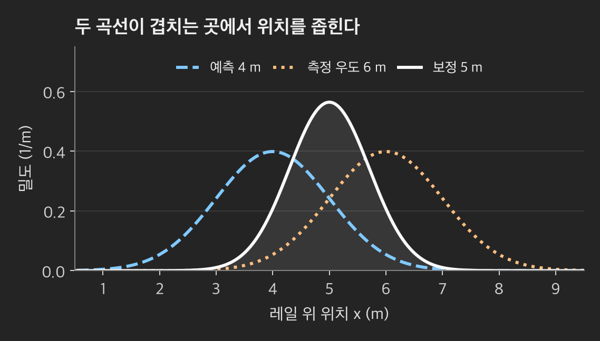
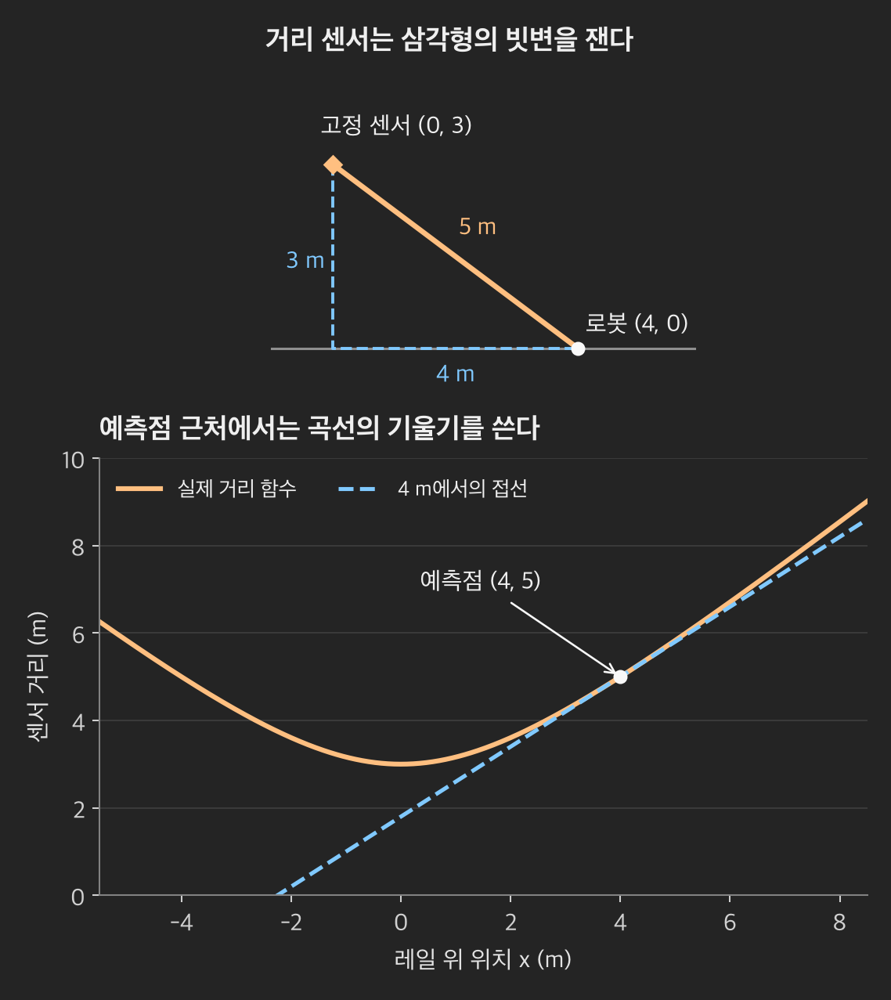
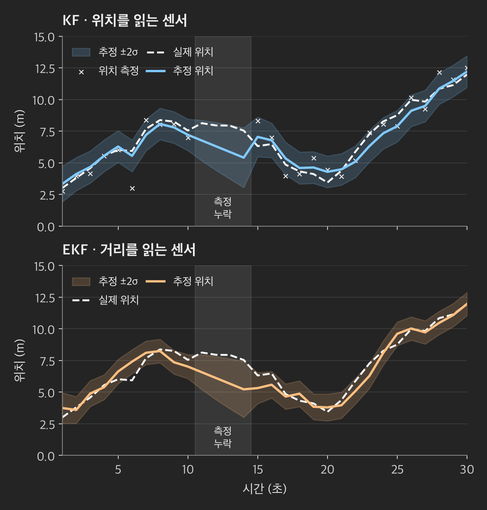

레일 위 로봇이 출발점에서 3 m 떨어져 있다. 바퀴가 한 바퀴 돌아간 양을 보니 1 m 더 갔을 것 같다. 그러면 지금 위치는 4 m다. 그런데 레일 옆 위치 센서는 **6 m**를 가리킨다. 지도 위 로봇을 어디에 그리면 좋을까?

두 값의 오차가 서로 독립이고, 평소에 비슷한 크기로 틀린다면 **5 m**가 자연스럽다. 하지만 센서의 눈금이 거칠다면 4 m 쪽에 더 가깝게 그려야 한다. **칼만 필터(KF)**는 매번 이 비율을 계산하고, 보정한 위치와 그 위치의 불확실성을 다음 순간으로 넘긴다.

이번에는 센서를 바꿔 보자. 새 센서는 로봇이 레일 어디에 있는지 직접 읽을 수 없다. 레일에서 3 m 떨어진 기둥까지의 **비스듬한 거리**만 잰다. 같은 로봇을 계속 추적하려면 계산 중 무엇을 바꿔야 할까? 여기서 **확장 칼만 필터(EKF)**가 등장한다.

[선형 예제 손계산](#linear) · [비선형 예제 손계산](#nonlinear) · [30초 추적 결과와 코드](#tracking) · [여러 상태로 확장하기](#advanced)

## 선형 예제 · 위치를 직접 읽는 센서
{: #linear}

### 위치 옆에 숫자를 하나 더 적는 이유

추정기에 두 숫자를 저장하자. 첫 번째는 **추정 위치**이고, 두 번째는 **위치 오차의 분산 P**다. 표준편차가 1 m라면 분산은 1 m²다. 오차를 제곱해 평균을 내므로 단위도 제곱된다. 그래프에 오차 폭을 m로 그릴 때는 다시 제곱근을 취한다.

| 기호 | 레일에서의 뜻 |
|---|---|
| x, x̂ | 실제 위치와 추정 위치. 실험에서는 정답 x를 기록할 수 있지만 필터는 x̂만 계산한다. |
| u, z | 직전 시각부터 지금까지의 이동량과 지금 센서가 읽은 값. 둘 다 이 예제에서는 m 단위다. |
| P, Q, R | 추정 위치의 오차 분산, 한 걸음 이동 중 새로 쌓이는 오차 분산, 센서 측정 오차의 분산. |
| 위첨자 −, + | 같은 시각에서 새 측정을 받기 직전의 **예측**과 받은 직후의 **보정**. 아래첨자 k는 몇 번째 시각인지 나타낸다. |

### ① 바퀴를 보고 한 걸음 예측한다

한 걸음의 실제 이동에는 미끄러짐 w가 있고, 위치 센서에는 측정 오차 v가 있다. 여기서는 둘 다 평균이 0인 가우시안 잡음으로 두며, 이전 추정 오차와 각 시각의 새 잡음들은 서로 독립이라고 가정한다. 모델은 다음 두 줄이다.

<math xmlns="http://www.w3.org/1998/Math/MathML" display="block"><semantics><mrow><msub><mi>x</mi><mi>k</mi></msub><mo>&#x0003D;</mo><msub><mi>x</mi><mrow><mi>k</mi><mo>&#x02212;</mo><mn>1</mn></mrow></msub><mo>&#x0002B;</mo><msub><mi>u</mi><mi>k</mi></msub><mo>&#x0002B;</mo><msub><mi>w</mi><mi>k</mi></msub></mrow><annotation encoding="application/x-tex">x_k=x_{k-1}+u_k+w_k</annotation></semantics></math>

<math xmlns="http://www.w3.org/1998/Math/MathML" display="block"><semantics><mrow><msub><mi>z</mi><mi>k</mi></msub><mo>&#x0003D;</mo><msub><mi>x</mi><mi>k</mi></msub><mo>&#x0002B;</mo><msub><mi>v</mi><mi>k</mi></msub></mrow><annotation encoding="application/x-tex">z_k=x_k+v_k</annotation></semantics></math>

**센서 오차가 없다면 실제 위치가 1 m 늘 때 눈금도 꼭 1 m 늘어난다.** 이 관계를 그래프로 그리면 기울기 1인 직선이다. 그래서 위치 센서의 관측 모델을 선형이라고 부른다.

직전 추정 위치는 3 m, 분산은 0.75 m²다. 이동량 1 m를 더하고, 이번 이동에서 새로 생기는 분산 0.25 m²도 더한다. 서로 독립인 오차를 더할 때는 **분산끼리** 더할 수 있다.

<math xmlns="http://www.w3.org/1998/Math/MathML" display="block"><semantics><mrow><msubsup><mover><mrow><mi>x</mi></mrow><mo stretchy="false">&#x0005E;</mo></mover><mi>k</mi><mo>&#x02212;</mo></msubsup><mo>&#x0003D;</mo><msubsup><mover><mrow><mi>x</mi></mrow><mo stretchy="false">&#x0005E;</mo></mover><mrow><mi>k</mi><mo>&#x02212;</mo><mn>1</mn></mrow><mo>&#x0002B;</mo></msubsup><mo>&#x0002B;</mo><msub><mi>u</mi><mi>k</mi></msub><mo>&#x0003D;</mo><mn>3</mn><mo>&#x0002B;</mo><mn>1</mn><mo>&#x0003D;</mo><mn>4</mn></mrow><annotation encoding="application/x-tex">\hat{x}_k^-=\hat{x}_{k-1}^+ + u_k=3+1=4</annotation></semantics></math>

<math xmlns="http://www.w3.org/1998/Math/MathML" display="block"><semantics><mrow><msubsup><mi>P</mi><mi>k</mi><mo>&#x02212;</mo></msubsup><mo>&#x0003D;</mo><msubsup><mi>P</mi><mrow><mi>k</mi><mo>&#x02212;</mo><mn>1</mn></mrow><mo>&#x0002B;</mo></msubsup><mo>&#x0002B;</mo><mi>Q</mi><mo>&#x0003D;</mo><mn>0.75</mn><mo>&#x0002B;</mo><mn>0.25</mn><mo>&#x0003D;</mo><mn>1</mn></mrow><annotation encoding="application/x-tex">P_k^-=P_{k-1}^+ + Q=0.75+0.25=1</annotation></semantics></math>

### ② 센서가 얼마나 뜻밖의 값을 냈는지 구한다

예측 위치 4 m라면 센서도 4 m를 읽으리라 예상한다. 실제 눈금은 6 m다. **관측값에서 예상 눈금을 뺀 값**을 혁신 또는 잔차라고 한다. 잔차가 양수이므로 추정 위치를 앞으로 옮길 근거가 생겼다.

<math xmlns="http://www.w3.org/1998/Math/MathML" display="block"><semantics><mrow><msub><mi>&#x003BD;</mi><mi>k</mi></msub><mo>&#x0003D;</mo><msub><mi>z</mi><mi>k</mi></msub><mo>&#x02212;</mo><msubsup><mover><mrow><mi>x</mi></mrow><mo stretchy="false">&#x0005E;</mo></mover><mi>k</mi><mo>&#x02212;</mo></msubsup><mo>&#x0003D;</mo><mn>6</mn><mo>&#x02212;</mo><mn>4</mn><mo>&#x0003D;</mo><mn>2</mn></mrow><annotation encoding="application/x-tex">\nu_k=z_k-\hat{x}_k^-=6-4=2</annotation></semantics></math>

센서의 표준편차를 1 m로 두면 R은 1 m²다. 잔차에는 위치 예측 오차와 센서 오차가 함께 들어 있으므로 잔차 분산 S는 2 m²가 된다. **칼만 이득 K**는 이번 잔차를 위치에 얼마나 반영할지 정한다.

<math xmlns="http://www.w3.org/1998/Math/MathML" display="block"><semantics><mrow><msub><mi>S</mi><mi>k</mi></msub><mo>&#x0003D;</mo><msubsup><mi>P</mi><mi>k</mi><mo>&#x02212;</mo></msubsup><mo>&#x0002B;</mo><mi>R</mi><mo>&#x0003D;</mo><mn>1</mn><mo>&#x0002B;</mo><mn>1</mn><mo>&#x0003D;</mo><mn>2</mn></mrow><annotation encoding="application/x-tex">S_k=P_k^-+R=1+1=2</annotation></semantics></math>

<math xmlns="http://www.w3.org/1998/Math/MathML" display="block"><semantics><mrow><msub><mi>K</mi><mi>k</mi></msub><mo>&#x0003D;</mo><mfrac><mrow><msubsup><mi>P</mi><mi>k</mi><mo>&#x02212;</mo></msubsup></mrow><mrow><msub><mi>S</mi><mi>k</mi></msub></mrow></mfrac><mo>&#x0003D;</mo><mfrac><mrow><mn>1</mn></mrow><mrow><mn>2</mn></mrow></mfrac></mrow><annotation encoding="application/x-tex">K_k=\frac{P_k^-}{S_k}=\frac{1}{2}</annotation></semantics></math>

### ③ 위치와 불확실성을 함께 보정한다

<math xmlns="http://www.w3.org/1998/Math/MathML" display="block"><semantics><mrow><msubsup><mover><mrow><mi>x</mi></mrow><mo stretchy="false">&#x0005E;</mo></mover><mi>k</mi><mo>&#x0002B;</mo></msubsup><mo>&#x0003D;</mo><msubsup><mover><mrow><mi>x</mi></mrow><mo stretchy="false">&#x0005E;</mo></mover><mi>k</mi><mo>&#x02212;</mo></msubsup><mo>&#x0002B;</mo><msub><mi>K</mi><mi>k</mi></msub><msub><mi>&#x003BD;</mi><mi>k</mi></msub><mo>&#x0003D;</mo><mn>4</mn><mo>&#x0002B;</mo><mn>0.5</mn><mi>&#x000D7;</mi><mn>2</mn><mo>&#x0003D;</mo><mn>5</mn></mrow><annotation encoding="application/x-tex">\hat{x}_k^+=\hat{x}_k^-+K_k\nu_k=4+0.5\times2=5</annotation></semantics></math>

<math xmlns="http://www.w3.org/1998/Math/MathML" display="block"><semantics><mrow><msubsup><mi>P</mi><mi>k</mi><mo>&#x0002B;</mo></msubsup><mo>&#x0003D;</mo><mo stretchy="false">&#x00028;</mo><mn>1</mn><mo>&#x02212;</mo><msub><mi>K</mi><mi>k</mi></msub><mo stretchy="false">&#x00029;</mo><msubsup><mi>P</mi><mi>k</mi><mo>&#x02212;</mo></msubsup><mo>&#x0003D;</mo><mo stretchy="false">&#x00028;</mo><mn>1</mn><mo>&#x02212;</mo><mn>0.5</mn><mo stretchy="false">&#x00029;</mo><mi>&#x000D7;</mi><mn>1</mn><mo>&#x0003D;</mo><mn>0.5</mn></mrow><annotation encoding="application/x-tex">P_k^+=(1-K_k)P_k^-=(1-0.5)\times1=0.5</annotation></semantics></math>

지도 위 로봇은 **5 m**로 이동한다. 표준편차는 1 m에서 **약 0.71 m**로 줄었다. 다음 걸음은 이 두 숫자에서 출발한다.

파란 파선은 측정 직전의 위치 분포다. 주황 점선은 ‘로봇이 이 위치라면 6 m라는 눈금이 얼마나 그럴듯한가’를 나타낸다. 이 직접 측정 예제에서는 두 곡선을 곱하고 전체 넓이가 1이 되게 맞추면 흰 실선이 나온다. 정규분포 두 개의 정보가 합쳐져 **중심도, 폭도** 달라진다.

### 왜 하필 그 비율일까?

‘잔차의 어느 비율을 쓰면 평균제곱오차가 가장 작을까?’라고 물으면 이득 식을 직접 얻을 수 있다. 예측 오차를 실제 위치에서 예측 위치를 뺀 값 e⁻로 놓는다. 위 보정식에 실제 센서값 z = x + v를 대입하면 보정 오차는 다음과 같다.

<math xmlns="http://www.w3.org/1998/Math/MathML" display="block"><semantics><mrow><msup><mi>e</mi><mo>&#x0002B;</mo></msup><mo>&#x0003D;</mo><mo stretchy="false">&#x00028;</mo><mn>1</mn><mo>&#x02212;</mo><mi>K</mi><mo stretchy="false">&#x00029;</mo><msup><mi>e</mi><mo>&#x02212;</mo></msup><mo>&#x02212;</mo><mi>K</mi><mi>v</mi></mrow><annotation encoding="application/x-tex">e^+=(1-K)e^- - Kv</annotation></semantics></math>

K를 키우면 예측 오차가 남는 비율은 줄고, 센서 잡음이 들어오는 비율은 커진다. 두 오차가 독립이고 평균이 0일 때 보정 오차 분산은 다음과 같다.

<math xmlns="http://www.w3.org/1998/Math/MathML" display="block"><semantics><mrow><mi>V</mi><mo stretchy="false">&#x00028;</mo><mi>K</mi><mo stretchy="false">&#x00029;</mo><mo>&#x0003D;</mo><mo stretchy="false">&#x00028;</mo><mn>1</mn><mo>&#x02212;</mo><mi>K</mi><msup><mo stretchy="false">&#x00029;</mo><mn>2</mn></msup><msup><mi>P</mi><mo>&#x02212;</mo></msup><mo>&#x0002B;</mo><msup><mi>K</mi><mn>2</mn></msup><mi>R</mi></mrow><annotation encoding="application/x-tex">V(K)=(1-K)^2P^-+K^2R</annotation></semantics></math>

이 곡선의 가장 낮은 점에서 기울기는 0이다. 미분해서 K를 구해 보자.

<math xmlns="http://www.w3.org/1998/Math/MathML" display="block"><semantics><mrow><mfrac><mrow><mi>d</mi><mi>V</mi></mrow><mrow><mi>d</mi><mi>K</mi></mrow></mfrac><mo>&#x0003D;</mo><mo>&#x02212;</mo><mn>2</mn><mo stretchy="false">&#x00028;</mo><mn>1</mn><mo>&#x02212;</mo><mi>K</mi><mo stretchy="false">&#x00029;</mo><msup><mi>P</mi><mo>&#x02212;</mo></msup><mo>&#x0002B;</mo><mn>2</mn><mi>K</mi><mi>R</mi><mo>&#x0003D;</mo><mn>0</mn></mrow><annotation encoding="application/x-tex">\frac{dV}{dK}=-2(1-K)P^-+2KR=0</annotation></semantics></math>

<math xmlns="http://www.w3.org/1998/Math/MathML" display="block"><semantics><mrow><mi>K</mi><mo stretchy="false">&#x00028;</mo><msup><mi>P</mi><mo>&#x02212;</mo></msup><mo>&#x0002B;</mo><mi>R</mi><mo stretchy="false">&#x00029;</mo><mo>&#x0003D;</mo><msup><mi>P</mi><mo>&#x02212;</mo></msup><mspace width="1em" /><mo>&#x021D2;</mo><mspace width="1em" /><mi>K</mi><mo>&#x0003D;</mo><mfrac><mrow><msup><mi>P</mi><mo>&#x02212;</mo></msup></mrow><mrow><msup><mi>P</mi><mo>&#x02212;</mo></msup><mo>&#x0002B;</mo><mi>R</mi></mrow></mfrac></mrow><annotation encoding="application/x-tex">K(P^-+R)=P^-\quad\Rightarrow\quad K=\frac{P^-}{P^-+R}</annotation></semantics></math>

센서 표준편차만 2 m로 바꾸면 R은 **4**가 된다. 이득은 1/5, 보정 위치는 **4.4 m**다. 같은 6 m라는 눈금을 받아도 센서 정밀도가 다르면 지도에 찍는 점이 달라진다.

## 비선형 예제 · 기둥까지의 거리를 읽는 센서
{: #nonlinear}

이번에도 예측 위치는 4 m이고 분산은 1 m²다. 레일을 가로축으로 놓고 고정 거리 센서를 좌표 (0, 3)에 설치한다. 로봇은 (x, 0)에 있다. 실을 팽팽하게 당겨 센서와 로봇을 이으면 직각삼각형의 빗변이 된다. 피타고라스 정리로 센서가 읽어야 할 거리 h(x)를 구할 수 있다.

<math xmlns="http://www.w3.org/1998/Math/MathML" display="block"><semantics><mrow><mi>h</mi><mo stretchy="false">&#x00028;</mo><mi>x</mi><mo stretchy="false">&#x00029;</mo><mo>&#x0003D;</mo><msqrt><mrow><msup><mi>x</mi><mn>2</mn></msup><mo>&#x0002B;</mo><msup><mn>3</mn><mn>2</mn></msup></mrow></msqrt><mo>&#x0002C;</mo><mspace width="2em" /><msub><mi>z</mi><mi>k</mi></msub><mo>&#x0003D;</mo><mi>h</mi><mo stretchy="false">&#x00028;</mo><msub><mi>x</mi><mi>k</mi></msub><mo stretchy="false">&#x00029;</mo><mo>&#x0002B;</mo><msub><mi>v</mi><mi>k</mi></msub></mrow><annotation encoding="application/x-tex">h(x)=\sqrt{x^2+3^2},\qquad z_k=h(x_k)+v_k</annotation></semantics></math>

위치 4 m에서 예상 눈금은 **5 m**다. 실제 눈금이 **5.5 m**라면 잔차는 0.5 m다. 여기서 두 값 모두 **센서까지의 거리**라는 점이 중요하다. 레일 위 위치와 빗변은 같은 m 단위를 써도 서로 다른 길이다.

### ① 예측점에서 거리 곡선의 기울기를 구한다

로봇이 예측점에서 조금 더 움직이면 빗변이 얼마나 늘어날까? 4 m에서 4.1 m로 이동하면 거리는 5 m에서 약 5.080 m로 늘어난다. 위치 변화 0.1 m당 거리 변화가 약 0.08 m다. 미분하면 이 관계의 순간 기울기 H가 나온다.

<math xmlns="http://www.w3.org/1998/Math/MathML" display="block"><semantics><mrow><msup><mi>h</mi><mi>&#x02032;</mi></msup><mo stretchy="false">&#x00028;</mo><mi>x</mi><mo stretchy="false">&#x00029;</mo><mo>&#x0003D;</mo><mfrac><mrow><mn>1</mn></mrow><mrow><mn>2</mn></mrow></mfrac><mo stretchy="false">&#x00028;</mo><msup><mi>x</mi><mn>2</mn></msup><mo>&#x0002B;</mo><mn>9</mn><msup><mo stretchy="false">&#x00029;</mo><mrow><mo>&#x02212;</mo><mn>1</mn><mo>&#x0002F;</mo><mn>2</mn></mrow></msup><mspace width="0.167em" /><mn>2</mn><mi>x</mi><mo>&#x0003D;</mo><mfrac><mrow><mi>x</mi></mrow><mrow><msqrt><mrow><msup><mi>x</mi><mn>2</mn></msup><mo>&#x0002B;</mo><mn>9</mn></mrow></msqrt></mrow></mfrac></mrow><annotation encoding="application/x-tex">h&#x27;(x)=\frac{1}{2}(x^2+9)^{-1/2}\,2x=\frac{x}{\sqrt{x^2+9}}</annotation></semantics></math>

<math xmlns="http://www.w3.org/1998/Math/MathML" display="block"><semantics><mrow><msub><mi>H</mi><mi>k</mi></msub><mo>&#x0003D;</mo><msup><mi>h</mi><mi>&#x02032;</mi></msup><mo stretchy="false">&#x00028;</mo><msubsup><mover><mrow><mi>x</mi></mrow><mo stretchy="false">&#x0005E;</mo></mover><mi>k</mi><mo>&#x02212;</mo></msubsup><mo stretchy="false">&#x00029;</mo><mo>&#x0003D;</mo><mfrac><mn>4</mn><mn>5</mn></mfrac><mo>&#x0003D;</mo><mn>0.8</mn></mrow><annotation encoding="application/x-tex">H_k=h&#x27;(\hat{x}_k^-)=\frac45=0.8</annotation></semantics></math>

예측점에서 짧은 구간만 보면 곡선을 접선으로 근사할 수 있다. 이것이 EKF의 **1차 선형화**다. 접선은 기울기와 출발점을 함께 가져야 한다.

<math xmlns="http://www.w3.org/1998/Math/MathML" display="block"><semantics><mrow><mi>h</mi><mo stretchy="false">&#x00028;</mo><mn>4</mn><mo>&#x0002B;</mo><mi>&#x003B4;</mi><mo stretchy="false">&#x00029;</mo><mo>&#x02248;</mo><mi>h</mi><mo stretchy="false">&#x00028;</mo><mn>4</mn><mo stretchy="false">&#x00029;</mo><mo>&#x0002B;</mo><msub><mi>H</mi><mi>k</mi></msub><mi>&#x003B4;</mi><mo>&#x0003D;</mo><mn>5</mn><mo>&#x0002B;</mo><mn>0.8</mn><mi>&#x003B4;</mi></mrow><annotation encoding="application/x-tex">h(4+\delta)\approx h(4)+H_k\delta=5+0.8\delta</annotation></semantics></math>

### ② 잔차는 실제 곡선에서, 오차의 크기는 접선에서 구한다

거리 센서의 표준편차는 0.6 m, 분산 R은 0.36 m²로 둔다. 위치 오차가 H배로 거리 눈금에 전달되면 그 **분산은 H²배**가 된다. 여기에 센서 자체의 오차 분산을 더한다.

<math xmlns="http://www.w3.org/1998/Math/MathML" display="block"><semantics><mrow><msub><mi>&#x003BD;</mi><mi>k</mi></msub><mo>&#x0003D;</mo><msub><mi>z</mi><mi>k</mi></msub><mo>&#x02212;</mo><mi>h</mi><mo stretchy="false">&#x00028;</mo><msubsup><mover><mrow><mi>x</mi></mrow><mo stretchy="false">&#x0005E;</mo></mover><mi>k</mi><mo>&#x02212;</mo></msubsup><mo stretchy="false">&#x00029;</mo><mo>&#x0003D;</mo><mn>5.5</mn><mo>&#x02212;</mo><mn>5</mn><mo>&#x0003D;</mo><mn>0.5</mn></mrow><annotation encoding="application/x-tex">\nu_k=z_k-h(\hat{x}_k^-)=5.5-5=0.5</annotation></semantics></math>

<math xmlns="http://www.w3.org/1998/Math/MathML" display="block"><semantics><mrow><msub><mi>S</mi><mi>k</mi></msub><mo>&#x0003D;</mo><msubsup><mi>H</mi><mi>k</mi><mn>2</mn></msubsup><msubsup><mi>P</mi><mi>k</mi><mo>&#x02212;</mo></msubsup><mo>&#x0002B;</mo><mi>R</mi><mo>&#x0003D;</mo><msup><mn>0.8</mn><mn>2</mn></msup><mi>&#x000D7;</mi><mn>1</mn><mo>&#x0002B;</mo><mn>0.36</mn><mo>&#x0003D;</mo><mn>1</mn></mrow><annotation encoding="application/x-tex">S_k=H_k^2P_k^-+R=0.8^2\times1+0.36=1</annotation></semantics></math>

이제 거리 잔차를 레일 방향 위치 보정량으로 바꾼다. 분자에 있는 P⁻H는 ‘예측 위치의 오차와 예상 눈금의 오차가 얼마나 함께 변하는가’를 나타내는 공분산이다.

<math xmlns="http://www.w3.org/1998/Math/MathML" display="block"><semantics><mrow><msub><mi>K</mi><mi>k</mi></msub><mo>&#x0003D;</mo><mfrac><mrow><msubsup><mi>P</mi><mi>k</mi><mo>&#x02212;</mo></msubsup><msub><mi>H</mi><mi>k</mi></msub></mrow><mrow><msub><mi>S</mi><mi>k</mi></msub></mrow></mfrac><mo>&#x0003D;</mo><mfrac><mrow><mn>1</mn><mi>&#x000D7;</mi><mn>0.8</mn></mrow><mrow><mn>1</mn></mrow></mfrac><mo>&#x0003D;</mo><mn>0.8</mn></mrow><annotation encoding="application/x-tex">K_k=\frac{P_k^-H_k}{S_k}=\frac{1\times0.8}{1}=0.8</annotation></semantics></math>

<math xmlns="http://www.w3.org/1998/Math/MathML" display="block"><semantics><mrow><msubsup><mover><mrow><mi>x</mi></mrow><mo stretchy="false">&#x0005E;</mo></mover><mi>k</mi><mo>&#x0002B;</mo></msubsup><mo>&#x0003D;</mo><mn>4</mn><mo>&#x0002B;</mo><mn>0.8</mn><mi>&#x000D7;</mi><mn>0.5</mn><mo>&#x0003D;</mo><mn>4.4</mn></mrow><annotation encoding="application/x-tex">\hat{x}_k^+=4+0.8\times0.5=4.4</annotation></semantics></math>

<math xmlns="http://www.w3.org/1998/Math/MathML" display="block"><semantics><mrow><msubsup><mi>P</mi><mi>k</mi><mo>&#x0002B;</mo></msubsup><mo>&#x0003D;</mo><mo stretchy="false">&#x00028;</mo><mn>1</mn><mo>&#x02212;</mo><msub><mi>K</mi><mi>k</mi></msub><msub><mi>H</mi><mi>k</mi></msub><mo stretchy="false">&#x00029;</mo><msubsup><mi>P</mi><mi>k</mi><mo>&#x02212;</mo></msubsup><mo>&#x0003D;</mo><mo stretchy="false">&#x00028;</mo><mn>1</mn><mo>&#x02212;</mo><mn>0.8</mn><mi>&#x000D7;</mi><mn>0.8</mn><mo stretchy="false">&#x00029;</mo><mi>&#x000D7;</mi><mn>1</mn><mo>&#x0003D;</mo><mn>0.36</mn></mrow><annotation encoding="application/x-tex">P_k^+=(1-K_kH_k)P_k^-=(1-0.8\times0.8)\times1=0.36</annotation></semantics></math>

EKF가 지도에 찍는 위치는 **4.4 m**, 추정 표준편차는 **0.6 m**다. 다시 센서 공간으로 보내 보면 h(4.4)는 약 5.33 m다. 예상 눈금이 5 m에서 측정값 5.5 m 쪽으로 움직였다. 잔차를 계산하는 코드에 Hx를 넣으면 3.2 m가 나오므로, 예측점에서의 거리 5 m부터 잘못된다.

### 직접 바꿔 보기

아래 조절기는 방금 손으로 계산한 한 번의 보정을 그대로 실행한다. 센서 종류를 고르면 해당 예제의 눈금과 잡음으로 돌아간다. 센서 표준편차를 키우면서 추정 위치가 어디로 움직이는지 살펴보자.



## 같은 로봇을 30초 동안 추적하면
{: #tracking}

실제로 구현할 것은 **직전 시각부터 지금까지의 이동량과 새 센서값을 받아, 현재 위치와 분산을 돌려주는 함수**다. 손계산에서는 한 번의 보정을 살펴봤다. 아래 그림은 같은 식에 매초 새 모의 데이터를 넣은 결과다. 두 필터가 보는 로봇의 실제 경로는 같고, KF는 위치를, EKF는 기둥까지의 거리를 받는다. 흰 파선은 결과를 채점할 때만 사용하는 실제 위치다.

- **1~10초.** KF 그래프의 ×는 센서가 읽은 위치다. EKF의 원시 측정은 기둥까지의 거리여서, 아래 그래프에는 같은 레일 좌표로 비교할 수 있는 추정 위치와 실제 위치를 그렸다.
- **11~14초.** 센서가 끊겨도 이동량은 들어온다. 두 필터는 예측만 네 번 실행한다. KF의 분산은 0.390 m²에서 1.390 m²로 증가한다. 한 번에 더하는 Q가 0.25 m²이므로 증가량이 정확히 1 m²다. 그림의 띠는 각 추정치에서 양쪽으로 표준편차의 두 배만큼 펼친 범위다.
- **15초.** 위치 센서가 8.32 m를 읽는다. KF의 직전 보정 위치 5.40 m에 이동량 −0.45 m를 더하면 예측은 약 4.95 m다. 측정이 돌아온 뒤 추정 위치는 약 7.04 m, 분산은 0.62 m²가 된다.

아래 Python 파일을 저장하고 실행하면 그림에 사용한 30행의 실제 위치, 두 추정 위치, 센서값을 확인할 수 있다. 표준 라이브러리만 사용하며 난수 시드는 17이다. [예제 코드 다운로드](/assets/kalman/rail_filters.py) · [GitHub에서 코드 읽기](https://github.com/Kongles/kongles.github.io/blob/main/assets/kalman/rail_filters.py)

~~~sh
python3 rail_filters.py
~~~

코드의 **step** 함수는 다음 순서로 동작한다. 예제의 두 호출은 관측 함수 **observe**, 기울기 함수 **slope**, 센서 분산을 각각 넘긴다.

~~~python
x = previous.position + displacement
p = previous.variance + process_variance
if measurement is None:
    return Estimate(x, p)

h = slope(x)
innovation = measurement - observe(x)
s = h * h * p + sensor_variance
gain = p * h / s
return Estimate(x + gain * innovation,
                (1 - gain * h)**2 * p + gain**2 * sensor_variance)
~~~

마지막 줄은 앞에서 이득을 유도할 때처럼 보정 뒤에 남은 두 오차의 분산을 더한다. 이 형태를 **조지프 형식(Joseph form)**이라고 한다. 위 이득을 대입하면 손계산의 짧은 분산식과 값이 같고, 코드에서는 음수가 아닌 두 항의 합으로 계산할 수 있다.

마지막 출력인 **위치 RMSE**는 매초 추정 위치와 실제 위치의 차이를 제곱해 평균을 낸 뒤 제곱근을 취한 값이다. 이 30초 경로에서는 KF **0.830 m**, EKF **0.929 m**다. 두 센서는 관측량과 잡음 크기가 다르다. 다른 시드나 센서 조건으로 실험할 때도 각 결과와 함께 그 조건을 기록해야 해석할 수 있다.

## 심화 · 위치와 속도를 함께 추정하려면
{: #advanced}

센서가 위치만 알려줘도 속도를 추정할 수 있을까? 상태를 **위치 p와 속도 v** 두 칸으로 늘려 보자. 등속 모델에서 다음 위치는 이전 위치에 ‘속도 × 경과 시간’을 더한 값이다. Δt초 뒤 상태로 보내는 행렬 F와, 상태에서 위치만 꺼내는 행렬 H는 이 두 문장을 숫자로 쓴 것이다.

<math xmlns="http://www.w3.org/1998/Math/MathML" display="block"><semantics><mrow><mi>&#x1D431;</mi><mo>&#x0003D;</mo><mo>&#x0005B;</mo><mtable><mtr><mtd><mi>p</mi></mtd></mtr><mtr><mtd><mi>v</mi></mtd></mtr></mtable><mo>&#x0005D;</mo><mo>&#x0002C;</mo><mspace width="1em" /><mi>F</mi><mo>&#x0003D;</mo><mo>&#x0005B;</mo><mtable><mtr><mtd><mn>1</mn></mtd><mtd><mi>&#x00394;</mi><mi>t</mi></mtd></mtr><mtr><mtd><mn>0</mn></mtd><mtd><mn>1</mn></mtd></mtr></mtable><mo>&#x0005D;</mo><mo>&#x0002C;</mo><mspace width="1em" /><mi>H</mi><mo>&#x0003D;</mo><mo>&#x0005B;</mo><mtable><mtr><mtd><mn>1</mn></mtd><mtd><mn>0</mn></mtd></mtr></mtable><mo>&#x0005D;</mo></mrow><annotation encoding="application/x-tex">\mathbf{x}=\begin{bmatrix}p\\v\end{bmatrix},\quad F=\begin{bmatrix}1&amp;\Delta t\\0&amp;1\end{bmatrix},\quad H=\begin{bmatrix}1&amp;0\end{bmatrix}</annotation></semantics></math>

P도 두 칸에 맞는 2×2 공분산 행렬이 된다. 대각선에는 각각 위치와 속도의 오차 분산이, 나머지 두 칸에는 두 오차가 함께 움직이는 정도가 들어간다. 속도를 크게 짐작하면 다음 위치도 멀리 예측하게 된다. 이 연결이 P에 들어 있으므로 위치 센서의 잔차로 속도까지 보정할 수 있다.

비선형 이동 모델을 f, 비선형 관측 모델을 h라고 하자. EKF는 **직전 보정 상태에서 f의 기울기 F**를 구하고, 한 걸음 예측한 뒤 **새 예측 상태에서 h의 기울기 H**를 구한다. 각 출력 성분을 각 입력 성분으로 편미분해 모은 표가 **야코비안**이다. 위 등속·위치 모델에서는 기울기가 일정해서 같은 식이 선형 KF로 돌아간다.

<math xmlns="http://www.w3.org/1998/Math/MathML" display="block"><semantics><mrow><msub><mi>F</mi><mi>k</mi></msub><mo>&#x0003D;</mo><msub><mrow><mo stretchy="true" fence="true" form="prefix" /><mfrac><mrow><mo>&#x02202;</mo><mi>f</mi></mrow><mrow><mo>&#x02202;</mo><mi>&#x1D431;</mi></mrow></mfrac><mo stretchy="true" fence="true" form="postfix">&#x0007C;</mo></mrow><mrow><msubsup><mover><mrow><mi>&#x1D431;</mi></mrow><mo stretchy="false">&#x0005E;</mo></mover><mrow><mi>k</mi><mo>&#x02212;</mo><mn>1</mn></mrow><mo>&#x0002B;</mo></msubsup><mo>&#x0002C;</mo><msub><mi>u</mi><mi>k</mi></msub></mrow></msub><mo>&#x0002C;</mo><mspace width="1em" /><msub><mi>H</mi><mi>k</mi></msub><mo>&#x0003D;</mo><msub><mrow><mo stretchy="true" fence="true" form="prefix" /><mfrac><mrow><mo>&#x02202;</mo><mi>h</mi></mrow><mrow><mo>&#x02202;</mo><mi>&#x1D431;</mi></mrow></mfrac><mo stretchy="true" fence="true" form="postfix">&#x0007C;</mo></mrow><mrow><msubsup><mover><mrow><mi>&#x1D431;</mi></mrow><mo stretchy="false">&#x0005E;</mo></mover><mi>k</mi><mo>&#x02212;</mo></msubsup></mrow></msub></mrow><annotation encoding="application/x-tex">F_k=\left.\frac{\partial f}{\partial\mathbf{x}}\right|_{\hat{\mathbf{x}}_{k-1}^+,u_k},\quad H_k=\left.\frac{\partial h}{\partial\mathbf{x}}\right|_{\hat{\mathbf{x}}_k^-}</annotation></semantics></math>

가산 잡음을 쓰면 예측과 보정은 아래처럼 정리된다. T는 행과 열을 바꾸는 전치, I는 단위행렬이다. P를 센서 좌표로 옮길 때 왼쪽과 오른쪽에서 H와 Hᵀ를 곱하는 것은, 앞 예제에서 분산에 기울기의 **제곱**을 곱했던 것과 같다.

<math xmlns="http://www.w3.org/1998/Math/MathML" display="block"><semantics><mrow><msubsup><mover><mrow><mi>&#x1D431;</mi></mrow><mo stretchy="false">&#x0005E;</mo></mover><mi>k</mi><mo>&#x02212;</mo></msubsup><mo>&#x0003D;</mo><mi>f</mi><mo stretchy="false">&#x00028;</mo><msubsup><mover><mrow><mi>&#x1D431;</mi></mrow><mo stretchy="false">&#x0005E;</mo></mover><mrow><mi>k</mi><mo>&#x02212;</mo><mn>1</mn></mrow><mo>&#x0002B;</mo></msubsup><mo>&#x0002C;</mo><msub><mi>u</mi><mi>k</mi></msub><mo stretchy="false">&#x00029;</mo><mo>&#x0002C;</mo><mspace width="1em" /><msubsup><mi>P</mi><mi>k</mi><mo>&#x02212;</mo></msubsup><mo>&#x0003D;</mo><msub><mi>F</mi><mi>k</mi></msub><msubsup><mi>P</mi><mrow><mi>k</mi><mo>&#x02212;</mo><mn>1</mn></mrow><mo>&#x0002B;</mo></msubsup><msubsup><mi>F</mi><mi>k</mi><mi>T</mi></msubsup><mo>&#x0002B;</mo><msub><mi>Q</mi><mi>k</mi></msub></mrow><annotation encoding="application/x-tex">\hat{\mathbf{x}}_k^-=f(\hat{\mathbf{x}}_{k-1}^+,u_k),\quad P_k^-=F_kP_{k-1}^+F_k^T+Q_k</annotation></semantics></math>

<math xmlns="http://www.w3.org/1998/Math/MathML" display="block"><semantics><mrow><msub><mrow><mi mathvariant="bold-italic">&#x003BD;</mi></mrow><mi>k</mi></msub><mo>&#x0003D;</mo><msub><mi>&#x1D433;</mi><mi>k</mi></msub><mo>&#x02212;</mo><mi>h</mi><mo stretchy="false">&#x00028;</mo><msubsup><mover><mrow><mi>&#x1D431;</mi></mrow><mo stretchy="false">&#x0005E;</mo></mover><mi>k</mi><mo>&#x02212;</mo></msubsup><mo stretchy="false">&#x00029;</mo><mo>&#x0002C;</mo><mspace width="1em" /><msub><mi>S</mi><mi>k</mi></msub><mo>&#x0003D;</mo><msub><mi>H</mi><mi>k</mi></msub><msubsup><mi>P</mi><mi>k</mi><mo>&#x02212;</mo></msubsup><msubsup><mi>H</mi><mi>k</mi><mi>T</mi></msubsup><mo>&#x0002B;</mo><msub><mi>R</mi><mi>k</mi></msub></mrow><annotation encoding="application/x-tex">\boldsymbol{\nu}_k=\mathbf{z}_k-h(\hat{\mathbf{x}}_k^-),\quad S_k=H_kP_k^-H_k^T+R_k</annotation></semantics></math>

<math xmlns="http://www.w3.org/1998/Math/MathML" display="block"><semantics><mrow><msub><mi>K</mi><mi>k</mi></msub><mo>&#x0003D;</mo><msubsup><mi>P</mi><mi>k</mi><mo>&#x02212;</mo></msubsup><msubsup><mi>H</mi><mi>k</mi><mi>T</mi></msubsup><msubsup><mi>S</mi><mi>k</mi><mrow><mo>&#x02212;</mo><mn>1</mn></mrow></msubsup><mo>&#x0002C;</mo><mspace width="1em" /><msubsup><mover><mrow><mi>&#x1D431;</mi></mrow><mo stretchy="false">&#x0005E;</mo></mover><mi>k</mi><mo>&#x0002B;</mo></msubsup><mo>&#x0003D;</mo><msubsup><mover><mrow><mi>&#x1D431;</mi></mrow><mo stretchy="false">&#x0005E;</mo></mover><mi>k</mi><mo>&#x02212;</mo></msubsup><mo>&#x0002B;</mo><msub><mi>K</mi><mi>k</mi></msub><msub><mrow><mi mathvariant="bold-italic">&#x003BD;</mi></mrow><mi>k</mi></msub></mrow><annotation encoding="application/x-tex">K_k=P_k^-H_k^TS_k^{-1},\quad \hat{\mathbf{x}}_k^+=\hat{\mathbf{x}}_k^-+K_k\boldsymbol{\nu}_k</annotation></semantics></math>

<math xmlns="http://www.w3.org/1998/Math/MathML" display="block"><semantics><mrow><msub><mi>A</mi><mi>k</mi></msub><mo>&#x0003D;</mo><mi>I</mi><mo>&#x02212;</mo><msub><mi>K</mi><mi>k</mi></msub><msub><mi>H</mi><mi>k</mi></msub><mo>&#x0002C;</mo><mspace width="1em" /><msubsup><mi>P</mi><mi>k</mi><mo>&#x0002B;</mo></msubsup><mo>&#x0003D;</mo><msub><mi>A</mi><mi>k</mi></msub><msubsup><mi>P</mi><mi>k</mi><mo>&#x02212;</mo></msubsup><msubsup><mi>A</mi><mi>k</mi><mi>T</mi></msubsup><mo>&#x0002B;</mo><msub><mi>K</mi><mi>k</mi></msub><msub><mi>R</mi><mi>k</mi></msub><msubsup><mi>K</mi><mi>k</mi><mi>T</mi></msubsup></mrow><annotation encoding="application/x-tex">A_k=I-K_kH_k,\quad P_k^+=A_kP_k^-A_k^T+K_kR_kK_k^T</annotation></semantics></math>

예를 들어 P⁻의 첫째 행이 [2, 1], 둘째 행이 [1, 1]이고 위치 센서의 R이 1이면 S는 3이다. 이득 벡터의 두 성분은 2/3과 1/3이다. 센서 위치가 예측보다 3 m 앞서면 위치는 **2 m**, 속도는 **1 m/s**만큼 함께 보정된다. 수식의 역행렬 표기를 코드로 옮길 때는 보통 S에 대한 선형 방정식을 풀어 이득을 구한다. 위 레일 코드에서는 S가 숫자 하나여서 나눗셈으로 끝난다.

### 거리 하나로 알 수 있는 것의 한계

로봇이 기둥 바로 앞인 x = 0에 있다고 예측해 보자. h(0)은 3 m이고 H는 0이다. 이 순간 EKF는 K를 0으로 계산한다. 그런데 센서가 거의 정확하게 5 m를 읽었다면 피타고라스 정리에 맞는 위치는 **+4 m와 −4 m, 두 곳**이다. 곡선의 바닥에 그은 수평 접선 하나로는 그 두 가능성을 표현하기 어렵다. 처음 위치를 어느 쪽에 놓았는지, 다른 위치의 센서나 방향 정보가 있는지가 결과를 좌우한다.

실험에서 추정이 이상하면 먼저 잔차를 시간순으로 그려 보자. 한쪽 부호로 오래 치우치면 센서의 영점이나 이동 모델을 점검할 이유가 있다. 또 잔차를 예상 표준편차 √S와 비교해 보자. 센서를 고정해 반복 측정한 분산은 R을 정하는 출발점이 되고, 실제 이동과 모델 예측 사이의 오차는 Q를 정하는 단서가 된다. KF의 오차 띠는 선형·가우시안 가정과 잡음 설정에 의존하고, EKF에서는 접선 근사 오차까지 영향을 준다.

선형 가우시안 필터의 확률적 유도와 1차 EKF의 가정을 더 따라가려면 Särkkä와 Svensson의 *Bayesian Filtering and Smoothing* 2판에서 6장과 7장을 함께 읽을 수 있다. [출판사 도서 페이지](https://www.cambridge.org/core/books/bayesian-filtering-and-smoothing/F88740E8D25010CF3119A5CA379FA37A) · [저자 공개본](https://users.aalto.fi/~ssarkka/pub/bfs_book_2023_online.pdf)
