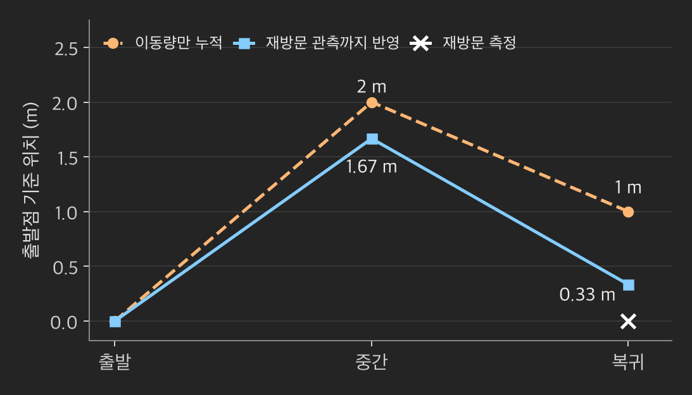
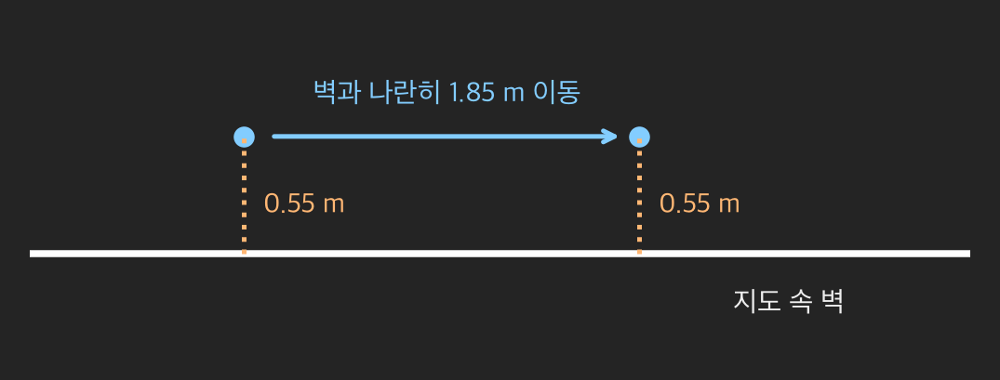

로봇이 복도를 한 바퀴 돌아 출발했던 문 앞에 섰다. 그런데 바퀴로 누적한 위치는 문에서 1 m 떨어져 있다. 문을 지도에서 옮겨야 할까? 로봇의 현재 위치를 고쳐야 할까? 아니면 **여기까지 온 경로 전체**를 조금씩 고쳐야 할까? 이 질문에 어떤 변수를 꺼내 계산하느냐가 SLAM 알고리즘의 차이다.

먼저 세 이름의 관계부터 짚자. **EKF-SLAM과 Graph SLAM은 무엇을 저장하고 어떻게 추정하는가**를 말한다. **Visual SLAM은 카메라에서 관측을 얻는다**는 뜻이다. 그래서 한 시스템에 두 이름이 동시에 붙는다. ORB-SLAM3는 영상 특징을 추적하면서 여러 카메라 자세와 지도점을 함께 최적화한다. FAST-LIO2는 LiDAR와 IMU를 사용하면서 반복 칼만 필터로 상태를 갱신한다. [ORB-SLAM3](https://arxiv.org/abs/2007.11898) · [FAST-LIO2](https://arxiv.org/abs/2107.06829)

이 글의 출발점은 Zhang·Shi·Li의 2024년 리뷰 *3D LiDAR SLAM: A survey*다. **그림 1**은 LiDAR 단독 방법을 특징 기반·직접 정합·투영 기반으로 나누고, 센서 융합을 LiDAR–관성·LiDAR–영상·세 센서 결합으로 나눈다. **그림 2**는 인접 스캔 정합, 재방문 검출, 백엔드 보정의 관계를 보여준다. 아래에서는 이 분류에 고전 확률 추정과 카메라 SLAM을 연결하고, 리뷰 이후의 2025~2026년 사례까지 살펴본다. [기준 리뷰, pp. 459–460 및 §3](https://doi.org/10.1111/phor.12497)

| 논문에서 먼저 물어볼 질문 | 가능한 답 | 실제로 확인할 것 |
|---|---|---|
| 무엇을 관측하는가? | 카메라, 2D·3D LiDAR, IMU와의 결합 | 픽셀·거리·각속도 중 무엇이 들어오는가 |
| 어떤 상태를 기억하는가? | 현재 자세와 지도, 여러 경로 가설, 과거 키프레임들의 그래프 | 재방문 때 어떤 시각의 추정치까지 바뀌는가 |
| 지도에는 무엇이 남는가? | 랜드마크, 점유 격자, 점·평면, 신경장, 3D 가우시안 | 장애물 질의·재위치 추정·새 시점 렌더링 중 무엇이 가능한가 |

[EKF](#ekf) · [FastSLAM](#fastslam) · [그래프](#graph) · [카메라](#visual) · [LiDAR](#lidar) · [센서 융합](#fusion) · [학습과 3D 가우시안](#learned) · [비교할 때](#evaluation)

## 공통 문제 · 무엇을 관측했고 무엇을 추정하는가?

시각 t의 로봇 자세를 xₜ, 환경 지도를 M이라고 쓰자. 자세는 평면 로봇이라면 가로 위치·세로 위치·방향각이다. uₜ는 이동 입력이나 오도메트리, zₜ는 벽이나 표지판을 본 센서값이다. 다음 식은 특정 경로와 지도가 그동안의 측정을 얼마나 잘 설명하는지 나타낸다. 정적 환경, 직전 자세에 의존하는 이동, 자세·지도와 대응 관계가 주어졌을 때 독립인 관측을 가정한 기본형이다.

<math xmlns="http://www.w3.org/1998/Math/MathML" display="block"><semantics><mrow><mi>p</mi><mo stretchy="false">&#x00028;</mo><msub><mi>x</mi><mrow><mn>0</mn><mi>:</mi><mi>t</mi></mrow></msub><mo>&#x0002C;</mo><mi>M</mi><mo>&#x02223;</mo><msub><mi>z</mi><mrow><mn>1</mn><mi>:</mi><mi>t</mi></mrow></msub><mo>&#x0002C;</mo><msub><mi>u</mi><mrow><mn>1</mn><mi>:</mi><mi>t</mi></mrow></msub><mo stretchy="false">&#x00029;</mo><mo>&#x0221D;</mo><mi>p</mi><mo stretchy="false">&#x00028;</mo><msub><mi>x</mi><mn>0</mn></msub><mo>&#x0002C;</mo><mi>M</mi><mo stretchy="false">&#x00029;</mo><munderover><mo>&#x0220F;</mo><mrow><mi>k</mi><mo>&#x0003D;</mo><mn>1</mn></mrow><mrow><mi>t</mi></mrow></munderover><mi>p</mi><mo stretchy="false">&#x00028;</mo><msub><mi>x</mi><mi>k</mi></msub><mo>&#x02223;</mo><msub><mi>x</mi><mrow><mi>k</mi><mo>&#x02212;</mo><mn>1</mn></mrow></msub><mo>&#x0002C;</mo><msub><mi>u</mi><mi>k</mi></msub><mo stretchy="false">&#x00029;</mo><mspace width="0.167em" /><mi>p</mi><mo stretchy="false">&#x00028;</mo><msub><mi>z</mi><mi>k</mi></msub><mo>&#x02223;</mo><msub><mi>x</mi><mi>k</mi></msub><mo>&#x0002C;</mo><mi>M</mi><mo stretchy="false">&#x00029;</mo></mrow><annotation encoding="application/x-tex">p(x_{0:t},M\mid z_{1:t},u_{1:t})\propto p(x_0,M)\prod_{k=1}^{t}p(x_k\mid x_{k-1},u_k)\,p(z_k\mid x_k,M)</annotation></semantics></math>

이동 항은 ‘이전 자세에서 이만큼 움직였을 가능성’, 관측 항은 ‘그 자세와 지도에서 이 눈금이 나올 가능성’이다. **데이터 연관**은 지금 본 문이 지도 속 어느 문인지 정하는 과정이다. 똑같이 생긴 옆문을 연결하면 수학적으로 오차가 작은 엉뚱한 지도도 만들 수 있다. **프런트엔드**가 대응 후보와 측정 제약을 만들고, **백엔드**가 그 제약에 맞춰 상태를 보정하는 이유다. [Cadena 등의 SLAM 튜토리얼](https://arxiv.org/abs/1606.05830)

## EKF-SLAM · 로봇을 고치면 왜 지도 속 문도 움직일까?
{: #ekf}

이전 칼만 필터 예제에서는 기둥의 좌표를 알고 있었다. 이제 기둥 좌표도 모른다고 하자. 고전적인 2D EKF-SLAM은 **현재 로봇 자세와 관측한 랜드마크 좌표 전부**를 벡터에 이어 붙인다. P는 그 전체의 공분산이다. P의 비대각 블록에는 로봇과 기둥, 서로 다른 두 기둥의 오차가 어떻게 함께 움직이는지가 담긴다. [KF·EKF 기초 글](/concepts/kalman-filter-ekf/) · [Durrant-Whyte와 Bailey의 SLAM 튜토리얼](https://doi.org/10.1109/MRA.2006.1638022)

<math xmlns="http://www.w3.org/1998/Math/MathML" display="block"><semantics><mrow><mi>&#x003BC;</mi><mo>&#x0003D;</mo><mo stretchy="false">&#x00028;</mo><mi>x</mi><mo>&#x0002C;</mo><mi>y</mi><mo>&#x0002C;</mo><mi>&#x003B8;</mi><mo>&#x0002C;</mo><msub><mi>m</mi><mrow><mn>1</mn><mi>x</mi></mrow></msub><mo>&#x0002C;</mo><msub><mi>m</mi><mrow><mn>1</mn><mi>y</mi></mrow></msub><mo>&#x0002C;</mo><mi>&#x02026;</mi><msup><mo stretchy="false">&#x00029;</mo><mi>T</mi></msup><mo>&#x0002C;</mo><mspace width="2em" /><mi>P</mi><mo>&#x0003D;</mo><mo>&#x0005B;</mo><mtable><mtr><mtd><msub><mi>P</mi><mrow><mi>r</mi><mi>r</mi></mrow></msub></mtd><mtd><msub><mi>P</mi><mrow><mi>r</mi><mi>m</mi></mrow></msub></mtd></mtr><mtr><mtd><msub><mi>P</mi><mrow><mi>m</mi><mi>r</mi></mrow></msub></mtd><mtd><msub><mi>P</mi><mrow><mi>m</mi><mi>m</mi></mrow></msub></mtd></mtr></mtable><mo>&#x0005D;</mo></mrow><annotation encoding="application/x-tex">\mu=(x,y,\theta,m_{1x},m_{1y},\ldots)^T,\qquad P=\begin{bmatrix}P_{rr}&amp;P_{rm}\\P_{mr}&amp;P_{mm}\end{bmatrix}</annotation></semantics></math>

**예측.** 이동 모델 f로 로봇을 움직이고 정적인 랜드마크의 평균은 그대로 둔다. 전체 상태에 대한 야코비안 F와 이동 잡음 Q를 사용해 공분산을 전파한다. 여기서 Q는 로봇 블록에 이동 잡음을 넣은 전체 상태 크기의 행렬이다.

<math xmlns="http://www.w3.org/1998/Math/MathML" display="block"><semantics><mrow><msup><mi>&#x003BC;</mi><mo>&#x02212;</mo></msup><mo>&#x0003D;</mo><mi>f</mi><mo stretchy="false">&#x00028;</mo><msup><mi>&#x003BC;</mi><mo>&#x0002B;</mo></msup><mo>&#x0002C;</mo><mi>u</mi><mo stretchy="false">&#x00029;</mo><mo>&#x0002C;</mo><mspace width="2em" /><msup><mi>P</mi><mo>&#x02212;</mo></msup><mo>&#x0003D;</mo><mi>F</mi><msup><mi>P</mi><mo>&#x0002B;</mo></msup><msup><mi>F</mi><mi>T</mi></msup><mo>&#x0002B;</mo><mi>Q</mi></mrow><annotation encoding="application/x-tex">\mu^-=f(\mu^+,u),\qquad P^-=FP^+F^T+Q</annotation></semantics></math>

**재관측.** 기둥 j까지의 상대 좌표를 Δx = mⱼₓ − x, Δy = mⱼᵧ − y라고 하자. 거리·방향 센서의 예상 눈금은 다음과 같다. 방향 잔차는 ±π 경계를 넘어갈 때 짧은 쪽 각도로 감싼다.

<math xmlns="http://www.w3.org/1998/Math/MathML" display="block"><semantics><mrow><msub><mi>h</mi><mi>j</mi></msub><mo stretchy="false">&#x00028;</mo><mi>&#x003BC;</mi><mo stretchy="false">&#x00029;</mo><mo>&#x0003D;</mo><mo>&#x0005B;</mo><mtable><mtr><mtd><msqrt><mrow><mi>&#x00394;</mi><msup><mi>x</mi><mn>2</mn></msup><mo>&#x0002B;</mo><mi>&#x00394;</mi><msup><mi>y</mi><mn>2</mn></msup></mrow></msqrt></mtd></mtr><mtr><mtd><mo /><mrow><mi>a</mi><mi>t</mi><mi>a</mi><mi>n</mi><mn>2</mn></mrow><mo stretchy="false">&#x00028;</mo><mi>&#x00394;</mi><mi>y</mi><mo>&#x0002C;</mo><mi>&#x00394;</mi><mi>x</mi><mo stretchy="false">&#x00029;</mo><mo>&#x02212;</mo><mi>&#x003B8;</mi></mtd></mtr></mtable><mo>&#x0005D;</mo></mrow><annotation encoding="application/x-tex">h_j(\mu)=\begin{bmatrix}\sqrt{\Delta x^2+\Delta y^2}\\ \operatorname{atan2}(\Delta y,\Delta x)-\theta\end{bmatrix}</annotation></semantics></math>

잔차 ν는 실제 눈금에서 예상 눈금을 뺀 값이다. H는 예측점에서 hⱼ를 미분한 행렬, R은 센서 잡음 공분산이다. 이득 K의 행이 모든 상태에 걸쳐 있으므로 한 기둥의 관측이 다른 상태의 보정으로도 이어질 수 있다.

<math xmlns="http://www.w3.org/1998/Math/MathML" display="block"><semantics><mrow><mi>&#x003BD;</mi><mo>&#x0003D;</mo><mi>z</mi><mo>&#x02212;</mo><msub><mi>h</mi><mi>j</mi></msub><mo stretchy="false">&#x00028;</mo><msup><mi>&#x003BC;</mi><mo>&#x02212;</mo></msup><mo stretchy="false">&#x00029;</mo><mo>&#x0002C;</mo><mspace width="1em" /><mi>S</mi><mo>&#x0003D;</mo><mi>H</mi><msup><mi>P</mi><mo>&#x02212;</mo></msup><msup><mi>H</mi><mi>T</mi></msup><mo>&#x0002B;</mo><mi>R</mi><mo>&#x0002C;</mo><mspace width="1em" /><mi>K</mi><mo>&#x0003D;</mo><msup><mi>P</mi><mo>&#x02212;</mo></msup><msup><mi>H</mi><mi>T</mi></msup><msup><mi>S</mi><mrow><mo>&#x02212;</mo><mn>1</mn></mrow></msup></mrow><annotation encoding="application/x-tex">\nu=z-h_j(\mu^-),\quad S=HP^-H^T+R,\quad K=P^-H^TS^{-1}</annotation></semantics></math>

<math xmlns="http://www.w3.org/1998/Math/MathML" display="block"><semantics><mrow><msup><mi>&#x003BC;</mi><mo>&#x0002B;</mo></msup><mo>&#x0003D;</mo><msup><mi>&#x003BC;</mi><mo>&#x02212;</mo></msup><mo>&#x0002B;</mo><mi>K</mi><mi>&#x003BD;</mi><mo>&#x0002C;</mo><mspace width="2em" /><msup><mi>P</mi><mo>&#x0002B;</mo></msup><mo>&#x0003D;</mo><mo stretchy="false">&#x00028;</mo><mi>I</mi><mo>&#x02212;</mo><mi>K</mi><mi>H</mi><mo stretchy="false">&#x00029;</mo><msup><mi>P</mi><mo>&#x02212;</mo></msup></mrow><annotation encoding="application/x-tex">\mu^+=\mu^-+K\nu,\qquad P^+=(I-KH)P^-</annotation></semantics></math>

**1차원으로 손계산해 보자.** 문이 로봇 앞에 있고 로봇 위치는 2 m, 문 위치는 5 m로 예측했다. 예상 거리 3 m, 측정 거리 4 m이므로 잔차는 +1 m다. 관측식은 ‘문 위치 − 로봇 위치’이므로 H = [−1, 1]이다. 아래 숫자는 설명을 위해 정한 공분산이며 분산 단위는 m²다.

<math xmlns="http://www.w3.org/1998/Math/MathML" display="block"><semantics><mrow><msup><mi>P</mi><mo>&#x02212;</mo></msup><mo>&#x0003D;</mo><mo>&#x0005B;</mo><mtable><mtr><mtd><mn>0.25</mn></mtd><mtd><mn>0.10</mn></mtd></mtr><mtr><mtd><mn>0.10</mn></mtd><mtd><mn>1.00</mn></mtd></mtr></mtable><mo>&#x0005D;</mo><mo>&#x0002C;</mo><mspace width="1em" /><mi>R</mi><mo>&#x0003D;</mo><mn>0.15</mn><mo>&#x0002C;</mo><mspace width="1em" /><mi>S</mi><mo>&#x0003D;</mo><mn>0.25</mn><mo>&#x0002B;</mo><mn>1.00</mn><mo>&#x02212;</mo><mn>2</mn><mo stretchy="false">&#x00028;</mo><mn>0.10</mn><mo stretchy="false">&#x00029;</mo><mo>&#x0002B;</mo><mn>0.15</mn><mo>&#x0003D;</mo><mn>1.20</mn></mrow><annotation encoding="application/x-tex">P^-=\begin{bmatrix}0.25&amp;0.10\\0.10&amp;1.00\end{bmatrix},\quad R=0.15,\quad S=0.25+1.00-2(0.10)+0.15=1.20</annotation></semantics></math>

<math xmlns="http://www.w3.org/1998/Math/MathML" display="block"><semantics><mrow><mi>K</mi><mo>&#x0003D;</mo><mfrac><mrow><mn>1</mn></mrow><mrow><mn>1.20</mn></mrow></mfrac><mo>&#x0005B;</mo><mtable><mtr><mtd><mo>&#x02212;</mo><mn>0.15</mn></mtd></mtr><mtr><mtd><mn>0.90</mn></mtd></mtr></mtable><mo>&#x0005D;</mo><mo>&#x0003D;</mo><mo>&#x0005B;</mo><mtable><mtr><mtd><mo>&#x02212;</mo><mn>0.125</mn></mtd></mtr><mtr><mtd><mn>0.75</mn></mtd></mtr></mtable><mo>&#x0005D;</mo><mo>&#x0002C;</mo><mspace width="1em" /><msup><mi>&#x003BC;</mi><mo>&#x0002B;</mo></msup><mo>&#x0003D;</mo><mo>&#x0005B;</mo><mtable><mtr><mtd><mn>1.875</mn></mtd></mtr><mtr><mtd><mn>5.750</mn></mtd></mtr></mtable><mo>&#x0005D;</mo></mrow><annotation encoding="application/x-tex">K=\frac{1}{1.20}\begin{bmatrix}-0.15\\0.90\end{bmatrix}=\begin{bmatrix}-0.125\\0.75\end{bmatrix},\quad \mu^+=\begin{bmatrix}1.875\\5.750\end{bmatrix}</annotation></semantics></math>

로봇은 12.5 cm 뒤로, 더 불확실했던 문은 75 cm 앞으로 이동한다. 보정한 간격은 3.875 m다. **처음 보는 문**이라면 거리·방향을 현재 자세에서 지도 좌표로 변환해 새 상태를 만들고, 그때의 자세 오차가 새 문에도 전달되도록 교차 공분산을 초기화한다. 랜드마크 N개를 모두 유지하는 고전 밀집 EKF는 공분산 저장 공간과 일반적인 한 번의 관측 갱신 비용이 N² 규모로 커진다. [FastSLAM 원 논문의 EKF 비교](https://robots.stanford.edu/papers/montemerlo.fastslam-tr.pdf)

## FastSLAM · 비슷한 문이 두 개라면 경로 가설을 나눠 들고 간다
{: #fastslam}

FastSLAM의 출발점은 **로봇이 지나온 경로를 정확히 안다고 가정하면 각 랜드마크를 훨씬 쉽게 추정할 수 있다**는 관찰이다. 독립적인 랜드마크 사전분포와 관측 잡음을 가정하고, 어떤 관측이 어느 랜드마크에 해당하는지 주어졌을 때 다음 분해가 성립한다. 간단히 쓰기 위해 이력 Dₜ에 입력·관측·대응 정보를 묶었다. [Montemerlo 등의 FastSLAM](https://robots.stanford.edu/papers/montemerlo.fastslam-tr.html)

<math xmlns="http://www.w3.org/1998/Math/MathML" display="block"><semantics><mrow><mi>p</mi><mo stretchy="false">&#x00028;</mo><msub><mi>x</mi><mrow><mn>0</mn><mi>:</mi><mi>t</mi></mrow></msub><mo>&#x0002C;</mo><mi>M</mi><mo>&#x02223;</mo><msub><mi>D</mi><mi>t</mi></msub><mo stretchy="false">&#x00029;</mo><mo>&#x0003D;</mo><mi>p</mi><mo stretchy="false">&#x00028;</mo><msub><mi>x</mi><mrow><mn>0</mn><mi>:</mi><mi>t</mi></mrow></msub><mo>&#x02223;</mo><msub><mi>D</mi><mi>t</mi></msub><mo stretchy="false">&#x00029;</mo><munder><mo>&#x0220F;</mo><mi>j</mi></munder><mi>p</mi><mo stretchy="false">&#x00028;</mo><msub><mi>m</mi><mi>j</mi></msub><mo>&#x02223;</mo><msub><mi>x</mi><mrow><mn>0</mn><mi>:</mi><mi>t</mi></mrow></msub><mo>&#x0002C;</mo><msub><mi>D</mi><mi>t</mi></msub><mo stretchy="false">&#x00029;</mo></mrow><annotation encoding="application/x-tex">p(x_{0:t},M\mid D_t)=p(x_{0:t}\mid D_t)\prod_j p(m_j\mid x_{0:t},D_t)</annotation></semantics></math>

1. **움직인다.** 각 입자는 가능한 경로 하나다. 기본 FastSLAM 1.0에서는 이동 모델에서 새 자세를 뽑는다.
2. **채점한다.** 각 입자의 지도에서 이번 눈금이 나올 우도를 구해 기존 가중치에 곱한다. 센서 모델과 랜드마크 불확실성이 예상 눈금의 폭을 정한다.
3. **지도를 고친다.** 그 입자의 자세를 조건으로 관측된 랜드마크의 작은 필터를 갱신한다. 입자마다 지도가 달라질 수 있다.
4. **재표본화한다.** 가중치를 정규화하고 필요할 때 입자를 다시 뽑는다. 소수 가설만 오래 살아남으면 실제 경로를 되찾기 어려워진다.

<math xmlns="http://www.w3.org/1998/Math/MathML" display="block"><semantics><mrow><msubsup><mover><mi>w</mi><mo stretchy="false">&#x0007E;</mo></mover><mi>t</mi><mrow><mo stretchy="false">&#x00028;</mo><mi>i</mi><mo stretchy="false">&#x00029;</mo></mrow></msubsup><mo>&#x0003D;</mo><msubsup><mi>w</mi><mrow><mi>t</mi><mo>&#x02212;</mo><mn>1</mn></mrow><mrow><mo stretchy="false">&#x00028;</mo><mi>i</mi><mo stretchy="false">&#x00029;</mo></mrow></msubsup><mi>p</mi><mo stretchy="false">&#x00028;</mo><msub><mi>z</mi><mi>t</mi></msub><mo>&#x02223;</mo><msubsup><mi>x</mi><mi>t</mi><mrow><mo stretchy="false">&#x00028;</mo><mi>i</mi><mo stretchy="false">&#x00029;</mo></mrow></msubsup><mo>&#x0002C;</mo><msubsup><mi>M</mi><mrow><mi>t</mi><mo>&#x02212;</mo><mn>1</mn></mrow><mrow><mo stretchy="false">&#x00028;</mo><mi>i</mi><mo stretchy="false">&#x00029;</mo></mrow></msubsup><mo stretchy="false">&#x00029;</mo><mo>&#x0002C;</mo><mspace width="2em" /><msubsup><mi>w</mi><mi>t</mi><mrow><mo stretchy="false">&#x00028;</mo><mi>i</mi><mo stretchy="false">&#x00029;</mo></mrow></msubsup><mo>&#x0003D;</mo><mfrac><mrow><msubsup><mover><mi>w</mi><mo stretchy="false">&#x0007E;</mo></mover><mi>t</mi><mrow><mo stretchy="false">&#x00028;</mo><mi>i</mi><mo stretchy="false">&#x00029;</mo></mrow></msubsup></mrow><mrow><msub><mo>&#x02211;</mo><mi>l</mi></msub><msubsup><mover><mi>w</mi><mo stretchy="false">&#x0007E;</mo></mover><mi>t</mi><mrow><mo stretchy="false">&#x00028;</mo><mi>l</mi><mo stretchy="false">&#x00029;</mo></mrow></msubsup></mrow></mfrac></mrow><annotation encoding="application/x-tex">\tilde w_t^{(i)}=w_{t-1}^{(i)}p(z_t\mid x_t^{(i)},M_{t-1}^{(i)}),\qquad w_t^{(i)}=\frac{\tilde w_t^{(i)}}{\sum_l\tilde w_t^{(l)}}</annotation></semantics></math>

예를 들어 두 경로의 초기 가중치가 같고, 거리의 예측 표준편차가 둘 다 0.5 m라고 하자. 실제 눈금이 첫 번째 예측에 딱 맞고 두 번째 예측과는 1 m 어긋난다. 두 번째 가설의 상대 우도는 exp(−1²/(2×0.5²)) ≈ 0.135다. 정규화한 가중치는 **약 88%와 12%**다. 이 수치는 이 두 가설에 준 상대적 무게다. 입자 밖에 있는 경로까지 포함한 정답 확률로 읽으면 안 된다.

## Graph SLAM · 돌아온 문 하나가 중간 경로를 어떻게 고칠까?
{: #graph}

그래프에서는 **노드**가 추정할 자세나 랜드마크이고, **팩터**가 여러 변수 사이의 측정 관계다. 연속 두 자세 사이의 이동량은 짧은 연결이고, 출발할 때 본 문을 돌아와 다시 확인하면 멀리 떨어진 두 시각 사이에 **루프 제약**이 생긴다. 자세만 노드로 두는 포즈 그래프는 랜드마크까지 함께 두는 팩터 그래프의 한 경우다. [Thrun과 Montemerlo의 GraphSLAM](https://robots.stanford.edu/papers/thrun.graphslam.html)

Tᵢ가 시각 i의 로봇 좌표를 세계 좌표로 보내는 강체변환이라면, Tᵢ⁻¹Tⱼ는 두 자세로부터 예측한 상대변환이다. Zᵢⱼ는 같은 방향으로 정의한 상대변환 측정값이다. 다음 잔차는 둘이 일치할 때 0이다. Log는 남은 회전·이동 차이를 작은 좌표 벡터로 옮긴다. Ω는 잔차 좌표에서 나타낸 측정 공분산의 역행렬이고 ρ는 큰 오차의 영향력을 제한할 수 있는 손실 함수다.

<math xmlns="http://www.w3.org/1998/Math/MathML" display="block"><semantics><mrow><msub><mi>e</mi><mrow><mi>i</mi><mi>j</mi></mrow></msub><mo>&#x0003D;</mo><mo>Log</mo><mo stretchy="false">&#x00028;</mo><msubsup><mi>Z</mi><mrow><mi>i</mi><mi>j</mi></mrow><mrow><mo>&#x02212;</mo><mn>1</mn></mrow></msubsup><msubsup><mi>T</mi><mi>i</mi><mrow><mo>&#x02212;</mo><mn>1</mn></mrow></msubsup><msub><mi>T</mi><mi>j</mi></msub><mo stretchy="false">&#x00029;</mo><mo>&#x0002C;</mo><mspace width="2em" /><msup><mi>T</mi><mo>&#x0002A;</mo></msup><mo>&#x0003D;</mo><msub><mo>argmin</mo><mi>T</mi></msub><munder><mo>&#x02211;</mo><mrow><mo stretchy="false">&#x00028;</mo><mi>i</mi><mo>&#x0002C;</mo><mi>j</mi><mo stretchy="false">&#x00029;</mo></mrow></munder><mi>&#x003C1;</mi><mo stretchy="false">&#x00028;</mo><msubsup><mi>e</mi><mrow><mi>i</mi><mi>j</mi></mrow><mi>T</mi></msubsup><msub><mi>&#x003A9;</mi><mrow><mi>i</mi><mi>j</mi></mrow></msub><msub><mi>e</mi><mrow><mi>i</mi><mi>j</mi></mrow></msub><mo stretchy="false">&#x00029;</mo></mrow><annotation encoding="application/x-tex">e_{ij}=\operatorname{Log}(Z_{ij}^{-1}T_i^{-1}T_j),\qquad T^*=\operatorname{argmin}_T\sum_{(i,j)}\rho(e_{ij}^T\Omega_{ij}e_{ij})</annotation></semantics></math>

상대 측정만으로는 지도 전체를 함께 옮기거나 돌려도 비용이 같다. 첫 자세를 고정해 기준을 잡고, 현재 궤적에서 잔차를 선형화한다. 가우스–뉴턴 한 단계는 아래 식의 증분 δ를 구해 자세에 합성하는 과정이다. J는 잔차의 야코비안, W는 측정 가중치다. 관련된 노드에만 미분값이 생겨 큰 문제에서도 희소 행렬 구조를 이용할 수 있다. [Grisetti 등의 그래프 SLAM 튜토리얼](https://mediawiki.isr.tecnico.ulisboa.pt/images/1/12/A_Tutorial_on_Graph-Based_SLAM.pdf)

<math xmlns="http://www.w3.org/1998/Math/MathML" display="block"><semantics><mrow><mo stretchy="false">&#x00028;</mo><msup><mi>J</mi><mi>T</mi></msup><mi>W</mi><mi>J</mi><mo stretchy="false">&#x00029;</mo><mi>&#x003B4;</mi><mo>&#x0003D;</mo><mo>&#x02212;</mo><msup><mi>J</mi><mi>T</mi></msup><mi>W</mi><mi>e</mi></mrow><annotation encoding="application/x-tex">(J^TWJ)\delta=-J^TWe</annotation></semantics></math>

**실제로 오차를 나눠 보자.** 직선 위에서 첫 위치는 0, 이동량은 차례로 +2 m, −1 m다. 누적하면 중간은 2 m, 마지막은 1 m다. 재방문 측정은 ‘마지막 위치가 출발점과 같다’고 말한다. 세 측정의 독립적인 오차 분산을 같게 두면 비용은 다음과 같다.

<math xmlns="http://www.w3.org/1998/Math/MathML" display="block"><semantics><mrow><mi>E</mi><mo>&#x0003D;</mo><mo stretchy="false">&#x00028;</mo><msub><mi>x</mi><mn>1</mn></msub><mo>&#x02212;</mo><mn>2</mn><msup><mo stretchy="false">&#x00029;</mo><mn>2</mn></msup><mo>&#x0002B;</mo><mo stretchy="false">&#x00028;</mo><msub><mi>x</mi><mn>2</mn></msub><mo>&#x02212;</mo><msub><mi>x</mi><mn>1</mn></msub><mo>&#x0002B;</mo><mn>1</mn><msup><mo stretchy="false">&#x00029;</mo><mn>2</mn></msup><mo>&#x0002B;</mo><msubsup><mi>x</mi><mn>2</mn><mn>2</mn></msubsup></mrow><annotation encoding="application/x-tex">E=(x_1-2)^2+(x_2-x_1+1)^2+x_2^2</annotation></semantics></math>

두 변수로 각각 미분해 0으로 놓으면 2x₁ − x₂ = 3, −x₁ + 2x₂ = −1이다. 해는 **중간 5/3 m, 마지막 1/3 m**다. 세 잔차의 절댓값이 각각 1/3 m가 된다. 루프 측정을 더 정밀하게 설정하면 마지막 위치는 0에 더 가까워진다.

복도처럼 문이 반복되는 곳에서는 **후보 검색 → 실제 기하 검증 → 루프 제약 추가**의 순서가 중요하다. 틀린 문을 매우 정밀한 제약으로 넣으면 최적화도 그 문에 맞춰 지도 전체를 휠 수 있다. [Zhang 등의 리뷰, §2 루프 폐쇄 검출](https://doi.org/10.1111/phor.12497)

## Visual SLAM · 카메라에서는 무엇을 오차로 삼을까?
{: #visual}

**특징점 방식.** 첫 영상에서 문틀 모서리를 찾아 다음 영상과 대응시킨다. 충분한 시점 차이가 있는 대응점으로 3D 위치를 삼각측량하고, 이미 만든 3D 점은 현재 영상에 다시 투영해 카메라 자세를 구한다. 중요한 영상을 키프레임으로 남긴 뒤 여러 자세와 지도점을 함께 고치는 계산이 **번들 조정(BA)**이다. ORB-SLAM3는 카메라 구성에 따라 단안·스테레오·RGB-D를 지원하고, 장소를 다시 인식해 지도를 보정하거나 연결할 수 있다. [ORB-SLAM3 원 논문](https://arxiv.org/abs/2007.11898)

<math xmlns="http://www.w3.org/1998/Math/MathML" display="block"><semantics><mrow><mi>&#x003C0;</mi><mo stretchy="false">&#x00028;</mo><mi>X</mi><mo>&#x0002C;</mo><mi>Y</mi><mo>&#x0002C;</mo><mi>Z</mi><mo stretchy="false">&#x00029;</mo><mo>&#x0003D;</mo><mo>&#x0005B;</mo><mtable><mtr><mtd><msub><mi>f</mi><mi>x</mi></msub><mi>X</mi><mo>&#x0002F;</mo><mi>Z</mi><mo>&#x0002B;</mo><msub><mi>c</mi><mi>x</mi></msub></mtd></mtr><mtr><mtd><msub><mi>f</mi><mi>y</mi></msub><mi>Y</mi><mo>&#x0002F;</mo><mi>Z</mi><mo>&#x0002B;</mo><msub><mi>c</mi><mi>y</mi></msub></mtd></mtr></mtable><mo>&#x0005D;</mo><mo>&#x0002C;</mo><mspace width="2em" /><msub><mi>r</mi><mrow><mi>i</mi><mi>j</mi></mrow></msub><mo>&#x0003D;</mo><msub><mi>u</mi><mrow><mi>i</mi><mi>j</mi></mrow></msub><mo>&#x02212;</mo><mi>&#x003C0;</mi><mo stretchy="false">&#x00028;</mo><msubsup><mi>T</mi><mi>i</mi><mrow><mo>&#x02212;</mo><mn>1</mn></mrow></msubsup><msub><mi>m</mi><mi>j</mi></msub><mo stretchy="false">&#x00029;</mo></mrow><annotation encoding="application/x-tex">\pi(X,Y,Z)=\begin{bmatrix}f_xX/Z+c_x\\f_yY/Z+c_y\end{bmatrix},\qquad r_{ij}=u_{ij}-\pi(T_i^{-1}m_j)</annotation></semantics></math>

<math xmlns="http://www.w3.org/1998/Math/MathML" display="block"><semantics><mrow><mo stretchy="false">&#x00028;</mo><msup><mi>T</mi><mo>&#x0002A;</mo></msup><mo>&#x0002C;</mo><msup><mi>M</mi><mo>&#x0002A;</mo></msup><mo stretchy="false">&#x00029;</mo><mo>&#x0003D;</mo><msub><mo>argmin</mo><mrow><mi>T</mi><mo>&#x0002C;</mo><mi>M</mi></mrow></msub><munder><mo>&#x02211;</mo><mrow><mo stretchy="false">&#x00028;</mo><mi>i</mi><mo>&#x0002C;</mo><mi>j</mi><mo stretchy="false">&#x00029;</mo></mrow></munder><mi>&#x003C1;</mi><mo stretchy="false">&#x00028;</mo><msubsup><mi>r</mi><mrow><mi>i</mi><mi>j</mi></mrow><mi>T</mi></msubsup><msub><mi>&#x003A9;</mi><mrow><mi>i</mi><mi>j</mi></mrow></msub><msub><mi>r</mi><mrow><mi>i</mi><mi>j</mi></mrow></msub><mo stretchy="false">&#x00029;</mo></mrow><annotation encoding="application/x-tex">(T^*,M^*)=\operatorname{argmin}_{T,M}\sum_{(i,j)}\rho(r_{ij}^T\Omega_{ij}r_{ij})</annotation></semantics></math>

여기서 Tᵢ는 카메라→세계 변환, mⱼ는 세계 좌표의 지도점, uᵢⱼ는 영상에서 찾은 픽셀이다. f는 픽셀 단위 초점거리, c는 주점이다. 예를 들어 fₓ = 400, cₓ = 320이고 카메라 좌표에서 X = 1 m, Z = 4 m이면 예상 가로 위치는 **420 px**다. 관측이 423 px라면 가로 재투영 잔차는 **3 px**다. 보정된 스테레오에서는 알려진 기선 B와 시차 d로 깊이 Z = fₓB/d를 얻는다. 일반 단안 영상만 쓰면 장면과 이동 길이를 같은 비율로 늘려도 투영이 같아 실제 미터 척도를 결정하기 어렵다.

**직접 방식.** 모서리에 이름표를 붙이는 대신, 한 영상의 픽셀을 깊이로 3D 복원하고 다음 영상으로 옮겨 **밝기가 얼마나 달라졌는지** 계산할 수 있다. 아래는 노출이 일정하다고 둔 기본 광도 잔차다. Dᵢ(u)는 깊이, π⁻¹은 해당 픽셀을 그 깊이의 3D 점으로 바꾸는 역투영이다.

<math xmlns="http://www.w3.org/1998/Math/MathML" display="block"><semantics><mrow><msup><mi>u</mi><mi>&#x02032;</mi></msup><mo>&#x0003D;</mo><mi>&#x003C0;</mi><mo stretchy="false">&#x00028;</mo><msubsup><mi>T</mi><mi>j</mi><mrow><mo>&#x02212;</mo><mn>1</mn></mrow></msubsup><msub><mi>T</mi><mi>i</mi></msub><mspace width="0.167em" /><msup><mi>&#x003C0;</mi><mrow><mo>&#x02212;</mo><mn>1</mn></mrow></msup><mo stretchy="false">&#x00028;</mo><mi>u</mi><mo>&#x0002C;</mo><msub><mi>D</mi><mi>i</mi></msub><mo stretchy="false">&#x00028;</mo><mi>u</mi><mo stretchy="false">&#x00029;</mo><mo stretchy="false">&#x00029;</mo><mo stretchy="false">&#x00029;</mo><mo>&#x0002C;</mo><mspace width="2em" /><msub><mi>r</mi><mi>I</mi></msub><mo>&#x0003D;</mo><msub><mi>I</mi><mi>j</mi></msub><mo stretchy="false">&#x00028;</mo><msup><mi>u</mi><mi>&#x02032;</mi></msup><mo stretchy="false">&#x00029;</mo><mo>&#x02212;</mo><msub><mi>I</mi><mi>i</mi></msub><mo stretchy="false">&#x00028;</mo><mi>u</mi><mo stretchy="false">&#x00029;</mo></mrow><annotation encoding="application/x-tex">u&#x27;=\pi(T_j^{-1}T_i\,\pi^{-1}(u,D_i(u))),\qquad r_I=I_j(u&#x27;)-I_i(u)</annotation></semantics></math>

자세를 조금씩 바꿔 여러 픽셀의 광도 잔차를 줄인다. 흰 벽처럼 밝기 기울기가 작은 곳에서는 픽셀이 움직여도 값이 비슷해 이동 방향을 정하기 어렵다. 반대로 조명이 갑자기 바뀌면 움직이지 않아도 잔차가 커진다. LSD-SLAM은 기울기가 있는 영역에 반밀집 지도를 만들고 키프레임 그래프를 보정한다. DSO는 노출·광도 보정을 다루는 직접 희소 **오도메트리**의 대표 예다. 논문을 비교할 때 재방문 검출과 전역 지도 보정이 포함됐는지도 확인해야 한다. [LSD-SLAM](https://cvg.cit.tum.de/research/vslam/lsdslam) · [DSO](https://arxiv.org/abs/1607.02565)

## LiDAR SLAM · 두 점군이 잘 겹쳤다는 말의 뜻
{: #lidar}

LiDAR 한 바퀴에는 서로 다른 시각에 찍힌 점들이 들어 있다. 회전 중인 로봇에서 점 전체를 같은 시각의 자세로 옮기면 곧은 벽도 휘어 보일 수 있다. 시간별 자세로 점을 공통 시각에 맞추는 **스캔 왜곡 보정(deskew)**, 대응점 찾기, 자세 갱신, 지도 삽입을 구분해서 보면 알고리즘의 차이가 선명해진다. [Zhang 등의 리뷰, §2–3](https://doi.org/10.1111/phor.12497)

### 특징 기반 · LOAM은 모서리와 평평한 면을 다르게 맞춘다

LOAM은 스캔에서 주변과 비교해 날카로운 부분과 평평한 부분을 고른다. 모서리점은 지도 속 직선에, 평면점은 평면에 가까워지도록 자세를 고친다. 빠른 오도메트리와 더 낮은 주기의 정밀 매핑을 분리한 것이 원 논문의 중요한 설계다. p가 스캔점이고 T가 스캔→지도 변환, a와 b가 지도 선 위의 서로 다른 두 점이면 점–선 거리는 다음과 같다. 분자는 평행사변형 넓이, 분모는 밑변 길이다. [Zhang과 Singh의 LOAM](https://www.roboticsproceedings.org/rss10/p07.pdf)

<math xmlns="http://www.w3.org/1998/Math/MathML" display="block"><semantics><mrow><msub><mi>d</mi><mrow><mi mathvariant="normal">l</mi><mi mathvariant="normal">i</mi><mi mathvariant="normal">n</mi><mi mathvariant="normal">e</mi></mrow></msub><mo>&#x0003D;</mo><mfrac><mrow><mo fence="false" stretchy="false">&#x02016;</mo><mo stretchy="false">&#x00028;</mo><mi>T</mi><mi>p</mi><mo>&#x02212;</mo><mi>a</mi><mo stretchy="false">&#x00029;</mo><mi>&#x000D7;</mi><mo stretchy="false">&#x00028;</mo><mi>T</mi><mi>p</mi><mo>&#x02212;</mo><mi>b</mi><mo stretchy="false">&#x00029;</mo><mo fence="false" stretchy="false">&#x02016;</mo></mrow><mrow><mo fence="false" stretchy="false">&#x02016;</mo><mi>a</mi><mo>&#x02212;</mo><mi>b</mi><mo fence="false" stretchy="false">&#x02016;</mo></mrow></mfrac><mo>&#x0002C;</mo><mspace width="2em" /><msub><mi>r</mi><mrow><mi mathvariant="normal">p</mi><mi mathvariant="normal">l</mi><mi mathvariant="normal">a</mi><mi mathvariant="normal">n</mi><mi mathvariant="normal">e</mi></mrow></msub><mo>&#x0003D;</mo><msup><mi>n</mi><mi>T</mi></msup><mo stretchy="false">&#x00028;</mo><mi>T</mi><mi>p</mi><mo>&#x02212;</mo><mi>q</mi><mo stretchy="false">&#x00029;</mo></mrow><annotation encoding="application/x-tex">d_{\rm line}=\frac{\|(Tp-a)\times(Tp-b)\|}{\|a-b\|},\qquad r_{\rm plane}=n^T(Tp-q)</annotation></semantics></math>

두 번째 식에서 q는 평면 위 한 점, n은 단위 법선이다. 점–평면 잔차는 벽의 수직 방향으로 벗어난 길이만 센다. **긴 벽을 따라 1.85 m 미끄러져도 아래 두 점의 잔차는 똑같이 0.55 m**다. 같은 방향의 평면점 수를 아무리 늘려도 그 벽만으로는 벽을 따라간 이동량을 알아내기 어렵다. 코너나 서로 다른 방향의 면이 중요한 이유다.

### 직접 정합 · ICP는 대응과 변환을 번갈아 추정한다

기본 점–점 ICP는 현재 자세로 점들을 옮긴 다음 지도에서 가까운 점을 찾는다. 그 대응을 잠시 고정해 강체변환을 갱신하고 다시 대응을 찾는다. 아래는 이상치와 가중치를 생략한 한 번의 반복이다. T는 회전과 평행이동만 허용한다.

<math xmlns="http://www.w3.org/1998/Math/MathML" display="block"><semantics><mrow><mi>c</mi><mo stretchy="false">&#x00028;</mo><mi>i</mi><mo stretchy="false">&#x00029;</mo><mo>&#x0003D;</mo><msub><mo>argmin</mo><mi>j</mi></msub><mo fence="false" stretchy="false">&#x02016;</mo><msub><mi>T</mi><mrow><mi mathvariant="normal">o</mi><mi mathvariant="normal">l</mi><mi mathvariant="normal">d</mi></mrow></msub><msub><mi>p</mi><mi>i</mi></msub><mo>&#x02212;</mo><msub><mi>q</mi><mi>j</mi></msub><mo fence="false" stretchy="false">&#x02016;</mo><mo>&#x0002C;</mo><mspace width="2em" /><msub><mi>T</mi><mrow><mi mathvariant="normal">n</mi><mi mathvariant="normal">e</mi><mi mathvariant="normal">w</mi></mrow></msub><mo>&#x0003D;</mo><msub><mo>argmin</mo><mi>T</mi></msub><munder><mo>&#x02211;</mo><mi>i</mi></munder><mo fence="false" stretchy="false">&#x02016;</mo><mi>T</mi><msub><mi>p</mi><mi>i</mi></msub><mo>&#x02212;</mo><msub><mi>q</mi><mrow><mi>c</mi><mo stretchy="false">&#x00028;</mo><mi>i</mi><mo stretchy="false">&#x00029;</mo></mrow></msub><msup><mo fence="false" stretchy="false">&#x02016;</mo><mn>2</mn></msup></mrow><annotation encoding="application/x-tex">c(i)=\operatorname{argmin}_j\|T_{\rm old}p_i-q_j\|,\qquad T_{\rm new}=\operatorname{argmin}_T\sum_i\|Tp_i-q_{c(i)}\|^2</annotation></semantics></math>

KISS-ICP는 이 점–점 형태에 모션 보상, 복셀 다운샘플링, 적응형 대응 거리와 강건 손실을 조합한 LiDAR 오도메트리다. 가까운 점을 찾는 과정은 초기 자세에 의존한다. 평행한 두 벽 사이에서 옆 벽을 대응시킨 채 시작하면 수치 최적화가 수렴해도 물리적으로 틀린 정합일 수 있다. [KISS-ICP 원 논문](https://arxiv.org/abs/2209.15397)

**NDT**는 지도 셀마다 점들의 평균 μ와 공분산 Σ를 저장한다. 셀 안에 옮겨진 점 y = Tp가 얼마나 자연스러운지는 아래 마할라노비스 거리로 평가할 수 있다. 가우시안 점수는 exp(−d²/2)에 비례한다. 같은 10 cm 오차도 점들이 길게 늘어선 방향과 얇게 모여 있는 방향에서 점수가 다르다. NDT는 이렇게 얻은 정합 점수를 높이는 자세를 찾는다. [Biber와 Straßer의 NDT](https://doi.org/10.1109/IROS.2003.1249285)

<math xmlns="http://www.w3.org/1998/Math/MathML" display="block"><semantics><mrow><msubsup><mi>d</mi><mi>c</mi><mn>2</mn></msubsup><mo>&#x0003D;</mo><mo stretchy="false">&#x00028;</mo><mi>y</mi><mo>&#x02212;</mo><msub><mi>&#x003BC;</mi><mi>c</mi></msub><msup><mo stretchy="false">&#x00029;</mo><mi>T</mi></msup><msubsup><mi>&#x003A3;</mi><mi>c</mi><mrow><mo>&#x02212;</mo><mn>1</mn></mrow></msubsup><mo stretchy="false">&#x00028;</mo><mi>y</mi><mo>&#x02212;</mo><msub><mi>&#x003BC;</mi><mi>c</mi></msub><mo stretchy="false">&#x00029;</mo></mrow><annotation encoding="application/x-tex">d_c^2=(y-\mu_c)^T\Sigma_c^{-1}(y-\mu_c)</annotation></semantics></math>

### 투영 기반 · 점군을 거리 영상으로 펼쳐 대응을 찾는다

리뷰의 세 번째 갈래는 3D 점을 원통·구면 등의 2D 표현으로 투영한다. 예를 들어 p = (x,y,z)를 방위각 α, 고도각 β, 거리 d로 바꾸고 두 각도를 센서 해상도에 맞춰 행과 열로 나누면 **거리 영상**이 된다.

<math xmlns="http://www.w3.org/1998/Math/MathML" display="block"><semantics><mrow><mi>&#x003B1;</mi><mo>&#x0003D;</mo><mo /><mrow><mi>a</mi><mi>t</mi><mi>a</mi><mi>n</mi><mn>2</mn></mrow><mo stretchy="false">&#x00028;</mo><mi>y</mi><mo>&#x0002C;</mo><mi>x</mi><mo stretchy="false">&#x00029;</mo><mo>&#x0002C;</mo><mspace width="1em" /><mi>&#x003B2;</mi><mo>&#x0003D;</mo><mo /><mrow><mi>a</mi><mi>t</mi><mi>a</mi><mi>n</mi><mn>2</mn></mrow><mo stretchy="false">&#x00028;</mo><mi>z</mi><mo>&#x0002C;</mo><msqrt><mrow><msup><mi>x</mi><mn>2</mn></msup><mo>&#x0002B;</mo><msup><mi>y</mi><mn>2</mn></msup></mrow></msqrt><mo stretchy="false">&#x00029;</mo><mo>&#x0002C;</mo><mspace width="1em" /><mi>d</mi><mo>&#x0003D;</mo><mo fence="false" stretchy="false">&#x02016;</mo><mi>p</mi><mo fence="false" stretchy="false">&#x02016;</mo></mrow><annotation encoding="application/x-tex">\alpha=\operatorname{atan2}(y,x),\quad \beta=\operatorname{atan2}(z,\sqrt{x^2+y^2}),\quad d=\|p\|</annotation></semantics></math>

이웃 픽셀에서 대응 후보를 찾거나 영상 특징을 추적한 뒤, 대응으로부터 3D 자세를 갱신할 수 있다. 예를 들어 가시 표면을 비교하는 거리 잔차는 ‘기준 거리 영상 D에서 변환점이 투영된 픽셀의 값’과 ‘변환점까지의 거리’의 차이다. 두 표면이 한 픽셀로 겹치는 경계에서는 가림 처리가 필요하다. 아래 식은 원리를 보여주는 한 구성이고, 리뷰의 표 3에는 서로 다른 투영과 추정기를 쓰는 방법들이 실려 있다. [리뷰 §3, 표 3](https://doi.org/10.1111/phor.12497)

<math xmlns="http://www.w3.org/1998/Math/MathML" display="block"><semantics><mrow><msub><mi>r</mi><mi>d</mi></msub><mo>&#x0003D;</mo><msub><mi>D</mi><mrow><mi mathvariant="normal">r</mi><mi mathvariant="normal">e</mi><mi mathvariant="normal">f</mi></mrow></msub><mo stretchy="false">&#x00028;</mo><mi>&#x003A0;</mi><mo stretchy="false">&#x00028;</mo><mi>T</mi><mi>p</mi><mo stretchy="false">&#x00029;</mo><mo stretchy="false">&#x00029;</mo><mo>&#x02212;</mo><mo fence="false" stretchy="false">&#x02016;</mo><mi>T</mi><mi>p</mi><mo fence="false" stretchy="false">&#x02016;</mo></mrow><annotation encoding="application/x-tex">r_d=D_{\rm ref}(\Pi(Tp))-\|Tp\|</annotation></semantics></math>

### 2D 격자 SLAM · Cartographer에서 점유 지도와 포즈 그래프가 만난다

2D 주행 로봇에서는 ‘이 칸을 지나갈 수 있는가’가 중요한 출력이다. 레이저가 통과한 칸에는 빈 공간의 증거를, 끝점에는 점유 증거를 쌓는다. 셀 c의 점유 확률을 p라 하면 **로그 오즈** ℓ은 log(p/(1−p))다. 역센서 모델이 이번 관측으로 주는 로그 오즈에서 사전 로그 오즈 ℓ₀를 빼고 누적하는 것이 기본 이진 격자 갱신이다. 이 식은 주어진 자세에서 지도를 갱신하는 부분이다. [점유 격자 갱신식, ETH Zürich 강의자료](https://se.inf.ethz.ch/courses/2013b_fall/rpl/lectures/07_mapping.pdf)

<math xmlns="http://www.w3.org/1998/Math/MathML" display="block"><semantics><mrow><msub><mi>&#x02113;</mi><mi>t</mi></msub><mo stretchy="false">&#x00028;</mo><mi>c</mi><mo stretchy="false">&#x00029;</mo><mo>&#x0003D;</mo><msub><mi>&#x02113;</mi><mrow><mi>t</mi><mo>&#x02212;</mo><mn>1</mn></mrow></msub><mo stretchy="false">&#x00028;</mo><mi>c</mi><mo stretchy="false">&#x00029;</mo><mo>&#x0002B;</mo><mo>logit</mo><mi>p</mi><mo stretchy="false">&#x00028;</mo><mi>c</mi><mo>&#x02223;</mo><msub><mi>z</mi><mi>t</mi></msub><mo>&#x0002C;</mo><msub><mi>x</mi><mi>t</mi></msub><mo stretchy="false">&#x00029;</mo><mo>&#x02212;</mo><msub><mi>&#x02113;</mi><mn>0</mn></msub><mo stretchy="false">&#x00028;</mo><mi>c</mi><mo stretchy="false">&#x00029;</mo></mrow><annotation encoding="application/x-tex">\ell_t(c)=\ell_{t-1}(c)+\operatorname{logit}p(c\mid z_t,x_t)-\ell_0(c)</annotation></semantics></math>

Hess 등의 **2D Cartographer**는 가까운 스캔을 서브맵에 맞춰 국소 자세를 추정하고, 과거 서브맵과의 정합 후보를 분기 한정 탐색(branch-and-bound)으로 찾는다. 격자에서 변환된 레이저 끝점들이 얼마나 점유된 칸에 올라가는지가 정합의 단서다. 검증된 스캔–서브맵 제약을 포즈 그래프에 추가하면 서브맵 사이의 상대 배치도 바뀐다. 따라서 **2D LiDAR·점유 격자·Graph SLAM** 모두 같은 시스템에 맞는 설명이다. [Hess 등의 2D LiDAR SLAM](https://research.google/pubs/real-time-loop-closure-in-2d-lidar-slam/)

## 센서 융합 · 같은 IMU를 붙여도 계산은 달라진다
{: #fusion}

IMU는 각속도와 비력을 빠르게 읽는다. 적분하면 짧은 구간의 회전과 이동을 예측할 수 있지만, 작은 바이어스도 누적된다. 상태에 자세 R, 위치 p, 속도 v, 자이로·가속도계 바이어스를 포함시키는 이유다. 아래 Rᵢ는 **IMU에서 세계로 보내는 회전**이고 g는 세계 좌표의 중력 가속도다.

**카메라 + IMU, VINS-Mono.** 영상 두 장 사이의 많은 IMU 눈금을 상대 회전·속도·위치 변화로 미리 묶는다. 이것이 **사전적분**이다. 키프레임 i, j의 후보 상태가 예측하는 이동을, IMU로 모은 이동 Δpᵢⱼ와 같은 좌표계에서 비교한다. 아래는 바이어스 보정이 이미 반영됐다고 둔 위치 성분이다.

<math xmlns="http://www.w3.org/1998/Math/MathML" display="block"><semantics><mrow><msub><mi>r</mi><mrow><mi>&#x00394;</mi><mi>p</mi></mrow></msub><mo>&#x0003D;</mo><msubsup><mi>R</mi><mi>i</mi><mi>T</mi></msubsup><mspace width="negativethinmathspace" /><mrow><mo stretchy="true" fence="true" form="prefix">&#x00028;</mo><msub><mi>p</mi><mi>j</mi></msub><mo>&#x02212;</mo><msub><mi>p</mi><mi>i</mi></msub><mo>&#x02212;</mo><msub><mi>v</mi><mi>i</mi></msub><mi>&#x00394;</mi><mi>t</mi><mo>&#x02212;</mo><mstyle displaystyle="false" scriptlevel="0"><mfrac><mn>1</mn><mn>2</mn></mfrac></mstyle><mi>g</mi><mi>&#x00394;</mi><msup><mi>t</mi><mn>2</mn></msup><mo stretchy="true" fence="true" form="postfix">&#x00029;</mo></mrow><mo>&#x02212;</mo><mi>&#x00394;</mi><msub><mi>p</mi><mrow><mi>i</mi><mi>j</mi></mrow></msub></mrow><annotation encoding="application/x-tex">r_{\Delta p}=R_i^T\!\left(p_j-p_i-v_i\Delta t-\tfrac12g\Delta t^2\right)-\Delta p_{ij}</annotation></semantics></math>

VINS-Mono는 최근 키프레임 구간에서 이런 IMU 잔차와 영상 재투영 잔차를 함께 줄이고, 오래된 상태의 정보를 주변화해 남긴다. 재방문 때는 별도의 포즈 그래프로 전역 일관성을 보정한다. 가속과 시차가 충분한 움직임은 단안 영상에서 빠진 척도와 중력 방향을 초기화하는 데 중요하다. [VINS-Mono](https://arxiv.org/abs/1708.03852)

**LiDAR + IMU, LIO-SAM과 FAST-LIO2.** LIO-SAM은 IMU 사전적분과 LiDAR 오도메트리 등의 제약을 팩터 그래프에 결합한다. 구현에 따라 GPS와 루프 제약도 넣을 수 있다. FAST-LIO2는 IMU로 상태를 예측한 뒤 원시 LiDAR 점을 증분 지도에 직접 정합하고 반복 오차상태 칼만 필터로 보정한다. 가까운 이동을 정밀하게 추적하는 기능과 과거 루프를 찾아 전체 지도를 재배치하는 기능은 평가할 때 각각 확인해야 한다. [LIO-SAM](https://arxiv.org/abs/2007.00258) · [FAST-LIO2](https://arxiv.org/abs/2107.06829)

필터 쪽 보정을 이해하려면 δ를 IMU 예측에서 벗어나는 작은 자세·상태 변화라고 보자. 아래는 한 번의 국소 선형화에서 **예측에서 벗어난 비용**과 **점–평면 잔차 비용**을 더한 단순형이다. 첫 항의 P⁻는 IMU 예측 공분산, Jₖ는 각 잔차의 미분이다. 반복 필터는 새 상태 근처에서 측정 모델을 다시 선형화한다.

<math xmlns="http://www.w3.org/1998/Math/MathML" display="block"><semantics><mrow><msup><mi>&#x003B4;</mi><mo>&#x0002A;</mo></msup><mo>&#x0003D;</mo><msub><mo>argmin</mo><mi>&#x003B4;</mi></msub><mrow><mo stretchy="true" fence="true" form="prefix">[</mo><msup><mi>&#x003B4;</mi><mi>T</mi></msup><mo stretchy="false">&#x00028;</mo><msup><mi>P</mi><mo>&#x02212;</mo></msup><msup><mo stretchy="false">&#x00029;</mo><mrow><mo>&#x02212;</mo><mn>1</mn></mrow></msup><mi>&#x003B4;</mi><mo>&#x0002B;</mo><msub><mo>&#x02211;</mo><mi>k</mi></msub><mfrac><mrow><mo stretchy="false">&#x00028;</mo><msub><mi>r</mi><mi>k</mi></msub><mo>&#x0002B;</mo><msub><mi>J</mi><mi>k</mi></msub><mi>&#x003B4;</mi><msup><mo stretchy="false">&#x00029;</mo><mn>2</mn></msup></mrow><mrow><msubsup><mi>&#x003C3;</mi><mi>k</mi><mn>2</mn></msubsup></mrow></mfrac><mo stretchy="true" fence="true" form="postfix">]</mo></mrow></mrow><annotation encoding="application/x-tex">\delta^*=\operatorname{argmin}_\delta\left[\delta^T(P^-)^{-1}\delta+\sum_k\frac{(r_k+J_k\delta)^2}{\sigma_k^2}\right]</annotation></semantics></math>

**카메라 + LiDAR, LIMO.** 영상 특징이 보인 방향은 카메라가 잘 알려주고, 실제 거리에는 LiDAR가 단서를 준다. LIMO는 특징점 근방의 LiDAR 점으로 깊이를 추출해 키프레임 기반 시각 오도메트리에 사용한다. 원리를 카메라 좌표로 쓰면 광선은 X = λd, 근방 평면은 nᵀX + b = 0이다. 만나게 하는 λ가 깊이의 단서다. 광선과 평면이 거의 평행하면 분모가 작아져 깊이가 민감해지고, 물체 가장자리에서는 서로 다른 표면의 점을 섞기 쉽다. [LIMO](https://arxiv.org/abs/1807.07524)

<math xmlns="http://www.w3.org/1998/Math/MathML" display="block"><semantics><mrow><mi>&#x003BB;</mi><mo>&#x0003D;</mo><mo>&#x02212;</mo><mfrac><mrow><mi>b</mi></mrow><mrow><msup><mi>n</mi><mi>T</mi></msup><mi>d</mi></mrow></mfrac></mrow><annotation encoding="application/x-tex">\lambda=-\frac{b}{n^Td}</annotation></semantics></math>

**LiDAR + 카메라 + IMU, R3LIVE.** LiDAR–관성 부분은 지도 구조와 운동을 추정하고, 영상 부분은 지도점의 색과 현재 영상의 밝기·색을 비교해 자세 및 지도 색을 갱신한다. 지도점 j의 색 cⱼ와, 그 점을 투영한 실제 영상 픽셀 사이의 차이가 대표적인 광도 잔차다. 앞에서 본 직접 시각 정합이 컬러 3D 지도와 연결된다. 세 센서의 시계나 외부 보정이 어긋나면 제각기 정확한 측정도 서로 다른 순간과 장소를 가리키게 된다. [R3LIVE](https://arxiv.org/abs/2109.07982)

<math xmlns="http://www.w3.org/1998/Math/MathML" display="block"><semantics><mrow><msub><mi>r</mi><mrow><mrow><mi mathvariant="normal">r</mi><mi mathvariant="normal">g</mi><mi mathvariant="normal">b</mi></mrow><mo>&#x0002C;</mo><mi>j</mi></mrow></msub><mo>&#x0003D;</mo><msub><mi>I</mi><mi>t</mi></msub><mo stretchy="false">&#x00028;</mo><mi>&#x003C0;</mi><mo stretchy="false">&#x00028;</mo><msub><mi>T</mi><mrow><mi>C</mi><mi>W</mi></mrow></msub><msub><mi>m</mi><mi>j</mi></msub><mo stretchy="false">&#x00029;</mo><mo stretchy="false">&#x00029;</mo><mo>&#x02212;</mo><msub><mi>c</mi><mi>j</mi></msub></mrow><annotation encoding="application/x-tex">r_{{\rm rgb},j}=I_t(\pi(T_{CW}m_j))-c_j</annotation></semantics></math>

## 학습 기반 SLAM · 대응을 배울까, 지도를 배울까?
{: #learned}

**암시적 지도.** iMAP은 3D 좌표를 넣으면 장면의 색과 밀도를 내는 신경망으로 지도를 표현한다. 현재 자세에서 예측한 색·깊이 영상과 실제 RGB-D 영상이 맞도록 추적 단계에서 자세를, 매핑 단계에서 지도 파라미터와 키프레임 자세를 조정한다. 아래 식은 이 흐름을 단순화한 것이다. θ는 지도 파라미터, C와 D는 색과 깊이, L은 관측과 렌더링의 차이다. 같은 장면을 그럴듯하게 그리는 서로 다른 지도가 존재할 수 있어 궤적 정확도도 따로 평가한다. [iMAP, ICCV 2021](https://openaccess.thecvf.com/content/ICCV2021/html/Sucar_iMAP_Implicit_Mapping_and_Positioning_in_Real-Time_ICCV_2021_paper.html)

<math xmlns="http://www.w3.org/1998/Math/MathML" display="block"><semantics><mrow><msub><mo>min</mo><mrow><mi>T</mi><mo>&#x0002C;</mo><mi>&#x003B8;</mi></mrow></msub><munder><mo>&#x02211;</mo><mi>u</mi></munder><mrow><mo stretchy="true" fence="true" form="prefix">[</mo><msub><mi>L</mi><mi>C</mi></msub><mo stretchy="false">&#x00028;</mo><mi>C</mi><mo stretchy="false">&#x00028;</mo><mi>u</mi><mo stretchy="false">&#x00029;</mo><mo>&#x0002C;</mo><msub><mover><mi>C</mi><mo stretchy="false">&#x0005E;</mo></mover><mi>&#x003B8;</mi></msub><mo stretchy="false">&#x00028;</mo><mi>u</mi><mi>;</mi><mi>T</mi><mo stretchy="false">&#x00029;</mo><mo stretchy="false">&#x00029;</mo><mo>&#x0002B;</mo><msub><mi>&#x003BB;</mi><mi>D</mi></msub><msub><mi>L</mi><mi>D</mi></msub><mo stretchy="false">&#x00028;</mo><mi>D</mi><mo stretchy="false">&#x00028;</mo><mi>u</mi><mo stretchy="false">&#x00029;</mo><mo>&#x0002C;</mo><msub><mover><mi>D</mi><mo stretchy="false">&#x0005E;</mo></mover><mi>&#x003B8;</mi></msub><mo stretchy="false">&#x00028;</mo><mi>u</mi><mi>;</mi><mi>T</mi><mo stretchy="false">&#x00029;</mo><mo stretchy="false">&#x00029;</mo><mo stretchy="true" fence="true" form="postfix">]</mo></mrow></mrow><annotation encoding="application/x-tex">\min_{T,\theta}\sum_u\left[L_C(C(u),\hat C_\theta(u;T))+\lambda_D L_D(D(u),\hat D_\theta(u;T))\right]</annotation></semantics></math>

**명시적 3D 가우시안 지도.** SplaTAM은 RGB-D 입력으로 위치·크기·색·불투명도를 가진 3D 가우시안을 늘려 가며 추적과 매핑을 수행한다. 한 픽셀에 여러 가우시안이 투영되면 카메라에서 가까운 순서로 색을 합성한다. αᵢ는 그 픽셀에서 i번째 가우시안의 불투명도다. 앞쪽이 이미 가렸으면 뒤쪽의 색 가중치는 작아진다. 예를 들어 앞쪽 α가 0.8, 뒤쪽 α가 0.5면 뒤쪽 색의 가중치는 **0.2 × 0.5 = 0.1**이다. [SplaTAM, CVPR 2024](https://openaccess.thecvf.com/content/CVPR2024/html/Keetha_SplaTAM_Splat_Track__Map_3D_Gaussians_for_Dense_RGB-D_SLAM_CVPR_2024_paper.html)

<math xmlns="http://www.w3.org/1998/Math/MathML" display="block"><semantics><mrow><msub><mi>w</mi><mi>i</mi></msub><mo>&#x0003D;</mo><msub><mi>&#x003B1;</mi><mi>i</mi></msub><munder><mo>&#x0220F;</mo><mrow><mi>j</mi><mo>&#x0003C;</mo><mi>i</mi></mrow></munder><mo stretchy="false">&#x00028;</mo><mn>1</mn><mo>&#x02212;</mo><msub><mi>&#x003B1;</mi><mi>j</mi></msub><mo stretchy="false">&#x00029;</mo><mo>&#x0002C;</mo><mspace width="2em" /><mover><mi>C</mi><mo stretchy="false">&#x0005E;</mo></mover><mo stretchy="false">&#x00028;</mo><mi>u</mi><mo stretchy="false">&#x00029;</mo><mo>&#x0003D;</mo><munder><mo>&#x02211;</mo><mi>i</mi></munder><msub><mi>w</mi><mi>i</mi></msub><msub><mi>c</mi><mi>i</mi></msub></mrow><annotation encoding="application/x-tex">w_i=\alpha_i\prod_{j&lt;i}(1-\alpha_j),\qquad \hat C(u)=\sum_i w_i c_i</annotation></semantics></math>

2026년 **VarSplat**은 여기에 가우시안마다 외관의 분산을 학습한다. 여러 색 성분이 섞인 픽셀의 불확실성에는 각 성분 자체의 변동과 성분 간 평균 색 차이가 함께 기여한다. 아래 전체분산 법칙에서 G는 어떤 가우시안 성분인지 나타낸다. 논문은 렌더링한 픽셀 불확실성을 추적과 서브맵 정합에, 가우시안 단위 불확실성을 루프 후보 점수에 반영한다. [VarSplat, CVPR 2026, §3](https://openaccess.thecvf.com/content/CVPR2026/papers/Tran_VarSplat_Uncertainty-aware_3D_Gaussian_Splatting_for_Robust_RGB-D_SLAM_CVPR_2026_paper.pdf)

<math xmlns="http://www.w3.org/1998/Math/MathML" display="block"><semantics><mrow><mo>Var</mo><mo stretchy="false">&#x00028;</mo><mi>C</mi><mo stretchy="false">&#x00029;</mo><mo>&#x0003D;</mo><mi>&#x1D53C;</mi><mo stretchy="false">[</mo><mo>Var</mo><mo stretchy="false">&#x00028;</mo><mi>C</mi><mo>&#x02223;</mo><mi>G</mi><mo stretchy="false">&#x00029;</mo><mo stretchy="false">]</mo><mo>&#x0002B;</mo><mo>Var</mo><mo stretchy="false">&#x00028;</mo><mi>&#x1D53C;</mi><mo stretchy="false">[</mo><mi>C</mi><mo>&#x02223;</mo><mi>G</mi><mo stretchy="false">]</mo><mo stretchy="false">&#x00029;</mo></mrow><annotation encoding="application/x-tex">\operatorname{Var}(C)=\mathbb{E}[\operatorname{Var}(C\mid G)]+\operatorname{Var}(\mathbb{E}[C\mid G])</annotation></semantics></math>

**학습한 대응과 기하 최적화.** MASt3R-SLAM은 두 영상에서 픽셀마다 3D 좌표가 담긴 **포인트맵**을 예측한다. 대응점을 찾는 한 단계에서는 목표 3D 점 q와 같은 방향을 가리키는 기준 영상 픽셀 u를 찾는다. ψ는 카메라 중심에서 본 광선을 단위벡터로 만드는 함수다. 이후 주변 특징 유사도로 대응을 다듬고, 키프레임 추적·지도 융합·루프 폐쇄와 전역 최적화를 수행한다. 이 식의 미지수는 카메라 자세가 아니라 **대응 픽셀 위치**라는 점에 주목하면 네트워크와 기하의 역할을 구별할 수 있다. [MASt3R-SLAM, CVPR 2025, §3.2](https://openaccess.thecvf.com/content/CVPR2025/papers/Murai_MASt3R-SLAM_Real-Time_Dense_SLAM_with_3D_Reconstruction_Priors_CVPR_2025_paper.pdf)

<math xmlns="http://www.w3.org/1998/Math/MathML" display="block"><semantics><mrow><mi>&#x003C8;</mi><mo stretchy="false">&#x00028;</mo><mi>q</mi><mo stretchy="false">&#x00029;</mo><mo>&#x0003D;</mo><mfrac><mrow><mi>q</mi></mrow><mrow><mo fence="false" stretchy="false">&#x02016;</mo><mi>q</mi><mo fence="false" stretchy="false">&#x02016;</mo></mrow></mfrac><mo>&#x0002C;</mo><mspace width="2em" /><msup><mi>u</mi><mo>&#x0002A;</mo></msup><mo>&#x0003D;</mo><msub><mo>argmin</mo><mi>u</mi></msub><mo fence="false" stretchy="false">&#x02016;</mo><mi>&#x003C8;</mi><mo stretchy="false">&#x00028;</mo><msub><mi>X</mi><mrow><mi mathvariant="normal">r</mi><mi mathvariant="normal">e</mi><mi mathvariant="normal">f</mi></mrow></msub><mo stretchy="false">&#x00028;</mo><mi>u</mi><mo stretchy="false">&#x00029;</mo><mo stretchy="false">&#x00029;</mo><mo>&#x02212;</mo><mi>&#x003C8;</mi><mo stretchy="false">&#x00028;</mo><mi>q</mi><mo stretchy="false">&#x00029;</mo><msup><mo fence="false" stretchy="false">&#x02016;</mo><mn>2</mn></msup></mrow><annotation encoding="application/x-tex">\psi(q)=\frac{q}{\|q\|},\qquad u^*=\operatorname{argmin}_u\|\psi(X_{\rm ref}(u))-\psi(q)\|^2</annotation></semantics></math>

## 처음의 복도로 돌아가서 · 어떤 결과를 비교할까?
{: #evaluation}

| 관찰한 현상 | 먼저 볼 계산 | 비교 실험 |
|---|---|---|
| 직선 복도에서 벽 모양은 잘 맞는데 전진 거리가 틀린다 | 점–평면 잔차가 전진 방향에 민감한가 | 코너가 있는 구간과 직선 구간의 상대 이동 오차를 나눠 본다. |
| 문을 다시 본 순간 이전 지도가 크게 휜다 | 루프 후보의 실제 기하 검증과 가중치 | 같은 기록에서 해당 제약을 켠 경우와 끈 경우의 전체 궤적을 본다. |
| 단안 지도의 모양은 맞지만 실제 거리와 다르다 | 척도를 알려 줄 측정, 초기화 시 움직임 | 회전·이동만 정렬한 결과와 척도까지 정렬한 결과를 명시한다. |
| 컬러 지도는 선명하지만 로봇 위치가 어긋난다 | 렌더링 오차와 자세 오차 | 영상 품질, 궤적 정확도, 추적 실패 구간을 따로 기록한다. |

정답 궤적이 있다면 **ATE**는 공통 좌표계로 정렬한 뒤 전체 위치가 얼마나 벗어나는지, **RPE**는 선택한 시간·거리 간격 안의 상대 움직임이 얼마나 틀리는지 묻는다. 예를 들어 A가 추정 위치를 정답 좌표계에 맞추는 정렬 변환이면 위치 ATE의 RMSE는 아래와 같다. 척도까지 허용하는 Sim(3) 정렬은 단안 궤적의 모양을 비교할 때 유용하지만, 실제 미터 척도의 오류까지 없애므로 어떤 정렬을 썼는지 반드시 함께 읽어야 한다. KITTI의 오도메트리 평가는 여러 길이의 부분 궤적에서 이동·회전 오차를 집계한다. [기준 리뷰 §4](https://doi.org/10.1111/phor.12497) · [KITTI 공식 평가 방식](https://www.cvlibs.net/datasets/kitti/eval_odometry.php)

<math xmlns="http://www.w3.org/1998/Math/MathML" display="block"><semantics><mrow><msub><mrow><mi mathvariant="normal">A</mi><mi mathvariant="normal">T</mi><mi mathvariant="normal">E</mi></mrow><mrow><mi mathvariant="normal">R</mi><mi mathvariant="normal">M</mi><mi mathvariant="normal">S</mi><mi mathvariant="normal">E</mi></mrow></msub><mo>&#x0003D;</mo><msqrt><mrow><mfrac><mrow><mn>1</mn></mrow><mrow><mi>N</mi></mrow></mfrac><msubsup><mo>&#x02211;</mo><mrow><mi>k</mi><mo>&#x0003D;</mo><mn>1</mn></mrow><mrow><mi>N</mi></mrow></msubsup><mo fence="false" stretchy="false">&#x02016;</mo><msubsup><mi>p</mi><mi>k</mi><mrow><mi mathvariant="normal">g</mi><mi mathvariant="normal">t</mi></mrow></msubsup><mo>&#x02212;</mo><mi>A</mi><mo stretchy="false">&#x00028;</mo><msub><mover><mi>p</mi><mo stretchy="false">&#x0005E;</mo></mover><mi>k</mi></msub><mo stretchy="false">&#x00029;</mo><msup><mo fence="false" stretchy="false">&#x02016;</mo><mn>2</mn></msup></mrow></msqrt></mrow><annotation encoding="application/x-tex">\mathrm{ATE}_{\rm RMSE}=\sqrt{\frac{1}{N}\sum_{k=1}^{N}\|p_k^{\rm gt}-A(\hat p_k)\|^2}</annotation></semantics></math>

다음 SLAM 논문을 읽을 때는 방법 이름 옆에 **① 관측값 하나, ② 그 관측의 잔차식, ③ 그 잔차로 고치는 변수**를 적어 보면 좋다. ‘문을 다시 봤다’는 같은 사건도 EKF에서는 교차 공분산을 통해 현재 자세와 지도점에, FastSLAM에서는 경로별 우도와 지도에, 포즈 그래프에서는 떨어진 시각들을 잇는 제약에 들어간다. 그 차이를 알면 실험 결과에서 어느 부분의 궤적이 왜 움직였는지 설명할 수 있다.
