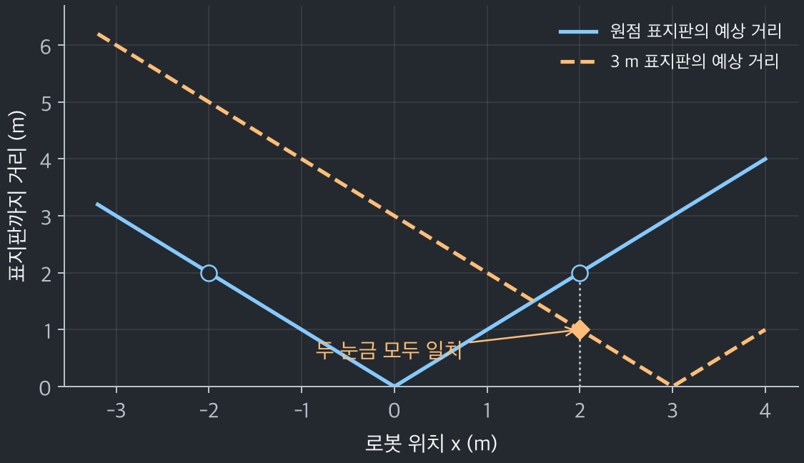

창고 바닥에 수직선을 긋고 로봇을 올려 보자. 원점의 표지판까지 거리가 2 m라고 한다. 로봇은 어디에 있을까? 오른쪽 2 m라고 답했다면, 왼쪽 2 m에서 센서가 무엇을 읽을지 생각해 보자. **측정이 정확해도 상태가 하나로 정해지지 않을 수 있다.** 이 간단한 문제가 책 전체의 출발점이다.

## 칠판에 먼저 적을 세 가지

상태 x는 나중 일을 예측하는 데 필요한 미지수다. 바퀴가 미끄러지지 않는 레일에서 한 번의 위치만 묻는다면 x는 위치 하나면 충분하다. 다음 1초 동안의 운동을 예측하려면 속도도 포함해야 한다. 바퀴 눈금이 계속 한쪽으로 치우친다면 바이어스까지 후보가 된다. 변수를 늘릴 때마다 어떤 관측이 그 변수를 다른 변수와 구별해 줄지 물어보자.

<math xmlns="http://www.w3.org/1998/Math/MathML" display="block"><semantics><mrow><msub><mi>x</mi><mi>k</mi></msub><mo>&#x0003D;</mo><mi>f</mi><mo stretchy="false">&#x00028;</mo><msub><mi>x</mi><mrow><mi>k</mi><mo>&#x02212;</mo><mn>1</mn></mrow></msub><mo>&#x0002C;</mo><msub><mi>u</mi><mi>k</mi></msub><mo stretchy="false">&#x00029;</mo><mo>&#x0002B;</mo><msub><mi>w</mi><mi>k</mi></msub><mo>&#x0002C;</mo><mspace width="2em" /><msub><mi>z</mi><mi>k</mi></msub><mo>&#x0003D;</mo><mi>h</mi><mo stretchy="false">&#x00028;</mo><msub><mi>x</mi><mi>k</mi></msub><mo stretchy="false">&#x00029;</mo><mo>&#x0002B;</mo><msub><mi>v</mi><mi>k</mi></msub></mrow><annotation encoding="application/x-tex">x_k=f(x_&#123;k-1},u_k)+w_k,\qquad z_k=h(x_k)+v_k</annotation></semantics></math>

시각 k의 입력 u는 엔코더로 계산한 이동량일 수 있다. f는 상태가 시간에 따라 바뀌는 방식, h는 후보 상태에서 센서가 읽을 값을 돌려준다. w와 v는 각각 이동과 측정에서 설명하지 못한 오차다. 이 식은 오차를 더할 수 있는 1차원 예다. 회전을 다루는 8강에서는 오차를 회전에 합성한다. 같은 엔코더 눈금을 입력과 별도 관측으로 두 번 쓰면 정보도 두 번 세게 된다.

## 거리 센서가 지워 버린 부호

표지판 위치를 a라고 하면 이상적인 거리 모델은 다음과 같다.

<math xmlns="http://www.w3.org/1998/Math/MathML" display="block"><semantics><mrow><msub><mi>h</mi><mi>a</mi></msub><mo stretchy="false">&#x00028;</mo><mi>x</mi><mo stretchy="false">&#x00029;</mo><mo>&#x0003D;</mo><mo stretchy="false">&#x0007C;</mo><mi>x</mi><mo>&#x02212;</mo><mi>a</mi><mo stretchy="false">&#x0007C;</mo><mo>&#x0002C;</mo><mspace width="2em" /><msub><mi>h</mi><mn>0</mn></msub><mo stretchy="false">&#x00028;</mo><mo>&#x02212;</mo><mn>2</mn><mo stretchy="false">&#x00029;</mo><mo>&#x0003D;</mo><msub><mi>h</mi><mn>0</mn></msub><mo stretchy="false">&#x00028;</mo><mn>2</mn><mo stretchy="false">&#x00029;</mo><mo>&#x0003D;</mo><mn>2</mn></mrow><annotation encoding="application/x-tex">h_a(x)=|x-a|,\qquad h_0(-2)=h_0(2)=2</annotation></semantics></math>

첫 측정에 맞는 후보는 두 개다. 두 후보에서 시작해 같은 방향으로 움직일 때 다음 눈금들이 달라질 수도 있고, 다른 위치의 표지판이 즉시 구별해 줄 수도 있다. 이런 구별 가능성은 측정 횟수뿐 아니라 로봇의 움직임과 센서 배치에도 달려 있다. 별의 각도에서 배의 위치를 찾거나, 바퀴와 카메라에서 로봇의 위치를 찾을 때 같은 질문이 남는다. 어떤 상태들이 같은 관측 이력을 만드는가?

<figure class="lecture-figure" markdown="0"><figcaption>파란 곡선에서 높이 2를 만드는 위치는 두 개다. 그중 주황 곡선의 높이도 1이 되는 위치를 찾아보자.</figcaption></figure>

이번에는 위치 3 m의 표지판에서 거리 1 m를 읽었다. x=+2일 때 예상은 1 m, x=−2일 때는 5 m다. 두 후보의 사전확률이 같고 새 거리 잡음이 표준편차 0.5 m인 가우시안이면, 잔차 4 m인 후보와 잔차 0인 후보 사이의 우도비는 아래처럼 작아진다.

<math xmlns="http://www.w3.org/1998/Math/MathML" display="block"><semantics><mrow><mfrac><mrow><mi>p</mi><mo stretchy="false">&#x00028;</mo><mi>z</mi><mo>&#x0003D;</mo><mn>1</mn><mo>&#x02223;</mo><mi>x</mi><mo>&#x0003D;</mo><mo>&#x02212;</mo><mn>2</mn><mo stretchy="false">&#x00029;</mo></mrow><mrow><mi>p</mi><mo stretchy="false">&#x00028;</mo><mi>z</mi><mo>&#x0003D;</mo><mn>1</mn><mo>&#x02223;</mo><mi>x</mi><mo>&#x0003D;</mo><mn>2</mn><mo stretchy="false">&#x00029;</mo></mrow></mfrac><mo>&#x0003D;</mo><mi>exp</mi><mrow><mo stretchy="true" fence="true" form="prefix">&#x00028;</mo><mo>&#x02212;</mo><mfrac><mrow><msup><mn>4</mn><mn>2</mn></msup></mrow><mrow><mn>2</mn><mo stretchy="false">&#x00028;</mo><mn>0.5</mn><msup><mo stretchy="false">&#x00029;</mo><mn>2</mn></msup></mrow></mfrac><mo stretchy="true" fence="true" form="postfix">&#x00029;</mo></mrow><mo>&#x0003D;</mo><msup><mi>e</mi><mrow><mo>&#x02212;</mo><mn>32</mn></mrow></msup></mrow><annotation encoding="application/x-tex">\frac&#123;p(z=1\mid x=-2)}&#123;p(z=1\mid x=2)}=\exp\left(-\frac&#123;4^2}&#123;2(0.5)^2}\right)=e^&#123;-32}</annotation></semantics></math>

이 값은 확률의 **비**다. 두 후보뿐이면 오른쪽 후보의 사후확률은 1/(1+e⁻³²)이다. 새로운 눈금 하나가 효과적인 이유는 두 후보의 예측이 잡음 폭에 비해 멀리 떨어져 있기 때문이다.

## 로봇 로그에 옮겨 보기

엔코더는 몸체의 운동을 간접적으로 알려 주는 내수용 센서이고, 표지판까지의 거리는 외부 환경을 보는 외수용 측정이다. 오래 적분한 바퀴 이동량은 미끄럼 오차를 누적하지만, 좌표를 아는 표지판은 절대 위치를 제한한다. 표지판 좌표까지 모른다면 로봇과 표지판을 같은 거리만큼 평행이동해도 상대 거리가 같다. 이후 SLAM에서 첫 자세를 고정하는 이유가 여기 있다. 실제 로그를 볼 때에는 미터와 라디안, 측정 시각, 기준 좌표계를 상태표 옆에 먼저 적자.

## 다음에 올 측정으로 모델을 시험한다

위치를 추정한 뒤에는 다음 이동의 센서 눈금을 미리 예측해 보자. 두 후보 −2 m와 +2 m에서 똑같이 오른쪽으로 0.5 m 움직이면 원점까지의 예상 거리는 각각 1.5 m와 2.5 m다. 이제 원점 표지판 하나만으로도 움직임 **전후의** 눈금이 두 후보를 가른다. 단, 이동 방향을 알고 있고 바퀴 미끄럼이 이 차이에 비해 작다는 조건이 붙는다. 이 계산은 어떤 센서를 더 살지 고민하기 전에 어떤 궤적으로 실험할지를 설계하는 방법이기도 하다.

## 확인 문제

같은 원점 표지판에서 정지한 채 거리를 100번 재면 좌우를 구별할 수 있을까?

풀이 보기

독립적인 잡음이면 거리 평균의 표준편차는 대략 10분의 1이 된다. 하지만 좌우 후보의 거리 분포는 여전히 같다. 부호를 알려 주는 방향 센서, 위치가 다른 표지판, 또는 후보마다 다른 눈금을 만드는 알려진 움직임이 필요하다.

