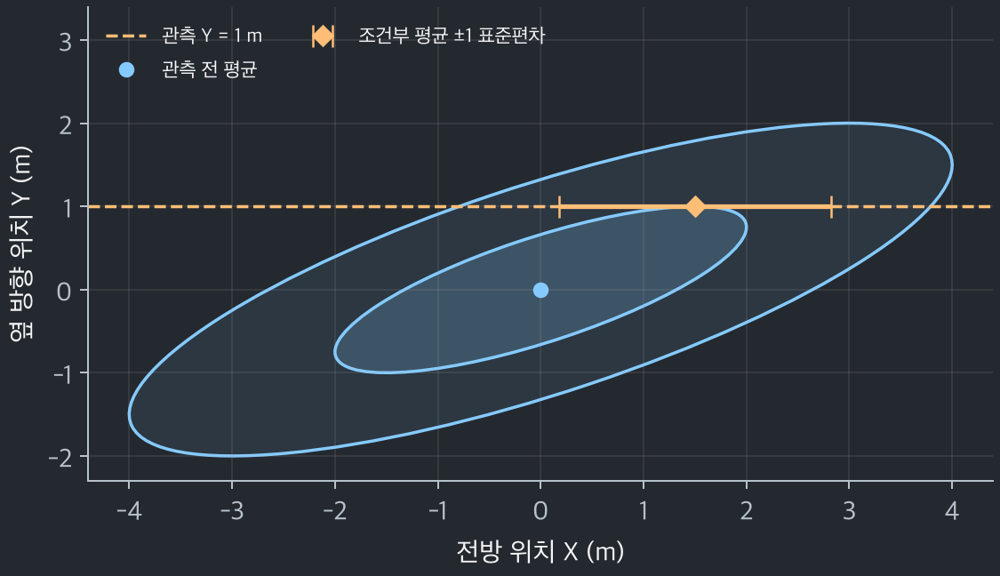

창고 로봇의 앞으로 난 방향을 X, 옆 방향을 Y라고 하자. 센서가 옆 방향만 재는데도 전방 위치의 추정치가 바뀔 수 있을까? 이번 시간에는 확률밀도, 공분산, 조건부 분포를 하나의 오차 타원에서 읽는다.

## 밀도에서 조건부 확률로

연속변수에서 한 점의 확률은 0이다. 밀도 곡선 아래에서 관심 구간을 적분해야 확률을 얻는다. 두 좌표를 함께 추정한 뒤 Y를 읽지 않았다면 Y를 적분해 없앤 **주변분포**를 쓴다. 반대로 Y를 실제로 읽었다면 그 값에서 자른 **조건부분포**를 다시 정규화한다.

<math xmlns="http://www.w3.org/1998/Math/MathML" display="block"><semantics><mrow><mi>p</mi><mo stretchy="false">&#x00028;</mo><mi>x</mi><mo stretchy="false">&#x00029;</mo><mo>&#x0003D;</mo><mo>&#x0222B;</mo><mi>p</mi><mo stretchy="false">&#x00028;</mo><mi>x</mi><mo>&#x0002C;</mo><mi>y</mi><mo stretchy="false">&#x00029;</mo><mspace width="0.167em" /><mi>d</mi><mi>y</mi><mo>&#x0002C;</mo><mspace width="2em" /><mi>p</mi><mo stretchy="false">&#x00028;</mo><mi>x</mi><mo>&#x02223;</mo><mi>y</mi><mo stretchy="false">&#x00029;</mo><mo>&#x0003D;</mo><mfrac><mrow><mi>p</mi><mo stretchy="false">&#x00028;</mo><mi>y</mi><mo>&#x02223;</mo><mi>x</mi><mo stretchy="false">&#x00029;</mo><mi>p</mi><mo stretchy="false">&#x00028;</mo><mi>x</mi><mo stretchy="false">&#x00029;</mo></mrow><mrow><mo>&#x0222B;</mo><mi>p</mi><mo stretchy="false">&#x00028;</mo><mi>y</mi><mo>&#x02223;</mo><mi>s</mi><mo stretchy="false">&#x00029;</mo><mi>p</mi><mo stretchy="false">&#x00028;</mo><mi>s</mi><mo stretchy="false">&#x00029;</mo><mspace width="0.167em" /><mi>d</mi><mi>s</mi></mrow></mfrac></mrow><annotation encoding="application/x-tex">p(x)=\int p(x,y)\,dy,\qquad p(x\mid y)=\frac&#123;p(y\mid x)p(x)}&#123;\int p(y\mid s)p(s)\,ds}</annotation></semantics></math>

분모는 가능한 모든 x가 그 눈금을 얼마나 잘 설명하는지 합한 값이다. 고정된 y에 대해 후보를 비교할 때에는 공통이지만, 사후확률이나 모델 간 증거를 구할 때는 필요하다. 공분산이 0이라는 말은 선형 상관이 없다는 뜻이다. 대칭분포의 X와 Y=X²는 공분산이 0이어도 종속적이다. 공동 가우시안에서는 공분산의 교차 블록이 0이면 독립이다.

## 오차 타원을 자르는 계산

평균이 (0,0)이고 X와 Y의 분산이 각각 4, 1 m², 교차 공분산이 1.5 m²라고 하자. 아래 첫 식의 P는 이 둘의 공분산 행렬이다. y=1 m를 추가 잡음 없이 알게 되면 기울어진 타원의 오른쪽 부분이 살아남는다.

<math xmlns="http://www.w3.org/1998/Math/MathML" display="block"><semantics><mrow><mi>P</mi><mo>&#x0003D;</mo><mo>&#x0005B;</mo><mtable><mtr><mtd><mn>4</mn></mtd><mtd><mn>1.5</mn></mtd></mtr><mtr><mtd><mn>1.5</mn></mtd><mtd><mn>1</mn></mtd></mtr></mtable><mo>&#x0005D;</mo><mo>&#x0002C;</mo><mspace width="2em" /><msub><mi>&#x003BC;</mi><mrow><mi>x</mi><mo>&#x02223;</mo><mi>y</mi></mrow></msub><mo>&#x0003D;</mo><msub><mi>&#x003BC;</mi><mi>x</mi></msub><mo>&#x0002B;</mo><msub><mi>P</mi><mrow><mi>x</mi><mi>y</mi></mrow></msub><msubsup><mi>P</mi><mrow><mi>y</mi><mi>y</mi></mrow><mrow><mo>&#x02212;</mo><mn>1</mn></mrow></msubsup><mo stretchy="false">&#x00028;</mo><mi>y</mi><mo>&#x02212;</mo><msub><mi>&#x003BC;</mi><mi>y</mi></msub><mo stretchy="false">&#x00029;</mo></mrow><annotation encoding="application/x-tex">P=\begin&#123;bmatrix}4&amp;1.5\\1.5&amp;1\end&#123;bmatrix},\qquad \mu_&#123;x\mid y}=\mu_x+P_&#123;xy}P_&#123;yy}^&#123;-1}(y-\mu_y)</annotation></semantics></math>

<math xmlns="http://www.w3.org/1998/Math/MathML" display="block"><semantics><mrow><msub><mi>P</mi><mrow><mi>x</mi><mo>&#x02223;</mo><mi>y</mi></mrow></msub><mo>&#x0003D;</mo><msub><mi>P</mi><mrow><mi>x</mi><mi>x</mi></mrow></msub><mo>&#x02212;</mo><msub><mi>P</mi><mrow><mi>x</mi><mi>y</mi></mrow></msub><msubsup><mi>P</mi><mrow><mi>y</mi><mi>y</mi></mrow><mrow><mo>&#x02212;</mo><mn>1</mn></mrow></msubsup><msub><mi>P</mi><mrow><mi>y</mi><mi>x</mi></mrow></msub><mo>&#x0003D;</mo><mn>4</mn><mo>&#x02212;</mo><msup><mn>1.5</mn><mn>2</mn></msup><mo>&#x0003D;</mo><mn>1.75</mn></mrow><annotation encoding="application/x-tex">P_&#123;x\mid y}=P_&#123;xx}-P_&#123;xy}P_&#123;yy}^&#123;-1}P_&#123;yx}=4-1.5^2=1.75</annotation></semantics></math>

새 평균은 1.5 m, 표준편차는 √1.75 ≈ 1.32 m다. 평균 이동 방향은 교차 공분산의 부호가 결정한다. 센서 자체에 독립 잡음 분산 R이 있다면 관측의 분산은 Pᵧᵧ+R이 된다. 완벽한 센서를 가정한 답을 실제 센서에 그대로 적용하면 과도하게 확신한다.

<figure class="lecture-figure" markdown="0"><figcaption>윤곽은 마할라노비스 거리 1과 2인 선이다. 주황 가로 막대는 Y=1을 읽은 뒤 X의 평균에서 좌우 한 표준편차다.</figcaption></figure>

## 같은 가우시안을 두 가지 방식으로 저장하기

평균 μ, 공분산 P 대신 정보행렬 Λ와 정보벡터 η를 저장할 수도 있다. 독립 측정의 우도를 곱하면 로그에서는 이차식이 더해진다. 그래서 정보 형식은 여러 측정을 쌓는 계산에 잘 맞는다.

<math xmlns="http://www.w3.org/1998/Math/MathML" display="block"><semantics><mrow><mi>&#x0039B;</mi><mo>&#x0003D;</mo><msup><mi>P</mi><mrow><mo>&#x02212;</mo><mn>1</mn></mrow></msup><mo>&#x0002C;</mo><mspace width="2em" /><mi>&#x003B7;</mi><mo>&#x0003D;</mo><mi>&#x0039B;</mi><mi>&#x003BC;</mi><mo>&#x0002C;</mo><mspace width="2em" /><msubsup><mi>D</mi><mi>M</mi><mn>2</mn></msubsup><mo>&#x0003D;</mo><mo stretchy="false">&#x00028;</mo><mi>x</mi><mo>&#x02212;</mo><mi>&#x003BC;</mi><msup><mo stretchy="false">&#x00029;</mo><mi>T</mi></msup><msup><mi>P</mi><mrow><mo>&#x02212;</mo><mn>1</mn></mrow></msup><mo stretchy="false">&#x00028;</mo><mi>x</mi><mo>&#x02212;</mo><mi>&#x003BC;</mi><mo stretchy="false">&#x00029;</mo></mrow><annotation encoding="application/x-tex">\Lambda=P^&#123;-1},\qquad \eta=\Lambda\mu,\qquad D_M^2=(x-\mu)^TP^&#123;-1}(x-\mu)</annotation></semantics></math>

마지막 식은 마할라노비스 거리의 제곱이다. 같은 1 m 차이라도 분산이 작은 방향에서 더 큰 벌점을 받는다. 올바른 비특이 n차원 가우시안 모델이라면 이 값은 자유도 n의 카이제곱 분포를 따른다. 그래서 2차원 타원에서 D_M²=1인 윤곽 안의 확률은 약 39%다. 1차원에서 외운 68%를 그대로 옮기면 안 된다.

가우시안 과정(GP)은 시간을 입력으로 받는 함수의 사전분포다. 유한 개 시각을 고를 때마다 함수값들이 공동 가우시안을 이루고, 커널이 두 시각의 공분산을 준다. 위 타원에서 X를 미측정 시각의 위치, Y를 과거 시각의 위치로 읽으면 같은 조건부 계산이 궤적 보간으로 바뀐다.

## 정확도를 두 배 높이려면 센서가 몇 번 더 읽어야 할까?

센서가 zᵢ=x+vᵢ를 읽고 잡음 vᵢ가 서로 독립인 N(0,σ²)를 따른다고 하자. 같은 위치를 N번 재면, 음의 로그우도를 x로 두 번 미분한 값은 N/σ²다. 이는 이 모델에서 Fisher 정보다. 정규성 조건을 만족하는 불편 추정량의 분산에는 크라메르–라오 하한이 있다.

<math xmlns="http://www.w3.org/1998/Math/MathML" display="block"><semantics><mrow><mi mathvariant="script">I</mi><mo stretchy="false">&#x00028;</mo><mi>x</mi><mo stretchy="false">&#x00029;</mo><mo>&#x0003D;</mo><mi>N</mi><mo>&#x0002F;</mo><msup><mi>&#x003C3;</mi><mn>2</mn></msup><mo>&#x0002C;</mo><mspace width="2em" /><mo>Var</mo><mo stretchy="false">&#x00028;</mo><mover><mi>x</mi><mo stretchy="false">&#x0005E;</mo></mover><mo stretchy="false">&#x00029;</mo><mo>&#x02265;</mo><msup><mi>&#x003C3;</mi><mn>2</mn></msup><mo>&#x0002F;</mo><mi>N</mi></mrow><annotation encoding="application/x-tex">\mathcal I(x)=N/\sigma^2,\qquad \operatorname&#123;Var}(\hat x)\geq \sigma^2/N</annotation></semantics></math>

이 경우 표본평균이 하한에 도달한다. 표준편차를 절반으로 줄이려면 측정이 네 배 필요하다. 같은 원시 눈금을 네 번 복사해서 넣는 경우에는 독립이라는 가정이 깨져 정보가 네 배가 되지 않는다. 센서 융합 코드에서 동일 원천의 측정을 추적해야 하는 이유다.

## 확인 문제

옆 방향 센서의 잡음 분산이 3 m²이면 전방 평균과 분산은 어떻게 될까?

풀이 보기

관측 분산은 1+3=4다. 이득은 1.5/4=0.375, 평균은 0.375 m, 분산은 4−1.5²/4=3.4375 m²다. 센서가 흐릿할수록 이전 추정에서 덜 움직인다.

