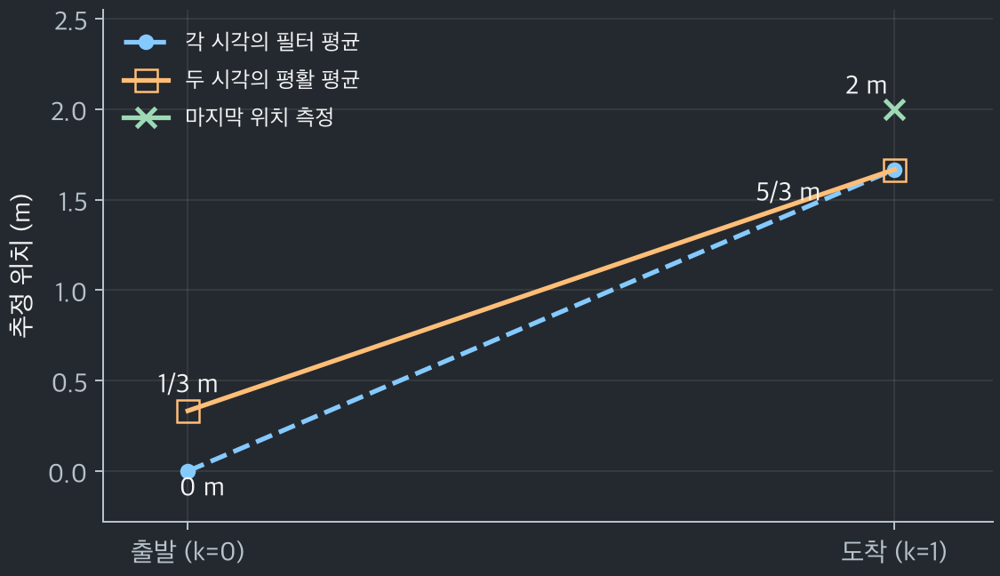

로봇이 1 m 전진했고 다음 위치 측정은 2 m였다. 오후에 이 기록을 다시 처리하면 출발 위치의 추정도 달라져야 할까? **필터링**은 당시까지 들어온 자료로 현재를 추정하고, **평활화**는 이후의 측정까지 사용해 과거를 다시 추정한다. 같은 모델로 두 답을 손으로 구해 보자.

## 사전분포와 센서식을 한 장에 쌓는다

출발 위치 x₀의 평균은 0 m, 분산은 1 m²다. 입력은 +1 m, 이동 잡음과 위치 센서 잡음의 분산도 각각 1 m²이며 모두 독립인 가우시안이다. 따라서 세 사건의 음의 로그확률은 상수를 빼면 잔차 제곱 세 개가 된다.

<math xmlns="http://www.w3.org/1998/Math/MathML" display="block"><semantics><mrow><mn>2</mn><mi>J</mi><mo>&#x0003D;</mo><msubsup><mi>x</mi><mn>0</mn><mn>2</mn></msubsup><mo>&#x0002B;</mo><mo stretchy="false">&#x00028;</mo><msub><mi>x</mi><mn>1</mn></msub><mo>&#x02212;</mo><msub><mi>x</mi><mn>0</mn></msub><mo>&#x02212;</mo><mn>1</mn><msup><mo stretchy="false">&#x00029;</mo><mn>2</mn></msup><mo>&#x0002B;</mo><mo stretchy="false">&#x00028;</mo><mn>2</mn><mo>&#x02212;</mo><msub><mi>x</mi><mn>1</mn></msub><msup><mo stretchy="false">&#x00029;</mo><mn>2</mn></msup></mrow><annotation encoding="application/x-tex">2J=x_0^2+(x_1-x_0-1)^2+(2-x_1)^2</annotation></semantics></math>

x₀, x₁로 각각 미분하면 2x₀−x₁=−1과 −x₀+2x₁=3이다. 동시에 풀면 x₀=1/3, x₁=5/3 m다. 헤시안은 대각선이 2, 비대각선이 −1인 행렬이고, 역행렬의 대각 원소는 모두 2/3 m²다. 선형 모델과 가우시안 오차에서는 이 최빈값이 평균과도 일치한다. 출발 위치 사전과 마지막 절대 관측을 모두 없애면 두 위치의 공통 평행이동을 구별할 수 없어 해가 유일하지 않다.

## 마지막 위치만 묻는다면

이전 정보를 평균과 공분산에 담아 한 시각씩 계산한다. 아래 F는 상태 전이, H는 센서 행렬, Q와 R은 각각 이동·관측 잡음 공분산이다. 단순 가산 입력은 u에 포함했다.

<math xmlns="http://www.w3.org/1998/Math/MathML" display="block"><semantics><mrow><msup><mi>m</mi><mo>&#x02212;</mo></msup><mo>&#x0003D;</mo><mi>F</mi><mi>m</mi><mo>&#x0002B;</mo><mi>u</mi><mo>&#x0002C;</mo><mspace width="1em" /><msup><mi>P</mi><mo>&#x02212;</mo></msup><mo>&#x0003D;</mo><mi>F</mi><mi>P</mi><msup><mi>F</mi><mi>T</mi></msup><mo>&#x0002B;</mo><mi>Q</mi><mo>&#x0002C;</mo><mspace width="1em" /><mi>K</mi><mo>&#x0003D;</mo><msup><mi>P</mi><mo>&#x02212;</mo></msup><msup><mi>H</mi><mi>T</mi></msup><mo stretchy="false">&#x00028;</mo><mi>H</mi><msup><mi>P</mi><mo>&#x02212;</mo></msup><msup><mi>H</mi><mi>T</mi></msup><mo>&#x0002B;</mo><mi>R</mi><msup><mo stretchy="false">&#x00029;</mo><mrow><mo>&#x02212;</mo><mn>1</mn></mrow></msup></mrow><annotation encoding="application/x-tex">m^-=Fm+u,\quad P^-=FPF^T+Q,\quad K=P^-H^T(HP^-H^T+R)^&#123;-1}</annotation></semantics></math>

<math xmlns="http://www.w3.org/1998/Math/MathML" display="block"><semantics><mrow><msup><mi>m</mi><mo>&#x0002B;</mo></msup><mo>&#x0003D;</mo><msup><mi>m</mi><mo>&#x02212;</mo></msup><mo>&#x0002B;</mo><mi>K</mi><mo stretchy="false">&#x00028;</mo><mi>z</mi><mo>&#x02212;</mo><mi>H</mi><msup><mi>m</mi><mo>&#x02212;</mo></msup><mo stretchy="false">&#x00029;</mo><mo>&#x0002C;</mo><mspace width="2em" /><msup><mi>P</mi><mo>&#x0002B;</mo></msup><mo>&#x0003D;</mo><msup><mi>P</mi><mo>&#x02212;</mo></msup><mo>&#x02212;</mo><mi>K</mi><mi>H</mi><msup><mi>P</mi><mo>&#x02212;</mo></msup></mrow><annotation encoding="application/x-tex">m^+=m^-+K(z-Hm^-),\qquad P^+=P^--KHP^-</annotation></semantics></math>

여기서는 F=H=1이다. 이동 뒤에는 m⁻=1, P⁻=2이고, 관측의 예상 분산은 2+1=3이다. 이득 2/3를 써서 m⁺=1+(2/3)(2−1)=5/3 m, P⁺=2/3 m²를 얻는다. 배치 해의 마지막 성분과 일치한다. 수치 구현에서는 혁신 공분산의 역행렬을 직접 만들지 않고 선형계를 풀 수 있다.

<figure class="lecture-figure" markdown="0"><figcaption>오른쪽의 마지막 추정치는 같다. 왼쪽 출발점에는 미래 측정을 사용한 평활화에서만 변화가 생긴다.</figcaption></figure>

## 왜 나중 눈금이 과거에 닿을까?

두 시각은 운동 모델로 연결되어 있다. Rauch–Tung–Striebel(RTS) 평활기는 전진 필터가 저장한 교차 정보를 사용해 마지막 측정의 영향을 한 걸음씩 되돌린다. k|N은 N시각까지 본 뒤의 k시각 추정이다.

<math xmlns="http://www.w3.org/1998/Math/MathML" display="block"><semantics><mrow><msub><mi>G</mi><mi>k</mi></msub><mo>&#x0003D;</mo><msub><mi>P</mi><mrow><mi>k</mi><mo>&#x02223;</mo><mi>k</mi></mrow></msub><msubsup><mi>F</mi><mi>k</mi><mi>T</mi></msubsup><msubsup><mi>P</mi><mrow><mi>k</mi><mo>&#x0002B;</mo><mn>1</mn><mo>&#x02223;</mo><mi>k</mi></mrow><mrow><mo>&#x02212;</mo><mn>1</mn></mrow></msubsup><mo>&#x0002C;</mo><mspace width="1em" /><msub><mi>m</mi><mrow><mi>k</mi><mo>&#x02223;</mo><mi>N</mi></mrow></msub><mo>&#x0003D;</mo><msub><mi>m</mi><mrow><mi>k</mi><mo>&#x02223;</mo><mi>k</mi></mrow></msub><mo>&#x0002B;</mo><msub><mi>G</mi><mi>k</mi></msub><mo stretchy="false">&#x00028;</mo><msub><mi>m</mi><mrow><mi>k</mi><mo>&#x0002B;</mo><mn>1</mn><mo>&#x02223;</mo><mi>N</mi></mrow></msub><mo>&#x02212;</mo><msub><mi>m</mi><mrow><mi>k</mi><mo>&#x0002B;</mo><mn>1</mn><mo>&#x02223;</mo><mi>k</mi></mrow></msub><mo stretchy="false">&#x00029;</mo></mrow><annotation encoding="application/x-tex">G_k=P_&#123;k\mid k}F_k^T P_&#123;k+1\mid k}^&#123;-1},\quad m_&#123;k\mid N}=m_&#123;k\mid k}+G_k(m_&#123;k+1\mid N}-m_&#123;k+1\mid k})</annotation></semantics></math>

예제에서는 G₀=1/2다. 출발 추정은 0+(1/2)(5/3−1)=1/3 m가 된다. 많은 시각을 쌓아도 이웃 시각만 묶는 이동식과 한 시각만 보는 센서식이면 정보행렬은 블록 삼중대각이다. 촐레스키 분해를 이용한 전진·후진 대입과 RTS는 이 구조를 활용한다. 먼 두 시각을 묶는 루프 제약이 생기면 행렬 패턴도 바뀐다.

평활화는 과거 평균뿐 아니라 그때의 공분산도 고친다. 전진 계산에서 저장한 예측 분산과 마지막 측정까지 반영한 분산의 차이를 같은 G로 되돌린다.

<math xmlns="http://www.w3.org/1998/Math/MathML" display="block"><semantics><mrow><msub><mi>P</mi><mrow><mi>k</mi><mo>&#x02223;</mo><mi>N</mi></mrow></msub><mo>&#x0003D;</mo><msub><mi>P</mi><mrow><mi>k</mi><mo>&#x02223;</mo><mi>k</mi></mrow></msub><mo>&#x0002B;</mo><msub><mi>G</mi><mi>k</mi></msub><mo stretchy="false">&#x00028;</mo><msub><mi>P</mi><mrow><mi>k</mi><mo>&#x0002B;</mo><mn>1</mn><mo>&#x02223;</mo><mi>N</mi></mrow></msub><mo>&#x02212;</mo><msub><mi>P</mi><mrow><mi>k</mi><mo>&#x0002B;</mo><mn>1</mn><mo>&#x02223;</mo><mi>k</mi></mrow></msub><mo stretchy="false">&#x00029;</mo><msubsup><mi>G</mi><mi>k</mi><mi>T</mi></msubsup></mrow><annotation encoding="application/x-tex">P_&#123;k\mid N}=P_&#123;k\mid k}+G_k(P_&#123;k+1\mid N}-P_&#123;k+1\mid k})G_k^T</annotation></semantics></math>

예제에서는 P₀|₁=1+(1/2)²(2/3−2)=2/3 m²다. 나중 관측을 포함한 배치 해의 첫 대각 원소와도 일치한다.

교재 후반의 연속시간 모델은 미분방정식으로 움직임을 주고 원하는 관측 시각 사이의 전이와 잡음을 계산한다. 이렇게 만든 GP 사전은 비동기 측정에도 적용된다. 연속시간 관측까지 모델링하는 칼만–뷰시 필터는 평균과 공분산을 미분방정식으로 갱신한다. 이산 센서의 분산을 연속 잡음의 스펙트럼 밀도로 옮길 때 시간 단위를 확인하자.

## 상태 두 개를 센서 하나로 볼 수 있을까?

위치와 속도를 상태로 두고 일정 속도 운동을 생각하자. 한 번의 위치 관측 H=[1,0]만 보면 속도는 자유롭다. Δ초 뒤 또 위치를 재면 두 번째 눈금에는 처음 속도의 효과가 들어 있다. 소음 없는 모델로 두 측정을 쌓은 행렬을 보자.

<math xmlns="http://www.w3.org/1998/Math/MathML" display="block"><semantics><mrow><mi mathvariant="script">O</mi><mo>&#x0003D;</mo><mo>&#x0005B;</mo><mtable><mtr><mtd><mi>H</mi></mtd></mtr><mtr><mtd><mi>H</mi><mi>F</mi></mtd></mtr></mtable><mo>&#x0005D;</mo><mo>&#x0003D;</mo><mo>&#x0005B;</mo><mtable><mtr><mtd><mn>1</mn></mtd><mtd><mn>0</mn></mtd></mtr><mtr><mtd><mn>1</mn></mtd><mtd><mi>&#x00394;</mi></mtd></mtr></mtable><mo>&#x0005D;</mo></mrow><annotation encoding="application/x-tex">\mathcal O=\begin&#123;bmatrix}H\\HF\end&#123;bmatrix}=\begin&#123;bmatrix}1&amp;0\\1&amp;\Delta\end&#123;bmatrix}</annotation></semantics></math>

Δ가 0이 아니면 두 열이 독립이라 이 모델에서는 초기 위치와 속도를 구별할 수 있다. 하지만 Δ가 아주 작으면 두 측정의 차이로 속도를 추정할 때 잡음이 크게 증폭된다. 초기 상태를 유일하게 구별할 수 있는지와 실제 자료에서 해가 얼마나 안정적인지는 별개의 실험 질문이다.

## 확인 문제

마지막 위치 센서의 분산만 4 m²가 되면 두 위치는 어디로 움직일까?

풀이 보기

이득은 2/(2+4)=1/3이므로 도착 추정은 4/3 m다. 출발 평활 이득은 여전히 1/2이므로 출발 추정은 1/6 m다. 덜 믿는 측정 하나가 궤적 전체를 덜 움직였다.

