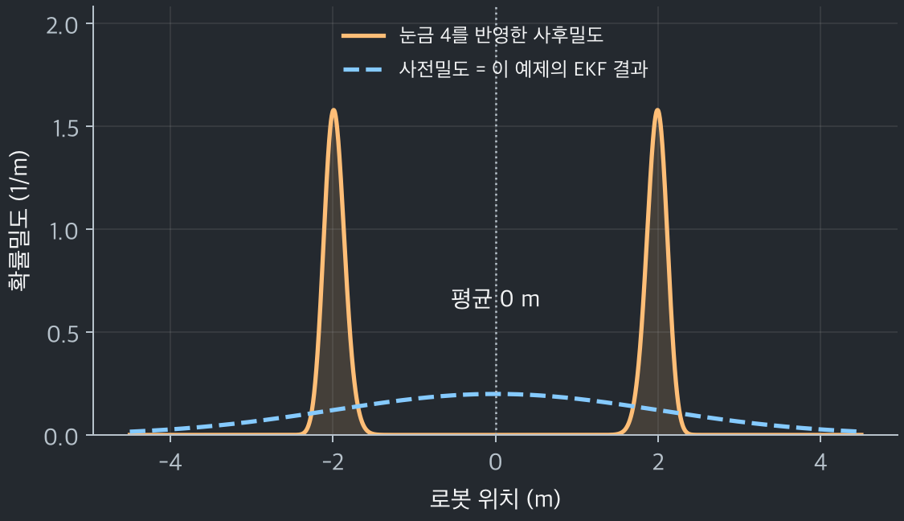

레일의 중앙에 자석이 있고, 센서가 위치 x의 제곱에 비례하는 눈금 z를 낸다고 하자. 보정된 모델은 z=x²+v다. 눈금이 4이면 두 위치가 모두 그럴듯하다. 그런데 평균 하나만 출력하는 필터는 정확히 중앙을 가리킬 수 있다. 어느 계산에서 정보가 사라졌을까?

## 먼저 정답의 모양을 그린다

위치의 사전분포는 평균 0, 분산 4 m²로 두고, 제곱 위치를 재는 센서 잡음의 표준편차는 0.5 m²로 둔다. 눈금 4 m²를 받은 사후밀도는 베이즈 법칙으로 아래처럼 쓸 수 있다. 비례상수는 전체 면적이 1이 되게 한다.

<math xmlns="http://www.w3.org/1998/Math/MathML" display="block"><semantics><mrow><mi>p</mi><mo stretchy="false">&#x00028;</mo><mi>x</mi><mo>&#x02223;</mo><mi>z</mi><mo>&#x0003D;</mo><mn>4</mn><mo stretchy="false">&#x00029;</mo><mo>&#x0221D;</mo><mi>exp</mi><mrow><mo stretchy="true" fence="true" form="prefix">&#x00028;</mo><mo>&#x02212;</mo><mfrac><mrow><msup><mi>x</mi><mn>2</mn></msup></mrow><mrow><mn>8</mn></mrow></mfrac><mo>&#x02212;</mo><mfrac><mrow><mo stretchy="false">&#x00028;</mo><mn>4</mn><mo>&#x02212;</mo><msup><mi>x</mi><mn>2</mn></msup><msup><mo stretchy="false">&#x00029;</mo><mn>2</mn></msup></mrow><mrow><mn>2</mn><mo stretchy="false">&#x00028;</mo><mn>0.5</mn><msup><mo stretchy="false">&#x00029;</mo><mn>2</mn></msup></mrow></mfrac><mo stretchy="true" fence="true" form="postfix">&#x00029;</mo></mrow></mrow><annotation encoding="application/x-tex">p(x\mid z=4)\propto\exp\left(-\frac&#123;x^2}&#123;8}-\frac&#123;(4-x^2)^2}&#123;2(0.5)^2}\right)</annotation></semantics></math>

대칭이므로 사후평균은 0이다. 반면 두 봉우리는 약 ±1.99 m에 있다. 평균과 최빈값(MAP)이 서로 다른 질문에 답한다는 뜻이다. 사후평균은 제곱 위치오차의 기댓값을 줄이지만, 평균 위치에서 예상한 센서 눈금은 0이다. 행동을 결정하려면 좌우 가설을 유지하거나 한쪽을 구별하는 관측을 추가해야 한다.

<figure class="lecture-figure" markdown="0"><figcaption>주황 두 봉우리를 하나의 평균으로 압축하면 어느 쪽에 질량이 있는지 알 수 없다. 점선은 평균 0에서 선형화한 EKF가 그대로 남긴 사전분포다.</figcaption></figure>

## 같은 관측을 세 가지 필터에 넣어 본다

**확장 칼만 필터(EKF).** 현재 추정점 주위에서 h(x)를 접선으로 바꾼다. 평균 0에서 기울기가 0이므로 예측 관측과 상태의 선형 교차 공분산도 0이다. 이 갱신은 평균과 분산을 모두 놓친다.

<math xmlns="http://www.w3.org/1998/Math/MathML" display="block"><semantics><mrow><mi>H</mi><mo>&#x0003D;</mo><msub><mrow><mo stretchy="true" fence="true" form="prefix" /><mfrac><mrow><mi>d</mi><msup><mi>x</mi><mn>2</mn></msup></mrow><mrow><mi>d</mi><mi>x</mi></mrow></mfrac><mo stretchy="true" fence="true" form="postfix">&#x0007C;</mo></mrow><mrow><mi>x</mi><mo>&#x0003D;</mo><mn>0</mn></mrow></msub><mo>&#x0003D;</mo><mn>0</mn><mo>&#x0002C;</mo><mspace width="2em" /><mi>K</mi><mo>&#x0003D;</mo><msup><mi>P</mi><mo>&#x02212;</mo></msup><msup><mi>H</mi><mi>T</mi></msup><mo stretchy="false">&#x00028;</mo><mi>H</mi><msup><mi>P</mi><mo>&#x02212;</mo></msup><msup><mi>H</mi><mi>T</mi></msup><mo>&#x0002B;</mo><mi>R</mi><msup><mo stretchy="false">&#x00029;</mo><mrow><mo>&#x02212;</mo><mn>1</mn></mrow></msup><mo>&#x0003D;</mo><mn>0</mn></mrow><annotation encoding="application/x-tex">H=\left.\frac&#123;d x^2}&#123;dx}\right|_&#123;x=0}=0,\qquad K=P^-H^T(HP^-H^T+R)^&#123;-1}=0</annotation></semantics></math>

**시그마점 필터.** 평균 양쪽의 정해진 표본을 실제 비선형 함수에 통과시켜 모멘트를 맞춘다. 여기서는 E[X²]=4를 포착할 수 있다. 하지만 완벽히 대칭인 표본에서는 X와 X²의 교차 공분산이 0이라 표준 칼만형 갱신으로 두 봉우리를 표현하지 못한다. 모멘트를 잘 근사하는 일과 분포의 모양을 보존하는 일은 구분해야 한다.

**입자 필터.** 사전에서 실제 표본을 뽑아 눈금의 우도로 가중한다. 이동 사전을 제안분포로 쓰는 기본형의 가중치와 유효표본수는 다음과 같다. w는 합이 1이 되도록 정규화한 가중치다.

<math xmlns="http://www.w3.org/1998/Math/MathML" display="block"><semantics><mrow><msubsup><mi>w</mi><mi>i</mi><mo>&#x0002B;</mo></msubsup><mo>&#x0221D;</mo><msubsup><mi>w</mi><mi>i</mi><mo>&#x02212;</mo></msubsup><mi>p</mi><mo stretchy="false">&#x00028;</mo><mi>z</mi><mo>&#x02223;</mo><msub><mi>x</mi><mi>i</mi></msub><mo stretchy="false">&#x00029;</mo><mo>&#x0002C;</mo><mspace width="2em" /><msub><mi>N</mi><mrow><mi mathvariant="normal">e</mi><mi mathvariant="normal">f</mi><mi mathvariant="normal">f</mi></mrow></msub><mo>&#x0003D;</mo><mfrac><mrow><mn>1</mn></mrow><mrow><msub><mo>&#x02211;</mo><mi>i</mi></msub><mo stretchy="false">&#x00028;</mo><msubsup><mi>w</mi><mi>i</mi><mo>&#x0002B;</mo></msubsup><msup><mo stretchy="false">&#x00029;</mo><mn>2</mn></msup></mrow></mfrac></mrow><annotation encoding="application/x-tex">w_i^+\propto w_i^-p(z\mid x_i),\qquad N_&#123;\rm eff}=\frac&#123;1}&#123;\sum_i(w_i^+)^2}</annotation></semantics></math>

±2 근처에 입자가 남아 있으면 두 봉우리를 보존한다. 처음부터 한쪽에 입자가 하나도 없으면 재표본화만으로 소실된 가설을 복구하기 어렵다. 차원이 높고 우도가 날카로울수록 제안분포 선택이 중요해진다.

## 반복과 배치는 무엇을 바꾸는가?

반복 EKF는 동일한 사전분포를 고정하고 선형화점을 바꾸면서 국소 사후 모드를 찾는 것을 목표로 한다. 이 예제에서 정확히 0부터 반복하면 기울기가 0이라 두 모드 사이의 정지점에 갇힌다. 같은 관측을 독립 측정처럼 여러 번 누적하면 공분산이 부당하게 줄어든다. 이 예제에서는 양수 쪽 초기값과 음수 쪽 초기값이 서로 다른 해로 갈 수 있다. 배치 MAP은 여러 시각의 이동·관측 잔차를 동시에 선형화한다. 가우스–뉴턴에서 잔차 r과 야코비안 J, 가중치 W에 대한 한 단계는 다음과 같다.

<math xmlns="http://www.w3.org/1998/Math/MathML" display="block"><semantics><mrow><mo stretchy="false">&#x00028;</mo><msup><mi>J</mi><mi>T</mi></msup><mi>W</mi><mi>J</mi><mo stretchy="false">&#x00029;</mo><mi>&#x003B4;</mi><mo>&#x0003D;</mo><mo>&#x02212;</mo><msup><mi>J</mi><mi>T</mi></msup><mi>W</mi><mi>r</mi><mo>&#x0002C;</mo><mspace width="2em" /><mi>x</mi><mo>&#x02190;</mo><mi>x</mi><mo>&#x0002B;</mo><mi>&#x003B4;</mi></mrow><annotation encoding="application/x-tex">(J^TWJ)\delta=-J^TWr,\qquad x\leftarrow x+\delta</annotation></semantics></math>

사전 항을 포함하면 MAP, 관측 우도만 최대화하면 ML이다. 슬라이딩 윈도에서는 오래된 상태를 주변화해 현재 구간에 그 정보를 남긴다. 주변화 시점의 선형화가 이후 추정과 어긋날 수 있으므로 윈도를 작게 한 대가가 계산량에만 나타나지는 않는다.

## 필터들이 근사하는 공통 계산

위의 세 필터 아래에는 두 번의 확률 연산이 있다. 다음 상태는 직전 상태와 입력에만 의존하고, 현재 상태가 주어지면 새 측정은 이전 눈금과 조건부 독립이라고 가정한다. 먼저 가능한 이전 상태 s를 운동 모델로 보내고, 이어서 현재 눈금의 우도를 곱한다. b는 해당 시각의 상태 밀도, η는 면적을 1로 만드는 상수다.

<math xmlns="http://www.w3.org/1998/Math/MathML" display="block"><semantics><mrow><msubsup><mi>b</mi><mi>k</mi><mo>&#x02212;</mo></msubsup><mo stretchy="false">&#x00028;</mo><mi>x</mi><mo stretchy="false">&#x00029;</mo><mo>&#x0003D;</mo><mo>&#x0222B;</mo><mi>p</mi><mo stretchy="false">&#x00028;</mo><mi>x</mi><mo>&#x02223;</mo><mi>s</mi><mo>&#x0002C;</mo><msub><mi>u</mi><mi>k</mi></msub><mo stretchy="false">&#x00029;</mo><msub><mi>b</mi><mrow><mi>k</mi><mo>&#x02212;</mo><mn>1</mn></mrow></msub><mo stretchy="false">&#x00028;</mo><mi>s</mi><mo stretchy="false">&#x00029;</mo><mspace width="0.167em" /><mi>d</mi><mi>s</mi><mo>&#x0002C;</mo><mspace width="2em" /><msub><mi>b</mi><mi>k</mi></msub><mo stretchy="false">&#x00028;</mo><mi>x</mi><mo stretchy="false">&#x00029;</mo><mo>&#x0003D;</mo><mi>&#x003B7;</mi><mi>p</mi><mo stretchy="false">&#x00028;</mo><msub><mi>z</mi><mi>k</mi></msub><mo>&#x02223;</mo><mi>x</mi><mo stretchy="false">&#x00029;</mo><msubsup><mi>b</mi><mi>k</mi><mo>&#x02212;</mo></msubsup><mo stretchy="false">&#x00028;</mo><mi>x</mi><mo stretchy="false">&#x00029;</mo></mrow><annotation encoding="application/x-tex">b_k^-(x)=\int p(x\mid s,u_k)b_&#123;k-1}(s)\,ds,\qquad b_k(x)=\eta p(z_k\mid x)b_k^-(x)</annotation></semantics></math>

선형화는 모델을 다루는 방법을, 시그마점은 적분을 계산하는 방법을, 가중 입자는 분포를 저장하는 방법까지 바꾼다. 로봇이 어느 쪽에 있을지를 뒤의 행동 계획에 넘겨야 한다면, 평균오차 지표 하나만으로 필터를 고르기 어렵다는 것을 두 봉우리 예제로 확인할 수 있다.

## 확인 문제

부호를 정확히 알려 주는 센서가 새로 들어와 x>0임을 확인했다. 평균 0을 계속 유지해야 할까?

풀이 보기

음수 쪽의 사후 질량을 제거한 뒤 다시 정규화해야 한다. 남은 분포는 +2 m 부근에 모인다. 이때는 그 봉우리 주위의 국소 가우시안 근사도 훨씬 설득력이 있다.

