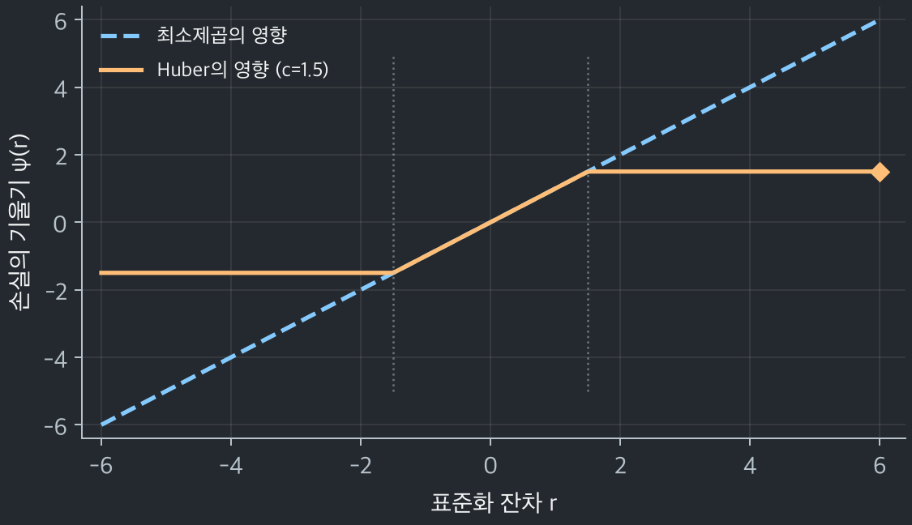

매번 같은 복도에서 로봇이 오른쪽으로 20 cm 치우친다. 다른 날에는 유리문 앞에서 거리 센서가 한 번만 3 m 튄다. 두 현상에 똑같이 측정 잡음 R을 키우면 무엇을 잃을까? 먼저 **지속적인 편향**, **틀린 대응**, **드문 이상치**, **분산의 오설정**을 서로 다른 가설로 두자.

## 틀린 위치와 틀린 자신감을 나눠 측정한다

혁신 ν는 실제 측정에서 예측 측정을 뺀 값이고, S는 그 차이의 예측 공분산이다. 정답이 있는 실험에서는 상태 오차 e와 공분산 P도 구할 수 있다. 다음 두 통계량은 잔차가 각자 예측한 폭과 어울리는지를 묻는다.

<math xmlns="http://www.w3.org/1998/Math/MathML" display="block"><semantics><mrow><mrow><mi mathvariant="normal">N</mi><mi mathvariant="normal">I</mi><mi mathvariant="normal">S</mi></mrow><mo>&#x0003D;</mo><msup><mi>&#x003BD;</mi><mi>T</mi></msup><msup><mi>S</mi><mrow><mo>&#x02212;</mo><mn>1</mn></mrow></msup><mi>&#x003BD;</mi><mo>&#x0002C;</mo><mspace width="2em" /><mrow><mi mathvariant="normal">N</mi><mi mathvariant="normal">E</mi><mi mathvariant="normal">E</mi><mi mathvariant="normal">S</mi></mrow><mo>&#x0003D;</mo><msup><mi>e</mi><mi>T</mi></msup><msup><mi>P</mi><mrow><mo>&#x02212;</mo><mn>1</mn></mrow></msup><mi>e</mi></mrow><annotation encoding="application/x-tex">\mathrm&#123;NIS}=\nu^TS^&#123;-1}\nu,\qquad \mathrm&#123;NEES}=e^TP^&#123;-1}e</annotation></semantics></math>

정확한 비특이 가우시안 가정 아래 기대값은 각각 측정 차원과 상태 차원이다. 1차원 예측 표준편차가 0.2 m일 때 0.6 m의 혁신 하나는 NIS=9다. 자유도 1인 카이제곱의 95% 단측 상한 3.84를 넘는다. 한 번 넘었다고 고장이라고 단정할 수는 없다. 여러 독립 시행의 분포, 잔차의 평균, 시간 상관도 함께 확인한다. 선형화나 데이터 연관 선택을 거친 실제 잔차에서는 이론 분포와 달라질 수 있다.

## 바이어스와 데이터 연관

거리식이 z=x+b+v라면 일정 오프셋 b를 상태로 넣어 추정할 수 있다. 바이어스가 천천히 변한다고 보면 작은 랜덤워크를 준다. 하지만 x와 b를 모두 모르고 그 합만 반복 측정하면 둘의 값은 분리되지 않는다. 위치를 아는 기준점, 독립 센서 또는 적절한 운동 제약이 추가되어야 한다.

지도 속 기둥 A와 B 중 어느 것이 이번 반사점인지도 추정 문제다. 후보마다 예상 측정과 S를 계산해 마할라노비스 거리로 문턱 검사를 할 수 있다. S가 서로 다르면 가우시안 우도에는 log det S도 들어간다. 가장 가까운 후보를 매 프레임 강제로 고르면 반복되는 기둥에서 잘못된 연결이 연달아 발생한다. 대응 보류와 기하학적 검증도 가능한 선택지다.

## 한 눈금이 해를 끌고 가지 못하도록

표준화한 잔차 r에 Huber 손실을 쓰면 작은 오차는 제곱으로, 큰 오차는 절댓값에 비례해 반영된다. 반복 재가중 최소제곱(IRLS)에서는 다음 가중치가 같은 효과를 낸다.

<math xmlns="http://www.w3.org/1998/Math/MathML" display="block"><semantics><mrow><mi>w</mi><mo stretchy="false">&#x00028;</mo><mi>r</mi><mo stretchy="false">&#x00029;</mo><mo>&#x0003D;</mo><mo>min</mo><mrow><mo stretchy="true" fence="true" form="prefix">&#x00028;</mo><mn>1</mn><mo>&#x0002C;</mo><mfrac><mrow><mi>c</mi></mrow><mrow><mo stretchy="false">&#x0007C;</mo><mi>r</mi><mo stretchy="false">&#x0007C;</mo></mrow></mfrac><mo stretchy="true" fence="true" form="postfix">&#x00029;</mo></mrow><mo>&#x0002C;</mo><mspace width="1em" /><mi>w</mi><mo stretchy="false">&#x00028;</mo><mn>0</mn><mo stretchy="false">&#x00029;</mo><mo>&#x0003D;</mo><mn>1</mn><mo>&#x0002C;</mo><mspace width="2em" /><mi>&#x003C8;</mi><mo stretchy="false">&#x00028;</mo><mi>r</mi><mo stretchy="false">&#x00029;</mo><mo>&#x0003D;</mo><mi>w</mi><mo stretchy="false">&#x00028;</mo><mi>r</mi><mo stretchy="false">&#x00029;</mo><mi>r</mi></mrow><annotation encoding="application/x-tex">w(r)=\min\left(1,\frac&#123;c}&#123;|r|}\right),\quad w(0)=1,\qquad \psi(r)=w(r)r</annotation></semantics></math>

<figure class="lecture-figure" markdown="0"><figcaption>오른쪽 끝 잔차 6에서 두 방법의 기울기를 읽어 보자. 같은 관측이라도 최적화 방향을 끌어당기는 힘은 6과 1.5로 다르다.</figcaption></figure>

c=1.5이고 잔차가 표준편차의 6배면 가중치는 0.25, 보정 방향으로 미치는 영향 ψ는 1.5다. 관측을 완전히 버린 것은 아니다. RANSAC은 다른 접근이다. 최소 표본으로 모델 가설을 만들고 전체 데이터 중 일치하는 측정의 수를 비교한다. 진짜 대응 비율이 η, 최소 표본 크기가 s라고 하자. 표본 안에서 각 점이 진짜일 확률도 독립이라고 근사하면(큰 후보 집합에서 s가 작을 때), 독립적인 시도 N번 안에 하나 이상 깨끗한 표본을 뽑을 확률은 다음과 같다.

<math xmlns="http://www.w3.org/1998/Math/MathML" display="block"><semantics><mrow><msub><mi>p</mi><mrow><mi mathvariant="normal">h</mi><mi mathvariant="normal">i</mi><mi mathvariant="normal">t</mi></mrow></msub><mo>&#x0003D;</mo><mn>1</mn><mo>&#x02212;</mo><mo stretchy="false">&#x00028;</mo><mn>1</mn><mo>&#x02212;</mo><msup><mi>&#x003B7;</mi><mi>s</mi></msup><msup><mo stretchy="false">&#x00029;</mo><mi>N</mi></msup></mrow><annotation encoding="application/x-tex">p_&#123;\rm hit}=1-(1-\eta^s)^N</annotation></semantics></math>

η=0.5, s=2, 성공 확률 목표가 0.99라면 최소 17번이다. 퇴화한 표본이나 샘플 간 종속성은 이 단순 계산에 반영되지 않는다.

교재의 공분산 추정 절로 돌아가 보면 정답이 있는 잔차에서 R을 학습하는 경우와, 주행 중 혁신 공분산을 맞추는 경우가 구분된다. 후자에서는 S에 상태 예측의 불확실성도 들어간다. 혁신이 크다는 사실만으로 Q, R, 바이어스 중 어느 하나를 유일하게 지목할 수 없다.

## 분산을 자료로부터 역산할 때

정답 위치가 있는 교정 실험에서는 측정에서 모델 출력을 빼고 잔차의 표본 공분산을 구할 수 있다. 정답이 없는 주행에서는 혁신을 쓰되, 센서 잡음과 예측 상태 오차가 독립인 가산 잡음 모델에서는 예측 상태 오차가 혁신 공분산에 기여한 만큼을 뺀다. 여러 프레임 동안 H와 P⁻가 거의 같고 혁신 평균이 0인 구간의 간단한 모멘트 추정은 다음과 같다.

<math xmlns="http://www.w3.org/1998/Math/MathML" display="block"><semantics><mrow><mover><mi>R</mi><mo stretchy="false">&#x0005E;</mo></mover><mo>&#x02248;</mo><mfrac><mrow><mn>1</mn></mrow><mrow><mi>N</mi></mrow></mfrac><munderover><mo>&#x02211;</mo><mrow><mi>k</mi><mo>&#x0003D;</mo><mn>1</mn></mrow><mi>N</mi></munderover><msub><mi>&#x003BD;</mi><mi>k</mi></msub><msubsup><mi>&#x003BD;</mi><mi>k</mi><mi>T</mi></msubsup><mo>&#x02212;</mo><mi>H</mi><msup><mi>P</mi><mo>&#x02212;</mo></msup><msup><mi>H</mi><mi>T</mi></msup></mrow><annotation encoding="application/x-tex">\hat R\approx\frac&#123;1}&#123;N}\sum_&#123;k=1}^N\nu_k\nu_k^T-HP^-H^T</annotation></semantics></math>

혁신의 경험 분산이 0.09 m², 상태 예측의 기여가 0.05 m²라면 센서 쪽 추정은 0.04 m²다. 짧은 로그에서는 차가 음수가 될 수도 있다. 이를 유효한 잡음 분산으로 그대로 입력하기 전에 표본 수, 예측 공분산, 잔차 평균과 모델이 맞는지 확인해야 한다.

## 확인 문제

혁신이 50프레임 내내 +0.18 m 부근이지만 드물게만 문턱을 넘는다. 먼저 무엇을 볼까?

풀이 보기

부호 있는 혁신의 평균과 시간 상관, 센서 장착 오프셋과 동기화를 보자. 절댓값이나 NIS만 보면 같은 부호가 반복된다는 단서가 사라진다. 정지 기준점에서의 반복 측정은 바이어스와 운동 모델 오류를 구별하는 실험이 된다.

