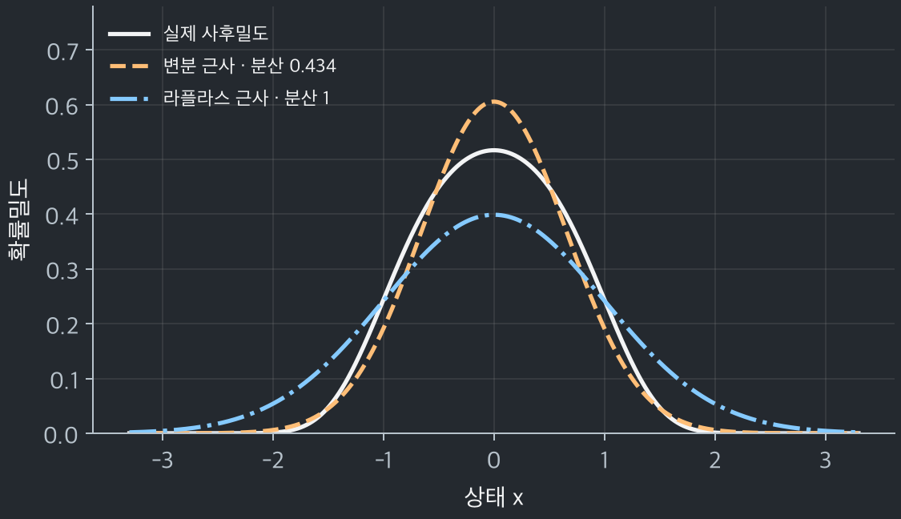

지도 위 가장 가능성 높은 위치를 찾은 뒤 그 지점의 곡률로 분산까지 정해도 될까? 사후분포의 꼭대기는 평평한데 꼬리는 급격히 줄어드는 경우를 만들어 보자. 이번 장은 가우시안의 **중심과 폭을 동시에 선택하는** 추론을 다룬다.

## 무엇을 최소화하는가?

관측을 y, 상태를 x, 공동밀도의 음의 로그를 φ(x)=−log p(x,y)라고 하자. 계산 가능한 가우시안 q를 골라 사후분포 p(x|y)에 맞춘다. 방향은 KL(q‖p)다. 아래 H(q)는 미분 엔트로피다.

<math xmlns="http://www.w3.org/1998/Math/MathML" display="block"><semantics><mrow><msub><mi>D</mi><mrow><mi mathvariant="normal">K</mi><mi mathvariant="normal">L</mi></mrow></msub><mo stretchy="false">&#x00028;</mo><mi>q</mi><mi>&#x02016;</mi><mi>p</mi><mo stretchy="false">&#x00028;</mo><mi>x</mi><mo>&#x02223;</mo><mi>y</mi><mo stretchy="false">&#x00029;</mo><mo stretchy="false">&#x00029;</mo><mo>&#x0003D;</mo><msub><mi>E</mi><mi>q</mi></msub><mo stretchy="false">[</mo><mi>&#x003D5;</mi><mo stretchy="false">&#x00028;</mo><mi>x</mi><mo stretchy="false">&#x00029;</mo><mo stretchy="false">]</mo><mo>&#x02212;</mo><mi>H</mi><mo stretchy="false">&#x00028;</mo><mi>q</mi><mo stretchy="false">&#x00029;</mo><mo>&#x0002B;</mo><mi>log</mi><mi>p</mi><mo stretchy="false">&#x00028;</mo><mi>y</mi><mo stretchy="false">&#x00029;</mo></mrow><annotation encoding="application/x-tex">D_&#123;\rm KL}(q\Vert p(x\mid y))=E_q[\phi(x)]-H(q)+\log p(y)</annotation></semantics></math>

오른쪽 마지막 항은 q를 바꿔도 일정하다. 첫 항만 줄이면 낮은 비용 한 점에 질량을 몰고 싶어진다. 두 번째 항은 지나치게 좁은 분포에 비용을 부과한다. 따라서 최적의 폭을 구하려면 중심에서의 비용뿐 아니라 그 주위에 질량을 놓았을 때의 평균 비용도 계산해야 한다. 반대 방향 KL(p‖q)을 택하면 해석과 필요한 기댓값이 바뀐다.

## 한 변수에서 최적의 분산을 직접 구한다

설명용 사후밀도를 exp(−x⁴/4−x²/2)에 비례하게 정하자. 대칭이고 비용이 엄격히 볼록해, 고정 분산에서 평균의 최적값은 0이다. 분산 v인 영평균 가우시안에서는 E[X²]=v, E[X⁴]=3v²다. 상수를 생략한 목적함수와 정지 조건은 다음과 같다.

<math xmlns="http://www.w3.org/1998/Math/MathML" display="block"><semantics><mrow><mi>L</mi><mo stretchy="false">&#x00028;</mo><mi>v</mi><mo stretchy="false">&#x00029;</mo><mo>&#x0003D;</mo><mfrac><mn>3</mn><mn>4</mn></mfrac><msup><mi>v</mi><mn>2</mn></msup><mo>&#x0002B;</mo><mfrac><mn>1</mn><mn>2</mn></mfrac><mi>v</mi><mo>&#x02212;</mo><mfrac><mn>1</mn><mn>2</mn></mfrac><mi>log</mi><mi>v</mi><mo>&#x0002C;</mo><mspace width="2em" /><mn>3</mn><msup><mi>v</mi><mn>2</mn></msup><mo>&#x0002B;</mo><mi>v</mi><mo>&#x02212;</mo><mn>1</mn><mo>&#x0003D;</mo><mn>0</mn></mrow><annotation encoding="application/x-tex">L(v)=\frac34v^2+\frac12v-\frac12\log v,\qquad 3v^2+v-1=0</annotation></semantics></math>

양의 근은 v=(√13−1)/6 ≈ 0.434다. 한편 MAP은 0이고 그 점의 곡률 φ″(0)=1이므로 라플라스 근사의 분산은 1이다. 라플라스는 꼭대기에서 본 곡률을 쓰고, 변분 해는 꼬리에서 급해지는 비용까지 평균해 더 좁아진다. 0.434는 이 방향의 KL을 최소화하는 가우시안 분산이다. 실제 사후분산과 같아야 한다는 조건은 없다.

<figure class="lecture-figure" markdown="0"><figcaption>세 곡선의 면적은 모두 1이다. 중심에서의 곡률만 보는 근사와 전체 분포에서 비용을 평균하는 근사의 꼬리를 비교해 보자.</figcaption></figure>

## 고차원 로봇 궤적에서 무엇을 계산할까?

충분히 매끄럽고 적분 경계항이 사라지는 경우, 제약 없는 가우시안 근사의 내부 정지점에서는 평균 방향의 기대 기울기가 0이고 정밀도는 기대 헤시안이 된다. 이는 Stein 항등식을 이용해 유도할 수 있다.

<math xmlns="http://www.w3.org/1998/Math/MathML" display="block"><semantics><mrow><msub><mi>E</mi><mi>q</mi></msub><mo stretchy="false">[</mo><mo>&#x02207;</mo><mi>&#x003D5;</mi><mo stretchy="false">&#x00028;</mo><mi>x</mi><mo stretchy="false">&#x00029;</mo><mo stretchy="false">]</mo><mo>&#x0003D;</mo><mn>0</mn><mo>&#x0002C;</mo><mspace width="2em" /><msup><mi>&#x003A3;</mi><mrow><mo>&#x02212;</mo><mn>1</mn></mrow></msup><mo>&#x0003D;</mo><msub><mi>E</mi><mi>q</mi></msub><mo stretchy="false">[</mo><msup><mo>&#x02207;</mo><mn>2</mn></msup><mi>&#x003D5;</mi><mo stretchy="false">&#x00028;</mo><mi>x</mi><mo stretchy="false">&#x00029;</mo><mo stretchy="false">]</mo></mrow><annotation encoding="application/x-tex">E_q[\nabla\phi(x)]=0,\qquad \Sigma^&#123;-1}=E_q[\nabla^2\phi(x)]</annotation></semantics></math>

1차원 예제에서는 φ″(x)=3x²+1이므로 1/v=3v+1이 된다. 손계산의 같은 이차식이 나온다. 일반적인 비볼록 문제에서는 한 단계의 기대 헤시안이 양의 정부호라는 보장이 없다. 감쇠와 양의 정부호를 보존하는 분산 매개화가 필요할 수 있다. 자연경사는 평균과 공분산의 변화가 분포에서 의미하는 거리를 고려한다.

운동 잔차가 이웃한 두 상태에만 걸리면 φ는 작은 팩터들의 합이다. 각 헤시안 기댓값도 그 팩터가 건드리는 상태 블록에만 기여한다. 그래서 전체 정밀도는 희소할 수 있지만, 역행렬인 공분산은 일반적으로 조밀하다. 팩터별 **주변 공분산**을 얻어 그 저차원 공간에서만 적분하는 것이 교재의 확장 전략이다. 선형–가우시안의 경우 사후 자체가 가우시안이므로 이 구성은 3강의 배치 해를 회복한다.

## 미분을 직접 계산할 수 없는 센서라면

시뮬레이터가 위치 x를 받아 비용 φ(x)만 돌려준다고 하자. 스칼라 가우시안 q=N(μ,v)에서 q의 밀도를 μ로 미분해 기댓값 안으로 넣으면 아래 식이 나온다. q의 꼬리에서 적분이 잘 정의된다고 가정한다.

<math xmlns="http://www.w3.org/1998/Math/MathML" display="block"><semantics><mrow><mfrac><mrow><mo>&#x02202;</mo></mrow><mrow><mo>&#x02202;</mo><mi>&#x003BC;</mi></mrow></mfrac><msub><mi>E</mi><mi>q</mi></msub><mo stretchy="false">[</mo><mi>&#x003D5;</mi><mo stretchy="false">&#x00028;</mo><mi>x</mi><mo stretchy="false">&#x00029;</mo><mo stretchy="false">]</mo><mo>&#x0003D;</mo><mfrac><mrow><mn>1</mn></mrow><mrow><mi>v</mi></mrow></mfrac><msub><mi>E</mi><mi>q</mi></msub><mo stretchy="false">[</mo><mo stretchy="false">&#x00028;</mo><mi>x</mi><mo>&#x02212;</mo><mi>&#x003BC;</mi><mo stretchy="false">&#x00029;</mo><mi>&#x003D5;</mi><mo stretchy="false">&#x00028;</mo><mi>x</mi><mo stretchy="false">&#x00029;</mo><mo stretchy="false">]</mo></mrow><annotation encoding="application/x-tex">\frac&#123;\partial}&#123;\partial\mu}E_q[\phi(x)]=\frac&#123;1}&#123;v}E_q[(x-\mu)\phi(x)]</annotation></semantics></math>

오른쪽은 센서 모델을 미분하지 않고 표본 위치와 출력값만으로 근사할 수 있다. 임의의 상수 baseline을 φ에서 빼도 E[x−μ]=0이어서 기대 기울기는 같다. 표본의 흔들림은 달라질 수 있다. 교재의 주변 표본화와 연결하면, 로봇 궤적 전체가 아니라 한 팩터가 참조하는 두세 상태만 뽑아 이런 기댓값을 계산할 수 있다.

## 센서 분산도 모르면 무엇을 평균할까?

잠재 상태가 주어졌을 때 서로 조건부 독립인 스칼라 관측을 생각하자. 각 관측의 잡음은 영평균 가우시안이고 공통 분산 R을 아직 모른다. 관측 잔차는 eᵢ이고 q는 잠재 상태의 현재 근사분포다. q를 고정한 채 음의 로그우도의 기댓값을 R로 미분하면 아래 갱신이 나온다. R에 별도 사전분포를 두지 않은 경우다.

<math xmlns="http://www.w3.org/1998/Math/MathML" display="block"><semantics><mrow><mi>L</mi><mo stretchy="false">&#x00028;</mo><mi>R</mi><mo stretchy="false">&#x00029;</mo><mo>&#x0003D;</mo><mfrac><mrow><mi>N</mi></mrow><mrow><mn>2</mn></mrow></mfrac><mi>log</mi><mi>R</mi><mo>&#x0002B;</mo><mfrac><mrow><mn>1</mn></mrow><mrow><mn>2</mn><mi>R</mi></mrow></mfrac><munder><mo>&#x02211;</mo><mi>i</mi></munder><msub><mi>E</mi><mi>q</mi></msub><mo stretchy="false">[</mo><msubsup><mi>e</mi><mi>i</mi><mn>2</mn></msubsup><mo stretchy="false">]</mo><mo>&#x0002C;</mo><mspace width="2em" /><msup><mi>R</mi><mo>&#x022C6;</mo></msup><mo>&#x0003D;</mo><mfrac><mn>1</mn><mi>N</mi></mfrac><munder><mo>&#x02211;</mo><mi>i</mi></munder><msub><mi>E</mi><mi>q</mi></msub><mo stretchy="false">[</mo><msubsup><mi>e</mi><mi>i</mi><mn>2</mn></msubsup><mo stretchy="false">]</mo></mrow><annotation encoding="application/x-tex">L(R)=\frac&#123;N}&#123;2}\log R+\frac&#123;1}&#123;2R}\sum_i E_q[e_i^2],\qquad R^\star=\frac1N\sum_i E_q[e_i^2]</annotation></semantics></math>

잔차가 상태에 선형이고 q에서 그 평균이 0.1 m, 분산이 0.04 m²이면 기대 제곱 잔차는 0.01+0.04=0.05 m²다. 상태를 평균에만 고정해 계산하면 뒤의 0.04를 놓친다. 상태 분포를 개선하는 단계와 그 분포 아래 모델 파라미터를 갱신하는 단계를 번갈아 진행할 수 있다. 5강의 혁신 공분산 차감식과는 다루는 확률량이 다르다. 여기서는 **관측을 이미 조건으로 쓴 상태 분포**에 대해 잔차 제곱을 평균한다.

## 확인 문제

위 비용에서 4차 항을 지워 φ(x)=x²/2만 남기면 두 근사의 분산은?

풀이 보기

L(v)=v/2−log(v)/2+상수이므로 최적 분산은 1이다. 중심 곡률도 1이며 실제 사후가 표준정규분포다. 비선형 꼬리를 지웠을 때 두 근사가 합쳐지는지 확인하면 유도식의 부호를 점검할 수 있다.

