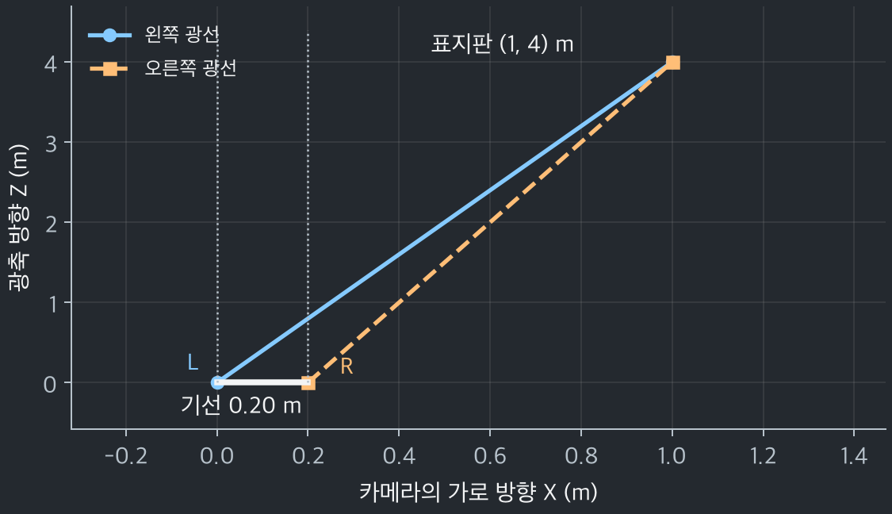

지도에는 표지판이 미터로, 카메라 로그에는 같은 표지판이 픽셀로 기록된다. 지도점 하나를 실제 영상 위에 찍어 보자. 이 계산이 맞아야 10강에서 픽셀 차이를 줄여 자세를 추정할 수 있다.

## 좌표계의 방향부터 정한다

W는 세계, C는 카메라다. 이 강의에서 T_AB는 B 좌표를 A 좌표로 옮긴다. t_WC는 카메라 원점의 세계 좌표이고 R_WC의 열은 카메라 기저축을 세계에서 본 방향이다. 같은 물리적 점을 두 숫자 벡터로 표현하면 아래 관계가 성립한다.

<math xmlns="http://www.w3.org/1998/Math/MathML" display="block"><semantics><mrow><msub><mi>p</mi><mi>W</mi></msub><mo>&#x0003D;</mo><msub><mi>R</mi><mrow><mi>W</mi><mi>C</mi></mrow></msub><msub><mi>p</mi><mi>C</mi></msub><mo>&#x0002B;</mo><msub><mi>t</mi><mrow><mi>W</mi><mi>C</mi></mrow></msub><mo>&#x0002C;</mo><mspace width="2em" /><msub><mi>p</mi><mi>C</mi></msub><mo>&#x0003D;</mo><msubsup><mi>R</mi><mrow><mi>W</mi><mi>C</mi></mrow><mi>T</mi></msubsup><mo stretchy="false">&#x00028;</mo><msub><mi>p</mi><mi>W</mi></msub><mo>&#x02212;</mo><msub><mi>t</mi><mrow><mi>W</mi><mi>C</mi></mrow></msub><mo stretchy="false">&#x00029;</mo></mrow><annotation encoding="application/x-tex">p_W=R_&#123;WC}p_C+t_&#123;WC},\qquad p_C=R_&#123;WC}^T(p_W-t_&#123;WC})</annotation></semantics></math>

회전행렬은 직교하고 행렬식이 +1이다. 그래서 역회전은 전치다. 동차변환 T에 마지막 성분 1인 점을 곱하면 회전과 이동을 함께 적용한다. 마지막 성분 0인 방향벡터에는 이동이 더해지지 않는다. 두 변환 T_WB와 T_BC는 가운데 B가 이어지게 곱한다. 상대 위치를 먼저 옮겨야 하는지 먼저 돌려야 하는지 헷갈리면, 지도의 카메라 원점 자체를 대입해 역변환 결과가 0인지부터 확인하자.

## 미터를 픽셀로 보내는 계산

카메라 광축은 +Z다. 카메라가 세계의 (1,0,0) m에 있고, 카메라 좌표를 세계로 옮기는 회전이 +Z축 기준 +90°라고 하자. 세계점 (1,1,4)에서 카메라 원점을 빼면 (0,1,4), 이를 역회전하면 카메라 좌표는 (1,0,4) m다. 왜곡을 보정한 핀홀 카메라의 식은 다음과 같다.

<math xmlns="http://www.w3.org/1998/Math/MathML" display="block"><semantics><mrow><mi>u</mi><mo>&#x0003D;</mo><msub><mi>f</mi><mi>x</mi></msub><mi>X</mi><mo>&#x0002F;</mo><mi>Z</mi><mo>&#x0002B;</mo><msub><mi>c</mi><mi>x</mi></msub><mo>&#x0002C;</mo><mspace width="2em" /><mi>v</mi><mo>&#x0003D;</mo><msub><mi>f</mi><mi>y</mi></msub><mi>Y</mi><mo>&#x0002F;</mo><mi>Z</mi><mo>&#x0002B;</mo><msub><mi>c</mi><mi>y</mi></msub><mo>&#x0002C;</mo><mspace width="2em" /><mi>Z</mi><mo>&#x0003E;</mo><mn>0</mn></mrow><annotation encoding="application/x-tex">u=f_x X/Z+c_x,\qquad v=f_y Y/Z+c_y,\qquad Z&gt;0</annotation></semantics></math>

초점거리 fₓ=fᵧ=400 px, 주점 (320,240) px이면 표지판은 (420,240) px에 찍힌다. Z로 나누므로 (2,0,8)도 같은 픽셀에 찍힌다. 단일 영상의 한 점이 제공하는 것은 광선 방향이다. 지도에 깊이를 넣으려면 다른 시점, 거리 센서, 사전정보 중 무엇을 썼는지 확인해야 한다.

<figure class="lecture-figure" markdown="0"><figcaption>위에서 본 X–Z 단면이다. 세로 점선은 두 광축이고 실선과 파선은 각 카메라에서 같은 표지판을 본 광선이다. 가로·세로 축척은 다르다.</figcaption></figure>

## 스테레오가 멀리서 약해지는 이유

수평 기선 B=0.20 m이고 두 카메라의 초점거리와 주점이 같은 정류 스테레오를 가정한다. 오른쪽 카메라가 +X 방향에 있다면 시차 d=u_L−u_R=fB/Z다. 방금 표지판은 왼쪽 420 px, 오른쪽 400 px에 보여 깊이 4 m가 된다. 양의 시차만 사용하는 이 모델에서 분모가 작을수록 깊이 추정은 예민해진다.

<math xmlns="http://www.w3.org/1998/Math/MathML" display="block"><semantics><mrow><mi>Z</mi><mo>&#x0003D;</mo><mfrac><mrow><mi>f</mi><mi>B</mi></mrow><mrow><mi>d</mi></mrow></mfrac><mo>&#x0002C;</mo><mspace width="2em" /><msub><mi>&#x003C3;</mi><mi>Z</mi></msub><mo>&#x02248;</mo><mfrac><mrow><mi>f</mi><mi>B</mi></mrow><mrow><msup><mi>d</mi><mn>2</mn></msup></mrow></mfrac><msub><mi>&#x003C3;</mi><mi>d</mi></msub></mrow><annotation encoding="application/x-tex">Z=\frac&#123;fB}&#123;d},\qquad \sigma_Z\approx\frac&#123;fB}&#123;d^2}\sigma_d</annotation></semantics></math>

시차 표준편차가 0.5 px이면 d=20 px에서는 깊이 표준편차 약 0.10 m, d=10 px에서는 0.40 m다. 이는 시차 오차가 작을 때의 1차 근사다. 시차가 0에 가까우면 깊이 분포가 비대칭이 되어 같은 공식을 신뢰하기 어렵다.

## 같은 자세, 다른 센서식

거리·방위각 센서는 같은 카메라 투영과 달리 벡터의 길이와 각도를 직접 사용한다. IMU의 자이로는 각속도를, 가속도계는 중력을 뺀 비력을 센서 좌표로 읽는다. R_WB가 몸체에서 세계로 보내는 회전이면 이상적인 비력은 R_WBᵀ(a_W−g_W)다. 정지할 때 가속도계가 0을 읽는다고 가정하고 위치를 적분하면 중력 방향으로 큰 오류가 생긴다. 로그에서 센서가 이미 중력을 제거해 내보내는지도 확인하자.

## 구현에서 회전 표현을 고르는 기준

오일러각 세 개는 사람이 자세를 읽기에 편하지만 회전 순서를 지정해야 하고, 특정 자세에서는 서로 다른 각도 변화가 같은 운동을 나타낸다. 단위 쿼터니언은 네 성분의 노름을 1로 유지해야 하며 q와 −q가 같은 회전을 나타낸다. 같은 자세를 표현한 두 로그 사이에서 부호가 뒤집혔다고 실제 360° 회전이 일어난 것은 아니다. 행렬로 바꾸어 두 기저벡터를 어디로 보내는지 확인하면 축 순서와 부호 오류를 찾기 쉽다. 이 문제를 연속적으로 처리하는 방법이 다음 강의의 지수지도와 국소 보간이다.

## 확인 문제

같은 카메라를 광축 방향으로 표지판에 1 m 가까이 옮겼다. 회전은 고정이다. 왼쪽 픽셀은 어디로 갈까?

풀이 보기

카메라 좌표는 (1,0,3)이 된다. u=320+400/3≈453.3 px, v=240 px다. 깊이가 작아지면서 영상 중심에서 더 바깥쪽으로 움직인다.

