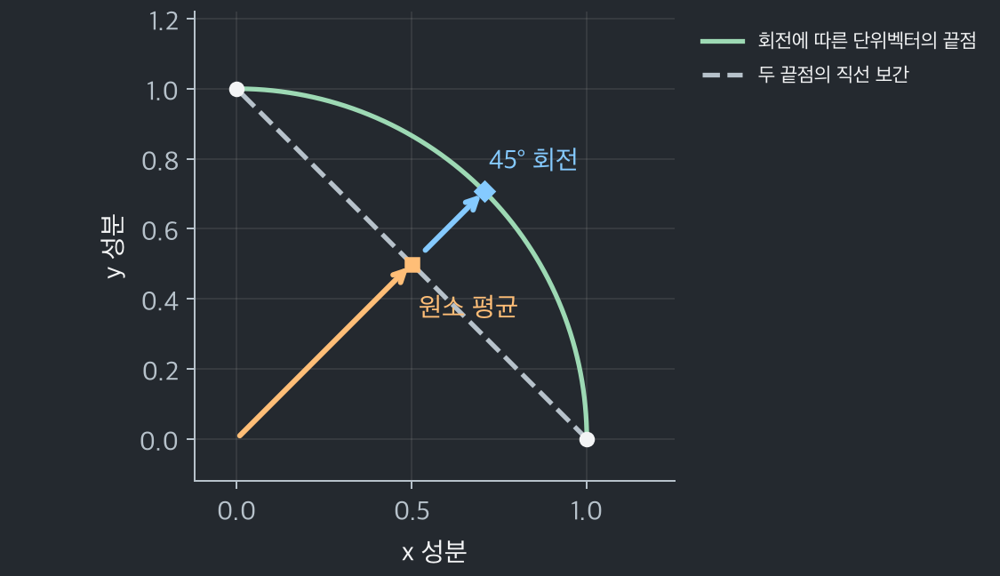

두 시각의 자세가 각각 0°와 90°다. 중간 시각에 두 회전행렬을 더해 절반으로 나누면 45° 회전일까? 직접 단위벡터에 곱해 보면 방향은 맞는데 길이가 줄어든다. 회전을 추정하려면 계산이 끝나도 여전히 회전인 연산이 필요하다.

## 원 위에서 먼저 틀려 본다

평면에서 I와 90° 회전행렬의 원소별 평균 A는 다음과 같다. A의 첫 열 길이는 1/√2이고 행렬식은 1/2다. 45° 회전의 첫 열 길이와 행렬식은 모두 1이다. 3차원에서도 SO(3)의 조건 RᵀR=I, det R=1을 지켜야 한다.

<math xmlns="http://www.w3.org/1998/Math/MathML" display="block"><semantics><mrow><mi>A</mi><mo>&#x0003D;</mo><mfrac><mn>1</mn><mn>2</mn></mfrac><mo>&#x0005B;</mo><mtable><mtr><mtd><mn>1</mn></mtd><mtd><mo>&#x02212;</mo><mn>1</mn></mtd></mtr><mtr><mtd><mn>1</mn></mtd><mtd><mn>1</mn></mtd></mtr></mtable><mo>&#x0005D;</mo><mo>&#x0002C;</mo><mspace width="2em" /><msup><mi>A</mi><mi>T</mi></msup><mi>A</mi><mo>&#x0003D;</mo><mfrac><mn>1</mn><mn>2</mn></mfrac><mi>I</mi></mrow><annotation encoding="application/x-tex">A=\frac12\begin&#123;bmatrix}1&amp;-1\\1&amp;1\end&#123;bmatrix},\qquad A^TA=\frac12 I</annotation></semantics></math>

두 회전 사이의 상대 회전을 먼저 구하고, 이를 접공간에서 절반으로 줄인 뒤 원래 회전에 합성할 수 있다. 여기서 Log는 행렬 로그, Exp는 행렬 지수를 나타낸다. 상대각이 π 미만인 짧은 가지를 선택한다.

<math xmlns="http://www.w3.org/1998/Math/MathML" display="block"><semantics><mrow><mi>R</mi><mo stretchy="false">&#x00028;</mo><mi>s</mi><mo stretchy="false">&#x00029;</mo><mo>&#x0003D;</mo><msub><mi>R</mi><mn>0</mn></msub><mo>Exp</mo><mo minsize="1.2em" maxsize="1.2em">(</mo><mi>s</mi><mo>Log</mo><mo stretchy="false">&#x00028;</mo><msubsup><mi>R</mi><mn>0</mn><mi>T</mi></msubsup><msub><mi>R</mi><mn>1</mn></msub><mo stretchy="false">&#x00029;</mo><mo minsize="1.2em" maxsize="1.2em">)</mo><mo>&#x0002C;</mo><mspace width="2em" /><mn>0</mn><mo>&#x02264;</mo><mi>s</mi><mo>&#x02264;</mo><mn>1</mn></mrow><annotation encoding="application/x-tex">R(s)=R_0\operatorname&#123;Exp}\big(s\operatorname&#123;Log}(R_0^TR_1)\big),\qquad 0\le s\le1</annotation></semantics></math>

<figure class="lecture-figure" markdown="0"><figcaption>오른쪽 단위벡터가 위쪽으로 돌아간다. 직선의 중점과 원호의 중점은 방향이 같지만 원점까지의 거리가 다르다.</figcaption></figure>

## 접공간에서 미분하고 군에서 갱신한다

3차원 작은 회전벡터 δθ의 방향은 회전축, 길이는 라디안이다. 쐐기 연산은 벡터를 반대칭 행렬로 바꾼다. δθ̂p=δθ×p다. Rodrigues 공식은 θ=‖δθ‖, 단위축 a일 때 아래와 같다. θ가 0에 가까울 때는 급수나 안정적인 라이브러리 구현을 사용한다.

<math xmlns="http://www.w3.org/1998/Math/MathML" display="block"><semantics><mrow><mo>Exp</mo><mo stretchy="false">&#x00028;</mo><mi>&#x003B8;</mi><mover><mi>a</mi><mo stretchy="false">&#x0005E;</mo></mover><mo stretchy="false">&#x00029;</mo><mo>&#x0003D;</mo><mi>I</mi><mo>&#x0002B;</mo><mi>sin</mi><mi>&#x003B8;</mi><mspace width="0.167em" /><mover><mi>a</mi><mo stretchy="false">&#x0005E;</mo></mover><mo>&#x0002B;</mo><mo stretchy="false">&#x00028;</mo><mn>1</mn><mo>&#x02212;</mo><mi>cos</mi><mi>&#x003B8;</mi><mo stretchy="false">&#x00029;</mo><msup><mover><mi>a</mi><mo stretchy="false">&#x0005E;</mo></mover><mn>2</mn></msup></mrow><annotation encoding="application/x-tex">\operatorname&#123;Exp}(\theta\hat a)=I+\sin\theta\,\hat a+(1-\cos\theta)\hat a^2</annotation></semantics></math>

R←R Exp(δθ̂)는 몸체 기준 오른쪽 섭동이다. 같은 물리적 미소 회전을 세계 기준으로 쓸 때는 왼쪽에 곱하며 δθ_W=Rδθ_B다. 이 관례에서 몸체 각속도 ω_B를 적분하는 식은 Ṙ=Rω̂_B다. 서로 다른 축 회전은 일반적으로 교환되지 않아서 큰 회전벡터를 단순히 더하면 합성이 틀린다. BCH 전개에는 두 섭동의 순서에 따른 교환자 항이 등장한다.

## 회전만 있는 좌표 변환을 자세로 확장한다

SE(3)의 미소 좌표를 (ρ,φ), 곧 이동 다음 회전 순서로 쌓자. T=(R,t)의 Adjoint는 같은 국소 운동을 다른 좌표로 옮긴다. 지렛팔 t 때문에 회전 오차가 위치 오차에도 영향을 준다.

<math xmlns="http://www.w3.org/1998/Math/MathML" display="block"><semantics><mrow><mi>&#x003B4;</mi><msub><mi>&#x003BE;</mi><mi>L</mi></msub><mo>&#x0003D;</mo><msub><mo>Ad</mo><mi>T</mi></msub><mi>&#x003B4;</mi><msub><mi>&#x003BE;</mi><mi>R</mi></msub><mo>&#x0002C;</mo><mspace width="2em" /><msub><mo>Ad</mo><mi>T</mi></msub><mo>&#x0003D;</mo><mo>&#x0005B;</mo><mtable><mtr><mtd><mi>R</mi></mtd><mtd><mover><mi>t</mi><mo stretchy="false">&#x0005E;</mo></mover><mi>R</mi></mtd></mtr><mtr><mtd><mn>0</mn></mtd><mtd><mi>R</mi></mtd></mtr></mtable><mo>&#x0005D;</mo></mrow><annotation encoding="application/x-tex">\delta\xi_L=\operatorname&#123;Ad}_T\delta\xi_R,\qquad \operatorname&#123;Ad}_T=\begin&#123;bmatrix}R&amp;\hat tR\\0&amp;R\end&#123;bmatrix}</annotation></semantics></math>

몸체 원점에서 2 m 떨어진 센서의 위치를 계산할 때, 몸체가 그 원점 둘레에서 0.01 rad만큼 잘못 회전한 것으로 추정되면, 회전축에 수직인 경우 위치에 약 0.02 m의 차이가 생긴다. 같은 자세 불확실성을 좌우 표현 사이에 옮길 때 공분산도 Ad_T Σ_R Ad_Tᵀ로 보낸다. 서로 상관된 두 자세를 합성할 때는 교차 공분산까지 필요하다. 이 사실을 무시하면 같은 오도메트리에서 파생된 두 추정치를 독립 정보로 더하게 된다.

교재 말미의 대칭성에서 **불변**은 좌표 표현을 함께 바꾸어도 잔차의 비용 같은 값이 같다는 뜻이고, **등변**은 입력을 변환하면 출력도 정해진 방식대로 변환된다는 뜻이다. 지도의 원점을 옮겼을 때 상대 측정의 비용이 그대로인지 검사하면 좌표계 구현을 점검할 수 있다.

## 잔차의 야코비안에도 섭동 방향이 나타난다

고정 대응점 p를 회전해 q와 맞추는 잔차를 r=q−Rp라고 하자. 몸체 기준의 오른쪽 섭동 R Exp(δθ̂)를 넣고 Exp(δθ̂)≈I+δθ̂만 남긴다. δθ×p=−p̂δθ이므로 다음 결과를 얻는다.

<math xmlns="http://www.w3.org/1998/Math/MathML" display="block"><semantics><mrow><mi>r</mi><mo stretchy="false">&#x00028;</mo><mi>&#x003B4;</mi><mi>&#x003B8;</mi><mo stretchy="false">&#x00029;</mo><mo>&#x02248;</mo><mi>q</mi><mo>&#x02212;</mo><mi>R</mi><mi>p</mi><mo>&#x0002B;</mo><mi>R</mi><mover><mi>p</mi><mo stretchy="false">&#x0005E;</mo></mover><mspace width="0.167em" /><mi>&#x003B4;</mi><mi>&#x003B8;</mi></mrow><annotation encoding="application/x-tex">r(\delta\theta)\approx q-Rp+R\hat p\,\delta\theta</annotation></semantics></math>

p=(1,0,0), R=I에서 +z로 0.01 rad 돌리면 예측점의 y는 약 +0.01, 관측에서 예측을 빼는 잔차의 y 성분은 약 0.01만큼 감소한다. 실제 코드에서 한 축씩 작은 수를 넣어 확인하면 미분의 부호를 검증할 수 있다. 왼쪽 섭동이라면 같은 유도에서 야코비안이 (Rp)의 쐐기 행렬로 바뀐다.

## 확인 문제

+170°에서 −170°까지 가장 짧은 길로 보간하면 중간 방향은 몇 도일까?

풀이 보기

두 자세 사이의 짧은 상대각은 +20°다. 절반인 +10°를 더하면 180°(동치인 −180°)다. 원시 각도 두 수를 평균해 얻는 0°는 반대편을 가리킨다.

