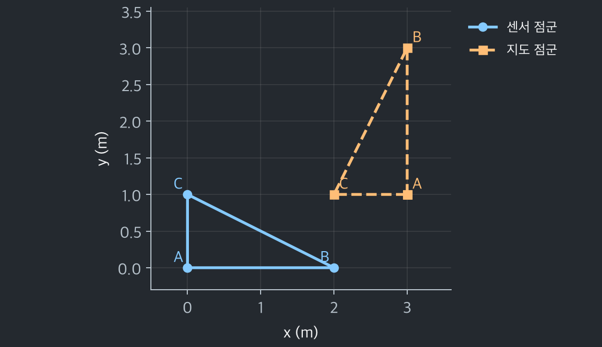

지도에 같은 반사체 세 개가 있고 로봇도 이를 한꺼번에 관측했다. 어느 점이 어느 반사체인지는 안다고 하자. 이번 시간에는 **지도점이 고정된 경우**에 한 자세를 먼저 구하고, 여러 시각의 자세와 IMU를 연결한다. 다음 장에서는 지도점까지 미지수로 바꾼다.

## 중심을 빼면 회전만 남는다

센서 좌표점 pᵢ를 고정 지도점 qᵢ로 옮기는 R,t를 구한다. 대응이 정확하고 각 점의 독립 오차가 같은 등방성 가우시안이면 최대우도 문제는 다음 최소제곱이 된다.

<math xmlns="http://www.w3.org/1998/Math/MathML" display="block"><semantics><mrow><msub><mo>min</mo><mrow><mi>R</mi><mo>&#x02208;</mo><mi>S</mi><mi>O</mi><mo stretchy="false">&#x00028;</mo><mn>3</mn><mo stretchy="false">&#x00029;</mo><mo>&#x0002C;</mo><mi>t</mi></mrow></msub><munder><mo>&#x02211;</mo><mi>i</mi></munder><mo fence="false" stretchy="false">&#x02016;</mo><msub><mi>q</mi><mi>i</mi></msub><mo>&#x02212;</mo><mi>R</mi><msub><mi>p</mi><mi>i</mi></msub><mo>&#x02212;</mo><mi>t</mi><msup><mo fence="false" stretchy="false">&#x02016;</mo><mn>2</mn></msup><mo>&#x0002C;</mo><mspace width="2em" /><msup><mi>t</mi><mo>&#x022C6;</mo></msup><mo>&#x0003D;</mo><mover><mi>q</mi><mo stretchy="true">&#x000AF;</mo></mover><mo>&#x02212;</mo><mi>R</mi><mover><mi>p</mi><mo stretchy="true">&#x000AF;</mo></mover></mrow><annotation encoding="application/x-tex">\min_&#123;R\in SO(3),t}\sum_i\|q_i-Rp_i-t\|^2,\qquad t^\star=\bar q-R\bar p</annotation></semantics></math>

t로 미분하면 이동은 두 중심의 차이로 정해진다. 중심을 뺀 점들로 H를 만들고 특이값 분해를 하면, 회전이 두 점군을 가장 잘 겹치도록 정할 수 있다. H를 어느 순서로 쌓았는지에 따라 U와 V의 순서가 바뀐다.

<math xmlns="http://www.w3.org/1998/Math/MathML" display="block"><semantics><mrow><mi>H</mi><mo>&#x0003D;</mo><munder><mo>&#x02211;</mo><mi>i</mi></munder><mo stretchy="false">&#x00028;</mo><msub><mi>p</mi><mi>i</mi></msub><mo>&#x02212;</mo><mover><mi>p</mi><mo stretchy="true">&#x000AF;</mo></mover><mo stretchy="false">&#x00029;</mo><mo stretchy="false">&#x00028;</mo><msub><mi>q</mi><mi>i</mi></msub><mo>&#x02212;</mo><mover><mi>q</mi><mo stretchy="true">&#x000AF;</mo></mover><msup><mo stretchy="false">&#x00029;</mo><mi>T</mi></msup><mo>&#x0003D;</mo><mi>U</mi><mi>&#x003A3;</mi><msup><mi>V</mi><mi>T</mi></msup><mo>&#x0002C;</mo><mspace width="2em" /><msup><mi>R</mi><mo>&#x022C6;</mo></msup><mo>&#x0003D;</mo><mi>V</mi><mo>diag</mo><mo stretchy="false">&#x00028;</mo><mn>1</mn><mo>&#x0002C;</mo><mn>1</mn><mo>&#x0002C;</mo><mo movablelimits="true">det</mo><mo stretchy="false">&#x00028;</mo><mi>V</mi><msup><mi>U</mi><mi>T</mi></msup><mo stretchy="false">&#x00029;</mo><mo stretchy="false">&#x00029;</mo><msup><mi>U</mi><mi>T</mi></msup></mrow><annotation encoding="application/x-tex">H=\sum_i(p_i-\bar p)(q_i-\bar q)^T=U\Sigma V^T,\qquad R^\star=V\operatorname&#123;diag}(1,1,\det(VU^T))U^T</annotation></semantics></math>

마지막 행렬식 항은 반사가 해로 들어오는 것을 막는다. 교재는 단위 쿼터니언 제약으로 회전을 구하는 경로도 보인다. 점마다 불확실성의 방향과 크기가 다른 경우에는 같은 닫힌형 해를 그대로 쓸 수 있는지 다시 따져야 한다. 대응을 모르면 정합 전에 대응 추정까지 추가된다.

<figure class="lecture-figure" markdown="0"><figcaption>같은 글자가 대응점이다. A에서 B로 향하는 변을 보면 회전을, 회전한 A의 위치를 보면 이동을 바로 읽을 수 있다.</figcaption></figure>

평면 검산에서는 p가 (0,0), (2,0), (0,1)이고, q가 (3,1), (3,3), (2,1)이다. 첫 두 점 사이 방향이 오른쪽에서 위로 바뀌었으므로 회전은 +90°다. p의 중심 (2/3,1/3)을 돌리면 (−1/3,2/3)이고, q의 중심 (8/3,5/3)에서 빼면 이동은 (3,1) m다. 세 점 모두에 대입하면 잔차는 0이다.

## 여러 프레임을 따로 맞출 때와 함께 맞출 때

한 시각의 정합만 반복하면 점이 적게 보이는 프레임에서 자세가 불안정하다. 추적 EKF는 운동으로 다음 자세를 예측하고 점 잔차로 현재를 갱신한다. 배치 MAP은 이동 사전과 여러 프레임의 관측을 함께 넣어 지나간 자세도 수정할 수 있다. 점 좌표가 사라지고 상대 자세 측정 Zᵢⱼ만 남은 경우에는 포즈 그래프를 만든다. Tᵢ가 몸체에서 세계로 보내는 자세라면 일치 여부를 국소 좌표로 쓴 잔차는 다음과 같다. ∨는 행렬 리 대수 원소를 벡터로 바꾼다.

<math xmlns="http://www.w3.org/1998/Math/MathML" display="block"><semantics><mrow><msub><mi>r</mi><mrow><mi>i</mi><mi>j</mi></mrow></msub><mo>&#x0003D;</mo><mo>Log</mo><mo stretchy="false">&#x00028;</mo><msubsup><mi>Z</mi><mrow><mi>i</mi><mi>j</mi></mrow><mrow><mo>&#x02212;</mo><mn>1</mn></mrow></msubsup><msubsup><mi>T</mi><mi>i</mi><mrow><mo>&#x02212;</mo><mn>1</mn></mrow></msubsup><msub><mi>T</mi><mi>j</mi></msub><msup><mo stretchy="false">&#x00029;</mo><mo>&#x02228;</mo></msup></mrow><annotation encoding="application/x-tex">r_&#123;ij}=\operatorname&#123;Log}(Z_&#123;ij}^&#123;-1}T_i^&#123;-1}T_j)^\vee</annotation></semantics></math>

상대 제약만 있으면 궤적 전체를 함께 움직여도 비용이 같다. 한 자세를 고정한 뒤 각 잔차를 공분산의 역행렬로 가중해 최소화한다. 폐루프 제약 하나가 먼 시각들을 잇기 때문에, 단순 순차 곱으로 모든 관측을 만족시킬 수 없는 경우가 생긴다.

## IMU는 자세 사이를 어떻게 잇는가?

R이 몸체에서 세계로 보내는 회전, f가 바이어스를 보정한 비력일 때 세계 가속도는 Rf+g다. 회전과 속도, 위치를 함께 전파한다. IMU만 적분하면 작은 바이어스가 누적된다. **사전적분**은 두 키프레임 사이의 빠른 IMU 눈금들을 시작 키프레임의 기준에서 상대 회전·속도·위치 제약으로 묶는다. 아래는 시간 간격 Δt에서 속도 부분의 이상적 관계다.

<math xmlns="http://www.w3.org/1998/Math/MathML" display="block"><semantics><mrow><mi>&#x00394;</mi><msub><mi>v</mi><mrow><mi>i</mi><mi>j</mi></mrow></msub><mo>&#x02243;</mo><msubsup><mi>R</mi><mi>i</mi><mi>T</mi></msubsup><mo stretchy="false">&#x00028;</mo><msub><mi>v</mi><mi>j</mi></msub><mo>&#x02212;</mo><msub><mi>v</mi><mi>i</mi></msub><mo>&#x02212;</mo><mi>g</mi><mi>&#x00394;</mi><mi>t</mi><mo stretchy="false">&#x00029;</mo></mrow><annotation encoding="application/x-tex">\Delta v_&#123;ij}\simeq R_i^T(v_j-v_i-g\Delta t)</annotation></semantics></math>

실제 팩터에는 바이어스 선형화점과 공분산이 함께 들어간다. 자세 후보를 수정할 때마다 원시 IMU 전체를 다시 적분하는 비용을 줄이되, 바이어스 변화가 크면 재적분이 필요할 수 있다.

## 어떤 방향의 자세가 약한지 계산하기

고정 지도점의 관측을 선형화한 야코비안을 Jᵢ, 관측 공분산을 Σᵢ라고 하자. 각 관측이 추가하는 국소 정보는 JᵢᵀΣᵢ⁻¹Jᵢ다. 여러 점을 합한 정보행렬의 작은 고유값은 그 고유벡터 방향으로 자세를 움직여도 측정이 거의 변하지 않는다는 뜻이다. 이동과 회전을 한 행렬에 담으므로 고유값 크기를 비교할 때 미터와 라디안의 스케일도 고려해야 한다. 예측 오차만 보고 추적 성공을 선언하는 대신, 갱신 전후의 공분산과 잘 보이지 않는 방향을 함께 기록하면 점이 좁은 영역에 몰린 구간을 진단할 수 있다.

## 확인 문제

3차원 점들이 전부 한 직선 위에 있다. 대응이 완벽하면 모든 회전을 알아낼 수 있을까?

풀이 보기

그 직선 자체를 축으로 점군을 돌려도 관측된 점 배치는 같다. 정합 오차가 0이어도 회전 한 자유도는 결정되지 않는다. 직선에서 떨어진 대응점이나 다른 방향을 제한하는 센서를 추가해야 한다.

