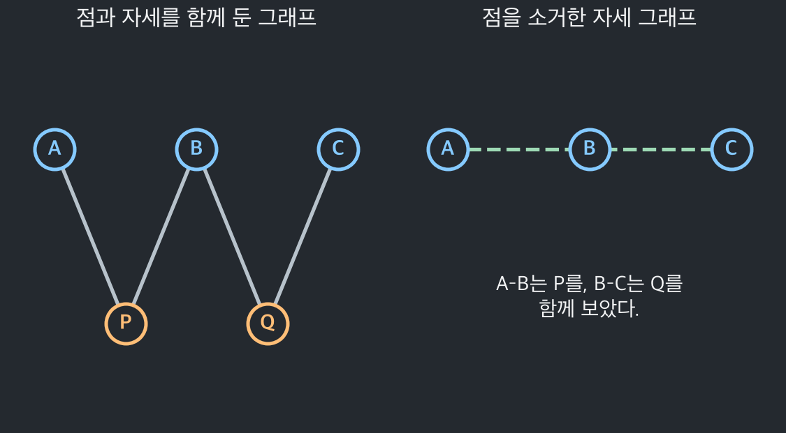

카메라를 오른쪽으로 10 cm 옮겨도 픽셀이 바뀌고, 물체를 왼쪽으로 10 cm 옮겨도 픽셀이 바뀐다. 실제 영상만 주어졌을 때 어느 쪽을 고쳐야 할까? 번들 조정(BA)은 같은 점을 여러 시점에서 본 기록을 묶어 **카메라 자세와 지도점**을 함께 추정한다.

## 픽셀 하나가 연결하는 두 변수

T_WCᵢ는 카메라 i에서 세계로 보내는 자세이고 mⱼ는 세계 좌표의 j번째 지도점이다. R_WCᵢ와 t_WCᵢ는 그 자세의 회전과 카메라 원점의 세계 좌표다. π는 7강에서 쓴 카메라 투영이다. 실제 픽셀 uᵢⱼ와 투영값의 차이를 구하고, 보인 쌍들만 더한다. 가중 노름은 ‖r‖²_W=rᵀWr이다.

<math xmlns="http://www.w3.org/1998/Math/MathML" display="block"><semantics><mrow><msub><mi>r</mi><mrow><mi>i</mi><mi>j</mi></mrow></msub><mo>&#x0003D;</mo><msub><mi>u</mi><mrow><mi>i</mi><mi>j</mi></mrow></msub><mo>&#x02212;</mo><mi>&#x003C0;</mi><mo stretchy="false">&#x00028;</mo><msubsup><mi>R</mi><mrow><mi>W</mi><msub><mi>C</mi><mi>i</mi></msub></mrow><mi>T</mi></msubsup><mo stretchy="false">&#x00028;</mo><msub><mi>m</mi><mi>j</mi></msub><mo>&#x02212;</mo><msub><mi>t</mi><mrow><mi>W</mi><msub><mi>C</mi><mi>i</mi></msub></mrow></msub><mo stretchy="false">&#x00029;</mo><mo stretchy="false">&#x00029;</mo><mo>&#x0002C;</mo><mspace width="2em" /><mi>J</mi><mo>&#x0003D;</mo><mfrac><mn>1</mn><mn>2</mn></mfrac><munder><mo>&#x02211;</mo><mrow><mo stretchy="false">&#x00028;</mo><mi>i</mi><mo>&#x0002C;</mo><mi>j</mi><mo stretchy="false">&#x00029;</mo><mo>&#x02208;</mo><mi mathvariant="script">O</mi></mrow></munder><mo fence="false" stretchy="false">&#x02016;</mo><msub><mi>r</mi><mrow><mi>i</mi><mi>j</mi></mrow></msub><msubsup><mo fence="false" stretchy="false">&#x02016;</mo><mrow><msubsup><mi>&#x003A3;</mi><mrow><mi>i</mi><mi>j</mi></mrow><mrow><mo>&#x02212;</mo><mn>1</mn></mrow></msubsup></mrow><mn>2</mn></msubsup></mrow><annotation encoding="application/x-tex">r_&#123;ij}=u_&#123;ij}-\pi(R_&#123;WC_i}^T(m_j-t_&#123;WC_i})),\qquad J=\frac12\sum_&#123;(i,j)\in\mathcal O}\|r_&#123;ij}\|_&#123;\Sigma_&#123;ij}^&#123;-1}}^2</annotation></semantics></math>

같은 지도점이 여러 영상에 나타나면 하나의 점 위치가 여러 자세의 추정을 묶는다. 책에서 다루는 SLAM 배치 문제는 여기에 운동 모델과 사전분포의 잔차를 더한다. 단안 영상만 사용하면 전체 자세와 지도를 함께 회전·평행이동·스케일 변환해도 투영이 같다. 첫 자세를 고정해도 미터 척도 하나는 남는다. 알려진 기선이나 거리 측정은 이를 제한할 수 있다.

## 큰 행렬을 왜 둘로 쪼개는가?

한 번 선형화한 정규방정식에서 자세 증분을 δp, 지도점 증분을 δm으로 모아 보자. B, C는 각각 자세와 점에 대한 정보 블록, E는 둘을 잇는 블록이다. a, b는 음의 기울기를 나눈 것이다.

<math xmlns="http://www.w3.org/1998/Math/MathML" display="block"><semantics><mrow><mo>&#x0005B;</mo><mtable><mtr><mtd><mi>B</mi></mtd><mtd><mi>E</mi></mtd></mtr><mtr><mtd><msup><mi>E</mi><mi>T</mi></msup></mtd><mtd><mi>C</mi></mtd></mtr></mtable><mo>&#x0005D;</mo><mo>&#x0005B;</mo><mtable><mtr><mtd><mi>&#x003B4;</mi><mi>p</mi></mtd></mtr><mtr><mtd><mi>&#x003B4;</mi><mi>m</mi></mtd></mtr></mtable><mo>&#x0005D;</mo><mo>&#x0003D;</mo><mo>&#x0005B;</mo><mtable><mtr><mtd><mi>a</mi></mtd></mtr><mtr><mtd><mi>b</mi></mtd></mtr></mtable><mo>&#x0005D;</mo></mrow><annotation encoding="application/x-tex">\begin&#123;bmatrix}B&amp;E\\E^T&amp;C\end&#123;bmatrix}\begin&#123;bmatrix}\delta p\\\delta m\end&#123;bmatrix}=\begin&#123;bmatrix}a\\b\end&#123;bmatrix}</annotation></semantics></math>

점끼리 직접 이어지는 팩터가 없다면 C는 점별 블록 대각이다. 각 점 블록을 풀 수 있다고 하고 두 번째 줄에서 δm을 구해 첫 줄에 대입한다. 이렇게 점을 먼저 소거해 얻는 행렬이 슈어 보완이다.

<math xmlns="http://www.w3.org/1998/Math/MathML" display="block"><semantics><mrow><mo stretchy="false">&#x00028;</mo><mi>B</mi><mo>&#x02212;</mo><mi>E</mi><msup><mi>C</mi><mrow><mo>&#x02212;</mo><mn>1</mn></mrow></msup><msup><mi>E</mi><mi>T</mi></msup><mo stretchy="false">&#x00029;</mo><mi>&#x003B4;</mi><mi>p</mi><mo>&#x0003D;</mo><mi>a</mi><mo>&#x02212;</mo><mi>E</mi><msup><mi>C</mi><mrow><mo>&#x02212;</mo><mn>1</mn></mrow></msup><mi>b</mi><mo>&#x0002C;</mo><mspace width="2em" /><mi>&#x003B4;</mi><mi>m</mi><mo>&#x0003D;</mo><msup><mi>C</mi><mrow><mo>&#x02212;</mo><mn>1</mn></mrow></msup><mo stretchy="false">&#x00028;</mo><mi>b</mi><mo>&#x02212;</mo><msup><mi>E</mi><mi>T</mi></msup><mi>&#x003B4;</mi><mi>p</mi><mo stretchy="false">&#x00029;</mo></mrow><annotation encoding="application/x-tex">(B-EC^&#123;-1}E^T)\delta p=a-EC^&#123;-1}b,\qquad \delta m=C^&#123;-1}(b-E^T\delta p)</annotation></semantics></math>

실제 계산은 C⁻¹를 전부 만드는 대신 작은 블록 선형계를 푼다. 같은 점을 함께 본 카메라들 사이에 새 연결이 생긴다. 따라서 어느 카메라가 어느 점을 보았는지가 메모리와 분해 비용을 결정한다. 시차가 거의 없는 점은 깊이 방향이 약해 C 블록이 불안정할 수 있다.

<figure class="lecture-figure" markdown="0"><figcaption>왼쪽의 파란 노드는 자세, 주황 노드는 지도점이다. 오른쪽 파선은 공통 지도점을 소거하면서 자세 사이에 생긴 결합을 나타낸다.</figcaption></figure>

## 손으로 한 번 소거해 보자

1차원 레일에서 첫 자세는 원점에 고정했다. 두 번째 자세 p의 이동 측정은 2 m, 첫 자세에서 본 지도점 m의 위치 측정은 5 m, 두 번째 자세에서 본 상대 위치 m−p는 2 m다. 독립 잡음 분산을 모두 1 m²로 두면 다음 식이 나온다. 선형 예제라 미지수 자체를 한 번에 풀어도 된다.

<math xmlns="http://www.w3.org/1998/Math/MathML" display="block"><semantics><mrow><mn>2</mn><mi>J</mi><mo>&#x0003D;</mo><mo stretchy="false">&#x00028;</mo><mi>p</mi><mo>&#x02212;</mo><mn>2</mn><msup><mo stretchy="false">&#x00029;</mo><mn>2</mn></msup><mo>&#x0002B;</mo><mo stretchy="false">&#x00028;</mo><mi>m</mi><mo>&#x02212;</mo><mn>5</mn><msup><mo stretchy="false">&#x00029;</mo><mn>2</mn></msup><mo>&#x0002B;</mo><mo stretchy="false">&#x00028;</mo><mi>m</mi><mo>&#x02212;</mo><mi>p</mi><mo>&#x02212;</mo><mn>2</mn><msup><mo stretchy="false">&#x00029;</mo><mn>2</mn></msup><mo>&#x0002C;</mo><mspace width="2em" /><mo>&#x0005B;</mo><mtable><mtr><mtd><mn>2</mn></mtd><mtd><mo>&#x02212;</mo><mn>1</mn></mtd></mtr><mtr><mtd><mo>&#x02212;</mo><mn>1</mn></mtd><mtd><mn>2</mn></mtd></mtr></mtable><mo>&#x0005D;</mo><mo>&#x0005B;</mo><mtable><mtr><mtd><mi>p</mi></mtd></mtr><mtr><mtd><mi>m</mi></mtd></mtr></mtable><mo>&#x0005D;</mo><mo>&#x0003D;</mo><mo>&#x0005B;</mo><mtable><mtr><mtd><mn>0</mn></mtd></mtr><mtr><mtd><mn>7</mn></mtd></mtr></mtable><mo>&#x0005D;</mo></mrow><annotation encoding="application/x-tex">2J=(p-2)^2+(m-5)^2+(m-p-2)^2,\qquad \begin&#123;bmatrix}2&amp;-1\\-1&amp;2\end&#123;bmatrix}\begin&#123;bmatrix}p\\m\end&#123;bmatrix}=\begin&#123;bmatrix}0\\7\end&#123;bmatrix}</annotation></semantics></math>

두 번째 줄로부터 m=(7+p)/2다. 첫 줄에 넣으면 (2−1/2)p=7/2, 즉 p=7/3 m, m=14/3 m다. p−2, m−5, m−p−2의 잔차는 각각 +1/3, −1/3, +1/3 m다. 원래 세 눈금은 서로 정확히 맞지 않으므로 같은 분산에서 오차를 나누어 가진다. 점을 계산 중에 없앴어도 마지막 대입으로 그 위치를 복구했다.

## 픽셀 오차 하나를 깊이 방향으로 미분해 보자

주점에서 오른쪽으로 100 px 떨어진 점이 있다. 7강처럼 X=1 m, Z=4 m, f=400 px인 예다. 다른 변수를 고정하면 픽셀 예측 u의 X와 Z에 대한 편미분은 아래와 같다.

<math xmlns="http://www.w3.org/1998/Math/MathML" display="block"><semantics><mrow><mfrac><mrow><mo>&#x02202;</mo><mi>u</mi></mrow><mrow><mo>&#x02202;</mo><mi>X</mi></mrow></mfrac><mo>&#x0003D;</mo><mfrac><mrow><mi>f</mi></mrow><mrow><mi>Z</mi></mrow></mfrac><mo>&#x0003D;</mo><mn>100</mn><mtext>&#x000A0;</mtext><mrow><mi mathvariant="normal">p</mi><mi mathvariant="normal">x</mi><mo>&#x0002F;</mo><mi mathvariant="normal">m</mi></mrow><mo>&#x0002C;</mo><mspace width="2em" /><mfrac><mrow><mo>&#x02202;</mo><mi>u</mi></mrow><mrow><mo>&#x02202;</mo><mi>Z</mi></mrow></mfrac><mo>&#x0003D;</mo><mo>&#x02212;</mo><mfrac><mrow><mi>f</mi><mi>X</mi></mrow><mrow><msup><mi>Z</mi><mn>2</mn></msup></mrow></mfrac><mo>&#x0003D;</mo><mo>&#x02212;</mo><mn>25</mn><mtext>&#x000A0;</mtext><mrow><mi mathvariant="normal">p</mi><mi mathvariant="normal">x</mi><mo>&#x0002F;</mo><mi mathvariant="normal">m</mi></mrow></mrow><annotation encoding="application/x-tex">\frac&#123;\partial u}&#123;\partial X}=\frac&#123;f}&#123;Z}=100\ &#123;\rm px/m},\qquad \frac&#123;\partial u}&#123;\partial Z}=-\frac&#123;fX}&#123;Z^2}=-25\ &#123;\rm px/m}</annotation></semantics></math>

그 점을 광선 방향으로 조금 움직여 ΔX=0.01 m, ΔZ=0.04 m라 두면 1차 픽셀 변화는 100×0.01−25×0.04=0 px다. 동일 광선 위라 실제 투영도 변하지 않는다. 다른 위치에서 시차가 생겨 두 관측 광선이 평행하지 않거나, 별도의 깊이 관측이 있어야 이 영공간을 줄일 수 있다. 이 기하학적 약점이 위에서 다룬 점 블록 C의 조건수에 나타난다.

## 확인 문제

지도점 하나가 모든 카메라에 보인다면 그 점을 소거한 뒤 자세 행렬은 어떤 모양이 될까?

풀이 보기

그 점을 본 모든 자세 쌍에 일반적으로 비영 블록이 생긴다. 미지수 수는 줄어도 행렬이 촘촘해져 비용이 늘 수 있다. 가려짐과 특징 추적 길이가 다른 데이터셋에서 BA 속도가 달라지는 이유 중 하나다.

