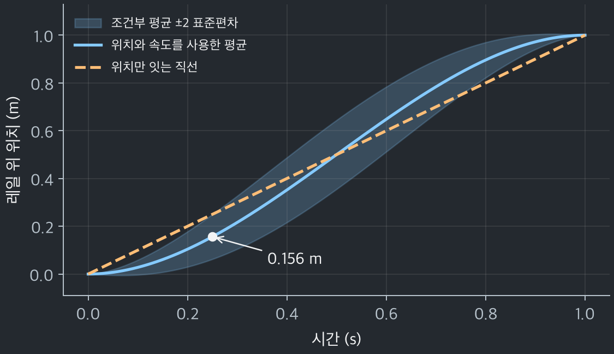

회전식 LiDAR는 한 바퀴 도는 동안 여러 시각에 점을 찍는다. 스캔 전체에 같은 자세 하나를 붙이면 주행 중 반듯한 벽도 휘어 보일 수 있다. 카메라 셔터와 IMU 시계까지 서로 다르면 어느 시각의 상태를 저장해야 할까? 마지막 강의에서는 임의의 시각 τ에 **자세와 그 불확실성**을 함께 질의한다.

## 연속 궤적에 어떤 움직임을 기대할까?

평면 레일에서 먼저 위치 p와 속도 v를 쌓는다. 평균적으로 등속이지만 가속도에 백색잡음이 들어온다고 가정한다. q는 연속시간 가속도 잡음의 스펙트럼 밀도다. 시간 간격 Δ의 상태전이와 이산 공정 잡음은 다음과 같다.

<math xmlns="http://www.w3.org/1998/Math/MathML" display="block"><semantics><mrow><mi>&#x003A6;</mi><mo stretchy="false">&#x00028;</mo><mi>&#x00394;</mi><mo stretchy="false">&#x00029;</mo><mo>&#x0003D;</mo><mo>&#x0005B;</mo><mtable><mtr><mtd><mn>1</mn></mtd><mtd><mi>&#x00394;</mi></mtd></mtr><mtr><mtd><mn>0</mn></mtd><mtd><mn>1</mn></mtd></mtr></mtable><mo>&#x0005D;</mo><mo>&#x0002C;</mo><mspace width="2em" /><mi>Q</mi><mo stretchy="false">&#x00028;</mo><mi>&#x00394;</mi><mo stretchy="false">&#x00029;</mo><mo>&#x0003D;</mo><mi>q</mi><mo>&#x0005B;</mo><mtable><mtr><mtd><msup><mi>&#x00394;</mi><mn>3</mn></msup><mo>&#x0002F;</mo><mn>3</mn></mtd><mtd><msup><mi>&#x00394;</mi><mn>2</mn></msup><mo>&#x0002F;</mo><mn>2</mn></mtd></mtr><mtr><mtd><msup><mi>&#x00394;</mi><mn>2</mn></msup><mo>&#x0002F;</mo><mn>2</mn></mtd><mtd><mi>&#x00394;</mi></mtd></mtr></mtable><mo>&#x0005D;</mo></mrow><annotation encoding="application/x-tex">\Phi(\Delta)=\begin&#123;bmatrix}1&amp;\Delta\\0&amp;1\end&#123;bmatrix},\qquad Q(\Delta)=q\begin&#123;bmatrix}\Delta^3/3&amp;\Delta^2/2\\\Delta^2/2&amp;\Delta\end&#123;bmatrix}</annotation></semantics></math>

Q의 두 대각 원소가 서로 다른 시간 거듭제곱을 갖는 이유는 위치까지 잡음이 한 번 더 적분되기 때문이다. 비대각 원소는 같은 가속도 잡음이 위치와 속도를 함께 밀었다는 정보다. 간격이 다른 센서 측정마다 같은 Q를 반복 사용하면 궤적의 부드러움과 불확실성이 관측 빈도에 따라 달라진다.

## 사이 시각은 양쪽 끝을 안다는 조건으로 추정한다

0초와 1초 위치를 0 m와 1 m, 두 끝의 속도를 모두 0 m/s로 정확히 알게 되었다고 하자. 위 사전에서 두 끝을 조건으로 한 평균은 3차 에르미트 곡선이다. s=t/(1초)는 무차원 시간이다. 이 예제의 계수는 끝점 위치·속도 네 조건을 다항식에 대입해 구할 수 있다.

<math xmlns="http://www.w3.org/1998/Math/MathML" display="block"><semantics><mrow><mover><mi>p</mi><mo stretchy="true">&#x000AF;</mo></mover><mo stretchy="false">&#x00028;</mo><mi>s</mi><mo stretchy="false">&#x00029;</mo><mo>&#x0003D;</mo><mn>3</mn><msup><mi>s</mi><mn>2</mn></msup><mo>&#x02212;</mo><mn>2</mn><msup><mi>s</mi><mn>3</mn></msup><mo>&#x0002C;</mo><mspace width="2em" /><mover><mi>p</mi><mo stretchy="true">&#x000AF;</mo></mover><mo stretchy="false">&#x00028;</mo><mn>0.25</mn><mo stretchy="false">&#x00029;</mo><mo>&#x0003D;</mo><mn>0.15625</mn><mtext>&#x000A0;</mtext><mi mathvariant="normal">m</mi></mrow><annotation encoding="application/x-tex">\bar p(s)=3s^2-2s^3,\qquad \bar p(0.25)=0.15625\ \mathrm m</annotation></semantics></math>

직선 보간은 같은 때 0.25 m를 준다. 양 끝에서 속도가 0이어야 한다는 측정이 있으므로 초반에 더 천천히 움직이는 쪽이 모델에 맞는다. 하지만 두 끝 사이의 실제 모든 가속도를 관측한 것은 아니다. 시작 상태를 정확히 고정하고 종료 상태까지 조건화한 **브리지**의 중간 공분산은 아래와 같다. T는 전체 시간이고 0<τ<T다.

<math xmlns="http://www.w3.org/1998/Math/MathML" display="block"><semantics><mrow><mi>C</mi><mo>&#x0003D;</mo><mi>Q</mi><mo stretchy="false">&#x00028;</mo><mi>&#x003C4;</mi><mo stretchy="false">&#x00029;</mo><mi>&#x003A6;</mi><mo stretchy="false">&#x00028;</mo><mi>T</mi><mo>&#x02212;</mo><mi>&#x003C4;</mi><msup><mo stretchy="false">&#x00029;</mo><mi>T</mi></msup><mo>&#x0002C;</mo><mspace width="2em" /><msub><mi>P</mi><mrow><mi>&#x003C4;</mi><mo>&#x02223;</mo><mn>0</mn><mo>&#x0002C;</mo><mi>T</mi></mrow></msub><mo>&#x0003D;</mo><mi>Q</mi><mo stretchy="false">&#x00028;</mo><mi>&#x003C4;</mi><mo stretchy="false">&#x00029;</mo><mo>&#x02212;</mo><mi>C</mi><mi>Q</mi><mo stretchy="false">&#x00028;</mo><mi>T</mi><msup><mo stretchy="false">&#x00029;</mo><mrow><mo>&#x02212;</mo><mn>1</mn></mrow></msup><msup><mi>C</mi><mi>T</mi></msup></mrow><annotation encoding="application/x-tex">C=Q(\tau)\Phi(T-\tau)^T,\qquad P_&#123;\tau\mid 0,T}=Q(\tau)-C Q(T)^&#123;-1}C^T</annotation></semantics></math>

<figure class="lecture-figure" markdown="0"><figcaption>파란 띠는 위치 평균 주위 두 표준편차다. 두 끝의 위치와 속도를 정확히 아는 예제에서는 중간에서만 불확실성이 남는다.</figcaption></figure>

그림은 q=1 m²/s³, T=1 s인 경우다. 중앙의 위치 분산은 1/192 m², 표준편차는 약 7.2 cm다. 끝점을 정확히 알기 때문에 띠 폭은 두 끝에서 0이다. 실제 궤적에서는 양 끝도 추정치이므로 두 끝의 공분산과 **상호 공분산**이 보간 결과에 추가로 전달된다. 끝점 추정치를 고정값처럼 넣으면 중간 자세를 과신한다.

## 이를 3차원 주행 로그로 옮기면

교재는 각 지지 자세 주변의 국소 리 대수 좌표에서 운동의 확률미분방정식을 다루고, 구간 예측과 다음 지지 상태의 차이를 운동 팩터로 만든다. 아래 식은 지지 자세 Tᵢ 근처에서 쓸 수 있는 한 가지 오른쪽 국소 좌표 관례다. ξ̂ᵢ(t)는 6차원 이동·회전 좌표를 행렬로 옮긴 것이다. 큰 구간에서 전역 회전벡터 하나를 쓴다고 가정하지 않는다.

<math xmlns="http://www.w3.org/1998/Math/MathML" display="block"><semantics><mrow><mi>T</mi><mo stretchy="false">&#x00028;</mo><mi>t</mi><mo stretchy="false">&#x00029;</mo><mo>&#x0003D;</mo><msub><mi>T</mi><mi>i</mi></msub><mo>Exp</mo><mo stretchy="false">&#x00028;</mo><msub><mover><mi>&#x003BE;</mi><mo stretchy="false">&#x0005E;</mo></mover><mi>i</mi></msub><mo stretchy="false">&#x00028;</mo><mi>t</mi><mo stretchy="false">&#x00029;</mo><mo stretchy="false">&#x00029;</mo><mo>&#x0002C;</mo><mspace width="2em" /><msub><mover><mi>p</mi><mo stretchy="true">&#x000AF;</mo></mover><mi>W</mi></msub><mo>&#x0003D;</mo><msub><mi>T</mi><mrow><mi>W</mi><mi>B</mi></mrow></msub><mo stretchy="false">&#x00028;</mo><msub><mi>t</mi><mrow><mi mathvariant="normal">r</mi><mi mathvariant="normal">a</mi><mi mathvariant="normal">y</mi></mrow></msub><mo stretchy="false">&#x00029;</mo><msub><mi>T</mi><mrow><mi>B</mi><mi>L</mi></mrow></msub><msub><mover><mi>p</mi><mo stretchy="true">&#x000AF;</mo></mover><mi>L</mi></msub></mrow><annotation encoding="application/x-tex">T(t)=T_i\operatorname&#123;Exp}(\hat\xi_i(t)),\qquad \bar p_W=T_&#123;WB}(t_&#123;\rm ray})T_&#123;BL}\bar p_L</annotation></semantics></math>

위 곱에서 T(t)=T_WB(t)는 몸체에서 세계로 보내는 자세, T_BL은 LiDAR에서 몸체로 보내는 고정 외부 보정이다. 막대가 붙은 점은 마지막 원소가 1인 4차원 동차좌표다. 점 하나의 시각 t_ray에 궤적을 질의해 세계로 옮기면 스캔 내 움직임을 보정할 수 있다. 이웃 지지 상태를 잇는 마르코프 사전 덕분에 운동 정보행렬은 희소하다. STEAM은 이런 궤적과 환경 지도점을 함께 추정한다. 실제 구현에서는 변환 방향, 좌우 섭동, 시간 기준을 한 관례로 일치시켜야 한다. 마지막 끝점보다 **나중**을 묻는 전방 외삽에서는 미래 쪽 제약이 없어 운동 잡음이 누적된다. 센서 시계 자체가 어긋났다면 정교한 보간만으로는 해결되지 않는다.

## 보간과 외삽의 차이를 공분산으로 확인하자

마지막 상태의 위치와 속도를 정확히 안다고 두고 0.5초 앞을 예측하자. 미래 관측이 없으므로 위치 분산은 Q의 왼쪽 위 원소 qΔ³/3이다. q=1일 때 약 0.0417 m², 표준편차 약 20.4 cm다. 같은 길이 0.5초가 지나도, 양쪽 끝을 알고 문의했던 위 예제의 중앙 표준편차 7.2 cm보다 크다. 차이는 단순한 보간 곡선의 선택이 아니라 **미래 끝점이 조건으로 들어갔는지**에서 생긴다. 실제 배치 처리와 실시간 예측 결과를 비교할 때 어느 시각까지의 관측을 사용했는지 남겨야 공정하다.

## 확인 문제

로봇이 5 m/s로 직선 주행한다. LiDAR 점의 타임스탬프가 항상 20 ms 늦게 기록되면 위치에 어느 정도 차이가 생길까?

풀이 보기

일정 속도 근사에서 5×0.020=0.10 m다. 순수 시간 오프셋만으로도 10 cm 오차가 생긴다. 차체 방향을 고정한 채 전진과 후진을 반복해 보자. 속도가 반전되면 시간 오프셋에 따른 위치 오차도 반전되지만, 차체에 고정된 장착 위치 오차의 세계 방향은 유지된다.

