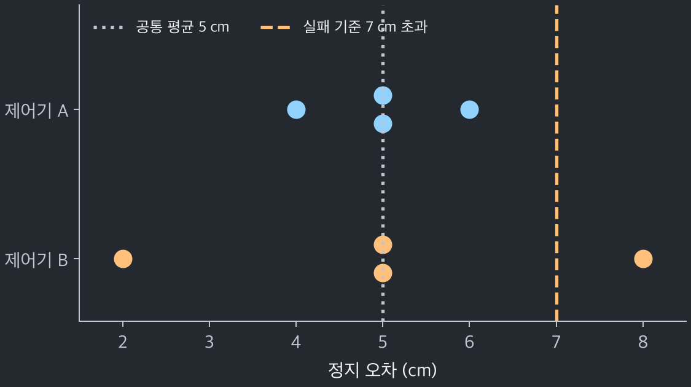

두 제어기 중 어느 쪽이 정지선을 더 안정적으로 지킬까? 독립적으로 네 번씩 주행시켜 목표 위치와의 거리 오차를 재었다고 하자. A는 4, 5, 5, 6 cm이고 B는 2, 5, 5, 8 cm다. 평균만 적으면 두 제어기의 실험 결과가 똑같아진다. 정지선에서 7 cm를 벗어나면 실패라는 조건을 붙이는 순간, 감춰졌던 차이가 보인다.

## 평균과 흩어짐을 함께 읽는다

표본평균은 관측값들이 균형을 이루는 위치다. 표본분산은 각 관측이 평균에서 얼마나 떨어졌는지를 제곱해 평균낸 양이다. 모집단 분산을 추정할 때에는 표본에서 이미 평균 하나를 맞췄으므로 분모에 n−1을 쓴다.

<math xmlns="http://www.w3.org/1998/Math/MathML" display="block"><semantics><mrow><mover><mi>x</mi><mo stretchy="true">&#x000AF;</mo></mover><mo>&#x0003D;</mo><mfrac><mrow><mn>1</mn></mrow><mrow><mi>n</mi></mrow></mfrac><munderover><mo>&#x02211;</mo><mrow><mi>i</mi><mo>&#x0003D;</mo><mn>1</mn></mrow><mrow><mi>n</mi></mrow></munderover><msub><mi>x</mi><mi>i</mi></msub><mo>&#x0002C;</mo><mspace width="2em" /><msup><mi>s</mi><mn>2</mn></msup><mo>&#x0003D;</mo><mfrac><mrow><mn>1</mn></mrow><mrow><mi>n</mi><mo>&#x02212;</mo><mn>1</mn></mrow></mfrac><munderover><mo>&#x02211;</mo><mrow><mi>i</mi><mo>&#x0003D;</mo><mn>1</mn></mrow><mrow><mi>n</mi></mrow></munderover><mo stretchy="false">&#x00028;</mo><msub><mi>x</mi><mi>i</mi></msub><mo>&#x02212;</mo><mover><mi>x</mi><mo stretchy="true">&#x000AF;</mo></mover><msup><mo stretchy="false">&#x00029;</mo><mn>2</mn></msup></mrow><annotation encoding="application/x-tex">\bar x=\frac&#123;1}&#123;n}\sum_&#123;i=1}^&#123;n}x_i,\qquad s^2=\frac&#123;1}&#123;n-1}\sum_&#123;i=1}^&#123;n}(x_i-\bar x)^2</annotation></semantics></math>

두 평균은 모두 5 cm다. A의 제곱편차 합은 2, B는 18이어서 표준편차는 각각 약 0.82 cm, 2.45 cm다. 그림에서 가로 위치는 실제 눈금이고, 겹치는 값만 세로로 쌓았다. B에서 한 번 실패했다는 사실은 관측 결과다. 네 번의 결과만으로 다음 주 실패율까지 정확히 알 수는 없다.

<figure class="lecture-figure" markdown="0"><figcaption>같은 위치의 점은 위아래로 나누어 표시했다. 규격을 7 cm에 두면 두 집단의 산포 차이가 실제 실패로 이어진다.</figcaption></figure>

## 다음 네 번의 주행을 어떻게 배치할까?

지난달 A는 마른 바닥에서, 이번 달 B는 젖은 바닥에서 돌린 로그라면 제어기와 바닥의 영향을 분리하기 어렵다. 과거 로그를 쓰는 소급 연구에서는 빠진 변수부터 점검한다. 관찰 연구라면 같은 기준으로 다음 로그를 수집할 수 있다. 어떤 변경이 원인인지 알고 싶다면 실험자가 조건을 배정한다.

예컨대 코스마다 A와 B를 모두 돌려 코스 차이를 **블록**으로 묶고, 각 블록에서 어느 제어기를 먼저 쓸지 무작위로 정한다. 바닥도 건식·습식으로 바꿔 본다면 제어기 차이가 바닥에 따라 달라지는 **상호작용**도 볼 수 있다. 통계에서 표본 수는 실험 단위를 몇 번 독립적으로 얻었는지에 달렸다. 한 주행에서 얻은 1,000개 프레임과 독립 주행 1,000번은 서로 다른 설계다.

## 확인 문제

A가 B보다 실패율이 낮다고 결론 내리기 전에 새 실험에서 무엇을 기록할까?

풀이 보기

실패 기준을 먼저 정하고, 주행별 제어기·코스·실행 순서·바닥 상태와 실패 여부를 남긴다. 이번 결과는 A 0/4, B 1/4이므로 다음 실험에서는 주행을 독립적으로 반복해 두 비율의 불확실성까지 비교한다.

