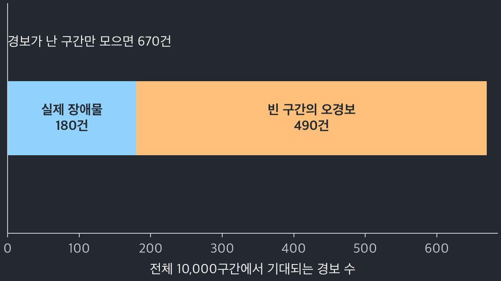

로봇이 장애물 경보를 울렸다. 장애물을 90% 검출하는 센서라면 눈앞에 장애물이 있을 확률도 90%일까? 이 질문은 **무엇을 이미 안다고 놓는가**를 뒤바꾸면 답이 크게 변한다는 사례다.

## 표본공간과 조건을 먼저 정한다

무작위로 고른 주행 구간 하나를 실험 단위로 잡자. D는 실제 장애물이 있는 사건, A는 경보가 울리는 사건이다. P(A|D)는 장애물이 있는 구간만 남긴 뒤 경보의 비율을 센다. P(D|A)는 경보가 난 구간만 남긴 뒤 실제 장애물의 비율을 센다. 두 식은 분자 P(D∩A)는 같지만 분모가 다르다.

<math xmlns="http://www.w3.org/1998/Math/MathML" display="block"><semantics><mrow><mi>P</mi><mo stretchy="false">&#x00028;</mo><mi>D</mi><mo>&#x02223;</mo><mi>A</mi><mo stretchy="false">&#x00029;</mo><mo>&#x0003D;</mo><mfrac><mrow><mi>P</mi><mo stretchy="false">&#x00028;</mo><mi>A</mi><mo>&#x02223;</mo><mi>D</mi><mo stretchy="false">&#x00029;</mo><mi>P</mi><mo stretchy="false">&#x00028;</mo><mi>D</mi><mo stretchy="false">&#x00029;</mo></mrow><mrow><mi>P</mi><mo stretchy="false">&#x00028;</mo><mi>A</mi><mo>&#x02223;</mo><mi>D</mi><mo stretchy="false">&#x00029;</mo><mi>P</mi><mo stretchy="false">&#x00028;</mo><mi>D</mi><mo stretchy="false">&#x00029;</mo><mo>&#x0002B;</mo><mi>P</mi><mo stretchy="false">&#x00028;</mo><mi>A</mi><mo>&#x02223;</mo><msup><mi>D</mi><mi>c</mi></msup><mo stretchy="false">&#x00029;</mo><mi>P</mi><mo stretchy="false">&#x00028;</mo><msup><mi>D</mi><mi>c</mi></msup><mo stretchy="false">&#x00029;</mo></mrow></mfrac></mrow><annotation encoding="application/x-tex">P(D\mid A)=\frac&#123;P(A\mid D)P(D)}&#123;P(A\mid D)P(D)+P(A\mid D^c)P(D^c)}</annotation></semantics></math>

구간의 2%에 장애물이 있고, 검출률은 90%, 빈 구간의 오경보율은 5%라고 하자. 10,000구간을 기준으로 한 **기대 도수**를 그려 보면 계산기를 쓰기 전에도 방향이 보인다.

<figure class="lecture-figure" markdown="0"><figcaption>전체 주행 구간에서 경보가 난 경우만 남긴 그림이다. 파란 부분이 전체 막대에서 차지하는 비율이 우리가 구할 확률이다.</figcaption></figure>

장애물이 있는 200구간에서는 180번 경보가 난다. 빈 9,800구간에서도 490번 경보가 난다. 따라서 경보 뒤 장애물 확률은 180/(180+490) ≈ **26.9%**다. 분모의 두 항은 겹치지 않는 두 경로를 모두 더한 **전확률**이다. 같은 센서라도 주행 환경이 달라져 장애물의 사전확률이 바뀌면 이 숫자도 바뀐다.



## 두 센서가 동시에 울리면?

일반적인 곱셈법칙은 P(A∩B)=P(A)P(B|A)다. 독립이라는 근거가 있을 때 B의 조건을 지울 수 있다. 독립과 배반은 다르다. 동시에 일어날 수 없는 두 사건이 각각 양의 확률을 갖는다면 오히려 서로 독립일 수 없다. 카메라와 LiDAR가 둘 다 비에 영향을 받는다면 장애물 유무를 고정한 뒤에도 두 경보가 함께 틀릴 수 있다.

경우의 수를 셀 때도 분모가 중요하다. 후보 5개 중 두 곳을 점검할 때 점검 집합의 수는 5×4/2=10개, 방문 순서까지 따지면 20개다. 가능한 결과를 등확률로 놓을 근거가 있을 때만 경우의 수를 그대로 확률로 바꿀 수 있다.

## 확인 문제

같은 센서를 장애물이 10%인 창고로 옮겼다. 경보 뒤 실제 장애물 확률은?

풀이 보기

10,000구간 중 진짜 경보는 1,000×0.90=900, 오경보는 9,000×0.05=450으로 기대된다. 답은 900/1,350=2/3이다. 검출률은 그대로여도 경보의 의미가 바뀐다.

