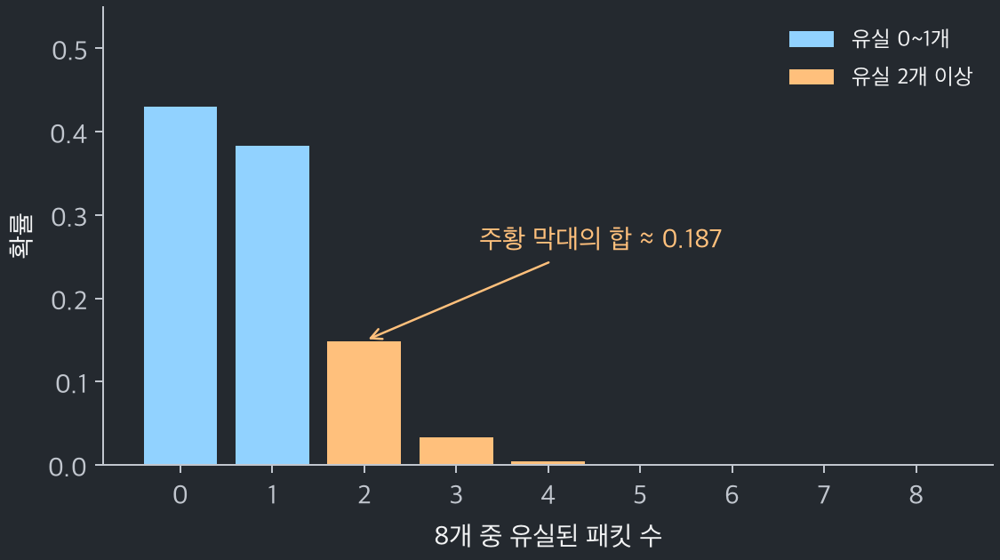

패킷 한 개의 유실 확률이 0.1이다. 여덟 번 보내면 몇 개를 잃을까? ‘평균 0.8개’만으로는 두 번 이상 잃어 재전송이 밀릴 확률을 알 수 없다. 이번 강의에서는 세고 있는 것이 **정해진 횟수 중 실패 수**인지, **성공할 때까지 걸리는 횟수**인지부터 구별한다.

## 실패 수의 확률질량을 만든다

전송마다 유실 확률 p가 같고 여덟 번이 독립이라고 가정한다. 정확히 k개가 유실되는 한 가지 순서의 확률은 pᵏ(1−p)ⁿ⁻ᵏ이고, 같은 수를 만드는 서로 다른 순서는 n개 중 k개를 택한 조합 수다.

<math xmlns="http://www.w3.org/1998/Math/MathML" display="block"><semantics><mrow><mi>P</mi><mo stretchy="false">&#x00028;</mo><mi>X</mi><mo>&#x0003D;</mo><mi>k</mi><mo stretchy="false">&#x00029;</mo><mo>&#x0003D;</mo><mo minsize="2.047em" maxsize="2.047em">&#x00028;</mo><mfrac linethickness="0"><mrow><mi>n</mi></mrow><mrow><mi>k</mi></mrow></mfrac><mo minsize="2.047em" maxsize="2.047em">&#x00029;</mo><msup><mi>p</mi><mi>k</mi></msup><mo stretchy="false">&#x00028;</mo><mn>1</mn><mo>&#x02212;</mo><mi>p</mi><msup><mo stretchy="false">&#x00029;</mo><mrow><mi>n</mi><mo>&#x02212;</mo><mi>k</mi></mrow></msup><mo>&#x0002C;</mo><mspace width="2em" /><mi>E</mi><mo stretchy="false">[</mo><mi>X</mi><mo stretchy="false">]</mo><mo>&#x0003D;</mo><mi>n</mi><mi>p</mi><mo>&#x0002C;</mo><mspace width="1em" /><mo>Var</mo><mo stretchy="false">&#x00028;</mo><mi>X</mi><mo stretchy="false">&#x00029;</mo><mo>&#x0003D;</mo><mi>n</mi><mi>p</mi><mo stretchy="false">&#x00028;</mo><mn>1</mn><mo>&#x02212;</mo><mi>p</mi><mo stretchy="false">&#x00029;</mo></mrow><annotation encoding="application/x-tex">P(X=k)=\binom&#123;n}&#123;k}p^k(1-p)^&#123;n-k},\qquad E[X]=np,\quad \operatorname&#123;Var}(X)=np(1-p)</annotation></semantics></math>

n=8, p=0.1이면 P(X=0)=0.9⁸≈0.4305, P(X=1)=8×0.1×0.9⁷≈0.3826이다. 따라서 두 개 이상 잃을 확률은 1−0.4305−0.3826≈**18.69%**다. 막대 높이는 각 정수의 확률이고, k 이하 막대의 합은 누적분포 F(k)다. 폭우가 여러 전송에 동시에 영향을 주면 독립 가정부터 재검토해야 한다.

<figure class="lecture-figure" markdown="0"><figcaption>유실 평균은 0.8개지만 실제 유실 개수는 정수다. 주황색 막대들을 합하면 두 개 이상 유실될 위험을 얻는다.</figcaption></figure>

## 질문이 바뀌면 분포도 바뀐다

| 실험에서 고정한 것 | 세는 것 | 맞는 모형과 조건 |
|---|---|---|
| 전송 8회 | 실패 횟수 | 이항. 독립이고 실패 확률이 같다. |
| 성공 1회 또는 r회까지 진행 | 필요한 총 시도 횟수 | 기하 또는 음이항. 첫 성공까지라면 가능한 값은 1부터다. |
| 유한 부품 묶음에서 비복원 추출 | 뽑힌 불량 수 | 초기하. 뽑을 때마다 남은 구성이 바뀐다. |
| 시간 1분 또는 공간 1 m | 구간 안 사건 수 | 일정률 푸아송 과정이면 평균이 λ인 푸아송 분포다. |

예를 들어 불량 2개가 든 10개 묶음에서 2개를 비복원으로 뽑으면 둘 다 불량일 확률은 (2/10)(1/9)=1/45다. 복원했다면 (2/10)²=1/25다. 또 한 번 전송의 성공률이 0.9일 때 첫 성공까지의 평균 전송 수는 1/0.9≈1.11회다. 무엇을 한 번의 관측으로 정의했는지가 답을 바꾼다.

마지막으로 **확률**과 **발생률**의 단위를 구분해 보자. 성공 확률 p인 독립 전송에서 첫 성공이 정확히 k번째라면 앞선 k−1번은 실패해야 한다. 반면 초당 λ건의 일정률 푸아송 과정에서 t초 동안 관찰하는 건수의 평균은 λt다.

<math xmlns="http://www.w3.org/1998/Math/MathML" display="block"><semantics><mrow><mi>P</mi><mo stretchy="false">&#x00028;</mo><mi>K</mi><mo>&#x0003D;</mo><mi>k</mi><mo stretchy="false">&#x00029;</mo><mo>&#x0003D;</mo><mo stretchy="false">&#x00028;</mo><mn>1</mn><mo>&#x02212;</mo><mi>p</mi><msup><mo stretchy="false">&#x00029;</mo><mrow><mi>k</mi><mo>&#x02212;</mo><mn>1</mn></mrow></msup><mi>p</mi><mo>&#x0002C;</mo><mspace width="2em" /><mi>P</mi><mo stretchy="false">&#x00028;</mo><mi>N</mi><mo stretchy="false">&#x00028;</mo><mi>t</mi><mo stretchy="false">&#x00029;</mo><mo>&#x0003D;</mo><mi>k</mi><mo stretchy="false">&#x00029;</mo><mo>&#x0003D;</mo><msup><mi>e</mi><mrow><mo>&#x02212;</mo><mi>&#x003BB;</mi><mi>t</mi></mrow></msup><mfrac><mrow><mo stretchy="false">&#x00028;</mo><mi>&#x003BB;</mi><mi>t</mi><msup><mo stretchy="false">&#x00029;</mo><mi>k</mi></msup></mrow><mrow><mi>k</mi><mo>&#x00021;</mo></mrow></mfrac></mrow><annotation encoding="application/x-tex">P(K=k)=(1-p)^&#123;k-1}p,\qquad P(N(t)=k)=e^&#123;-\lambda t}\frac&#123;(\lambda t)^k}&#123;k!}</annotation></semantics></math>

왼쪽 k는 1부터, 오른쪽 k는 0부터다. 초당 0.2건인 사건이 5초 동안 한 번도 없을 확률은 exp(−1)이다. 다음 강의에서는 같은 사건을 ‘첫 발생까지 5초 넘게 기다린다’는 연속시간 질문으로 다시 만난다.

## 확인 문제

위의 8회 전송에서 적어도 한 번 잃을 확률은? 그 확률과 평균 유실 개수는 왜 다를까?

풀이 보기

1−0.9⁸≈0.5695다. 평균 0.8개는 두 개나 세 개 잃은 경우를 개수만큼 가중한다. ‘적어도 한 번’은 그런 경우를 모두 한 번으로 센다.

