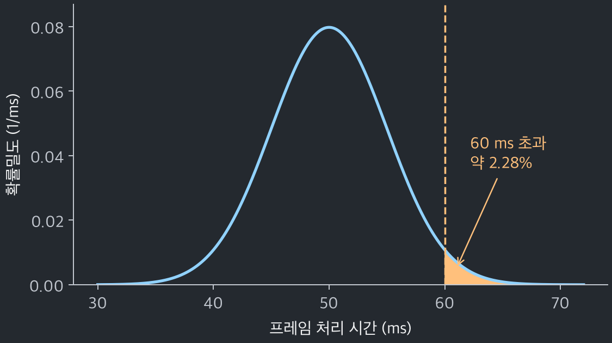

센서 처리 시간이 60 ms를 넘으면 제어 주기를 놓친다. 평균 지연이 50 ms라는 사양에서 마감 실패율까지 알 수 있을까? 처리 시간은 연속량이므로 특정 눈금 하나의 확률 대신 **마감선을 넘는 면적**을 구한다.

## 높이가 아니라 면적을 읽는다

밀도 f(t)의 단위가 1/ms라면 밀도에 ms를 곱해 적분한 값은 무차원 확률이다. 누적분포 F는 왼쪽에 쌓인 면적이다. 예를 들어 40~60 ms의 균등분포에서는 밀도가 1/20이고 52~56 ms 구간의 확률은 4/20이다. 연속모형에서 정확히 52.000… ms일 확률은 0이어도, 반올림해 ‘52 ms’라고 기록되는 구간의 확률은 양수다.

<math xmlns="http://www.w3.org/1998/Math/MathML" display="block"><semantics><mrow><mi>P</mi><mo stretchy="false">&#x00028;</mo><mi>a</mi><mo>&#x0003C;</mo><mi>T</mi><mo>&#x02264;</mo><mi>b</mi><mo stretchy="false">&#x00029;</mo><mo>&#x0003D;</mo><mi>F</mi><mo stretchy="false">&#x00028;</mo><mi>b</mi><mo stretchy="false">&#x00029;</mo><mo>&#x02212;</mo><mi>F</mi><mo stretchy="false">&#x00028;</mo><mi>a</mi><mo stretchy="false">&#x00029;</mo><mo>&#x0003D;</mo><msubsup><mo>&#x0222B;</mo><mi>a</mi><mi>b</mi></msubsup><mi>f</mi><mo stretchy="false">&#x00028;</mo><mi>t</mi><mo stretchy="false">&#x00029;</mo><mspace width="0.167em" /><mi>d</mi><mi>t</mi></mrow><annotation encoding="application/x-tex">P(a&lt;T\le b)=F(b)-F(a)=\int_a^b f(t)\,dt</annotation></semantics></math>

많은 작은 요인이 더해져 분포가 대략 대칭이라고 보고 T를 N(50,5²) ms 단위의 정규모형으로 놓자. 60 ms는 평균에서 표준편차 두 개 위다. 표준정규 누적분포를 Φ라고 하면 마감 초과 확률은 다음과 같다.

<math xmlns="http://www.w3.org/1998/Math/MathML" display="block"><semantics><mrow><mi>P</mi><mo stretchy="false">&#x00028;</mo><mi>T</mi><mo>&#x0003E;</mo><mn>60</mn><mo stretchy="false">&#x00029;</mo><mo>&#x0003D;</mo><mn>1</mn><mo>&#x02212;</mo><mi>&#x003A6;</mi><mrow><mo stretchy="true" fence="true" form="prefix">&#x00028;</mo><mfrac><mrow><mn>60</mn><mo>&#x02212;</mo><mn>50</mn></mrow><mrow><mn>5</mn></mrow></mfrac><mo stretchy="true" fence="true" form="postfix">&#x00029;</mo></mrow><mo>&#x0003D;</mo><mn>1</mn><mo>&#x02212;</mo><mi>&#x003A6;</mi><mo stretchy="false">&#x00028;</mo><mn>2</mn><mo stretchy="false">&#x00029;</mo><mo>&#x02248;</mo><mn>0.02275</mn></mrow><annotation encoding="application/x-tex">P(T&gt;60)=1-\Phi\left(\frac&#123;60-50}&#123;5}\right)=1-\Phi(2)\approx0.02275</annotation></semantics></math>

<figure class="lecture-figure" markdown="0"><figcaption>세로 점선은 마감 시각이다. 선에서의 높이가 아니라 오른쪽에 남은 면적이 마감 초과 확률이다.</figcaption></figure>

서로 독립인 프레임 100개를 처리하면 초과 횟수의 기댓값은 약 2.28회다. 이는 최대 초과 횟수를 보장하지 않는다. 특히 가비지 컬렉션처럼 드문 지연 원인이 긴 오른쪽 꼬리를 만들면 평균과 분산을 잘 맞춘 정규모형도 마감 위험을 과소평가할 수 있다.

## 대기시간과 개수를 연결한다

초당 평균 0.2회인 일정률 푸아송 과정에서는 다음 사건까지의 대기시간 W가 지수분포이고 꼬리 확률은 exp(−0.2t)이다(t의 단위는 초). 이미 3초 기다렸을 때 5초 더 기다릴 확률은 P(W>8|W>3)=e⁻¹≈0.368이다. 이 무기억성은 지수모형의 성질이다. 오래 쓸수록 고장 위험이 커지는 부품에는 별도의 수명 모형이 필요하다.

반대로 큰 이항 개수를 정규분포로 근사할 때 X≤k는 연속축에서 k+0.5까지의 면적으로 잡는 **연속성 보정**을 쓴다. np와 n(1−p)가 모두 충분해야 하며, 희귀한 꼬리가 중요하다면 정확한 이항확률과 비교하자.

## 확인 문제

같은 정규모형에서 마감을 55 ms로 줄이면 몇 퍼센트가 넘을까?

풀이 보기

표준화하면 (55−50)/5=1이다. 오른쪽 꼬리 1−Φ(1)≈15.87%다. 마감이 5 ms 줄었지만 실패율은 약 2.28%에서 15.87%로 늘어난다.

