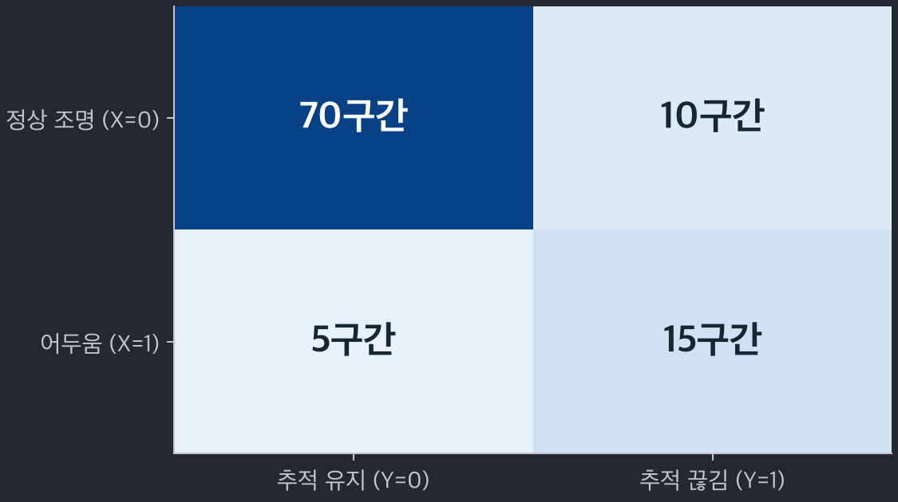

어두운 구간에서는 카메라 추적이 자주 끊길까? 장애물 경보 하나만 보던 2강과 달리, 이번에는 조명과 추적 상태를 한 쌍으로 기록한다. 결합분포에서 한 변수를 지우거나 고정하면 각각 다른 질문에 답한다.

## 한 표에서 세 가지 확률을 읽는다

100구간의 가상 로그를 보자. 행 X는 정상 조명(0)과 어두움(1), 열 Y는 추적 유지(0)와 끊김(1)이다. 각 칸의 도수를 100으로 나누면 구간 하나를 균등하게 골랐을 때의 경험적 결합확률이다.

<figure class="lecture-figure" markdown="0"><figcaption>칸 하나는 두 사건이 함께 일어난 도수다. 행 전체, 열 전체, 표 전체 중 어디를 분모로 삼는지에 따라 물음이 달라진다.</figcaption></figure>

어둡고 추적이 끊긴 경우는 15구간이므로 P(X=1,Y=1)=0.15다. 조명을 무시하고 열을 더하면 끊김의 주변확률은 (10+15)/100=0.25다. **어두운 구간만** 남기면 분모가 20으로 바뀌어 조건부확률은 15/20=0.75다. 독립이었다면 결합확률은 0.20×0.25=0.05였을 것이다. 이 자료에서는 조명이 끊김을 예측하는 단서가 된다. 조명만 바꾸면 같은 효과가 난다는 인과 결론에는 별도 실험이 필요하다.

<math xmlns="http://www.w3.org/1998/Math/MathML" display="block"><semantics><mrow><mo>Cov</mo><mo stretchy="false">&#x00028;</mo><mi>X</mi><mo>&#x0002C;</mo><mi>Y</mi><mo stretchy="false">&#x00029;</mo><mo>&#x0003D;</mo><mi>E</mi><mo stretchy="false">[</mo><mi>X</mi><mi>Y</mi><mo stretchy="false">]</mo><mo>&#x02212;</mo><mi>E</mi><mo stretchy="false">[</mo><mi>X</mi><mo stretchy="false">]</mo><mi>E</mi><mo stretchy="false">[</mo><mi>Y</mi><mo stretchy="false">]</mo><mo>&#x0003D;</mo><mn>0.15</mn><mo>&#x02212;</mo><mo stretchy="false">&#x00028;</mo><mn>0.20</mn><mo stretchy="false">&#x00029;</mo><mo stretchy="false">&#x00028;</mo><mn>0.25</mn><mo stretchy="false">&#x00029;</mo><mo>&#x0003D;</mo><mn>0.10</mn></mrow><annotation encoding="application/x-tex">\operatorname&#123;Cov}(X,Y)=E[XY]-E[X]E[Y]=0.15-(0.20)(0.25)=0.10</annotation></semantics></math>

연속 센서 쌍도 원리는 같다. 결합밀도에서 Y를 적분하면 X의 주변밀도가 되고, 특정 X에서 잘라 주변밀도로 나누면 Y의 조건부밀도가 된다. 한 변수를 지우는 합과 적분은 다른 변수를 관측했다는 뜻이 아니다.

## 두 센서를 평균 내면 얼마나 조용해질까?

두 거리 추정의 오차 표준편차가 2 cm, 3 cm이고 공분산이 3 cm²라고 하자. 두 오차를 절반씩 섞었을 때의 분산은 다음과 같다.

<math xmlns="http://www.w3.org/1998/Math/MathML" display="block"><semantics><mrow><mo>Var</mo><mrow><mo stretchy="true" fence="true" form="prefix">&#x00028;</mo><mfrac><mrow><mi>A</mi><mo>&#x0002B;</mo><mi>B</mi></mrow><mrow><mn>2</mn></mrow></mfrac><mo stretchy="true" fence="true" form="postfix">&#x00029;</mo></mrow><mo>&#x0003D;</mo><mfrac><mrow><mo>Var</mo><mo stretchy="false">&#x00028;</mo><mi>A</mi><mo stretchy="false">&#x00029;</mo><mo>&#x0002B;</mo><mo>Var</mo><mo stretchy="false">&#x00028;</mo><mi>B</mi><mo stretchy="false">&#x00029;</mo><mo>&#x0002B;</mo><mn>2</mn><mo>Cov</mo><mo stretchy="false">&#x00028;</mo><mi>A</mi><mo>&#x0002C;</mo><mi>B</mi><mo stretchy="false">&#x00029;</mo></mrow><mrow><mn>4</mn></mrow></mfrac><mo>&#x0003D;</mo><mfrac><mrow><mn>4</mn><mo>&#x0002B;</mo><mn>9</mn><mo>&#x0002B;</mo><mn>6</mn></mrow><mrow><mn>4</mn></mrow></mfrac><mo>&#x0003D;</mo><mn>4.75</mn><mtext>&#x000A0;</mtext><msup><mrow><mi mathvariant="normal">c</mi><mi mathvariant="normal">m</mi></mrow><mn>2</mn></msup></mrow><annotation encoding="application/x-tex">\operatorname&#123;Var}\left(\frac&#123;A+B}&#123;2}\right)=\frac&#123;\operatorname&#123;Var}(A)+\operatorname&#123;Var}(B)+2\operatorname&#123;Cov}(A,B)}&#123;4}=\frac&#123;4+9+6}&#123;4}=4.75\ \mathrm&#123;cm}^2</annotation></semantics></math>

독립이라고 놓으면 3.25 cm²로 과도하게 낙관한다. 두 센서가 같은 시간 동기화 오차를 공유하면 이런 일이 생긴다. 일반적으로 선형 조합 wᵀX의 분산은 wᵀΣw다. 비선형 함수에서는 미분 가능한 추정점 주변에서 기울기로 선형화해 같은 원리로 오차를 전파한다. 상관 0은 선형 관계가 없다는 뜻이며, 일반 분포에서는 독립을 보장하지 않는다.

## 확인 문제

표에서 추적이 끊겼다는 것만 알 때, 구간이 어두웠을 확률은?

풀이 보기

끊김 25구간 중 어두운 구간은 15개이므로 15/25=0.60이다. 같은 셀 15를 써도 분모가 바뀌므로 ‘어두울 때 끊길 확률’ 0.75와 다르다.

