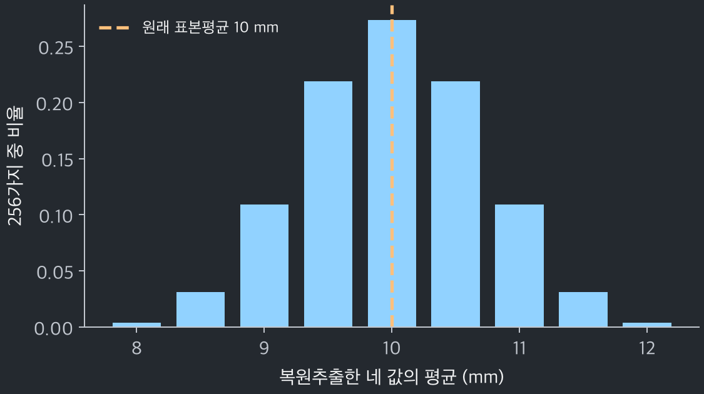

로봇 네 대에서 각각 독립적으로 보정 오차 8, 10, 10, 12 mm를 얻었다. 표본평균 10 mm는 이미 관측한 숫자다. 같은 절차로 다른 네 대를 뽑으면 달라질 수 있는 것은 **평균을 계산하는 규칙의 결과**다. 그 결과들이 이루는 분포가 표본분포다.

## 센서 오차의 폭과 평균의 오차를 구분한다

독립이고 같은 분포에서 나온 측정의 분산이 σ²라면, 합의 분산은 nσ²이고 평균은 그 합을 n으로 나눈 것이다. 따라서 평균의 분산은 σ²/n, 표준오차는 σ/√n이다.

<math xmlns="http://www.w3.org/1998/Math/MathML" display="block"><semantics><mrow><mo>Var</mo><mo stretchy="false">&#x00028;</mo><mover><mi>X</mi><mo stretchy="true">&#x000AF;</mo></mover><mo stretchy="false">&#x00029;</mo><mo>&#x0003D;</mo><mfrac><mrow><msup><mi>&#x003C3;</mi><mn>2</mn></msup></mrow><mrow><mi>n</mi></mrow></mfrac><mo>&#x0002C;</mo><mspace width="2em" /><mover><mrow><mrow><mi mathvariant="normal">S</mi><mi mathvariant="normal">E</mi></mrow></mrow><mo>&#x0005E;</mo></mover><mo stretchy="false">&#x00028;</mo><mover><mi>X</mi><mo stretchy="true">&#x000AF;</mo></mover><mo stretchy="false">&#x00029;</mo><mo>&#x0003D;</mo><mfrac><mrow><mi>s</mi></mrow><mrow><msqrt><mi>n</mi></msqrt></mrow></mfrac></mrow><annotation encoding="application/x-tex">\operatorname&#123;Var}(\bar X)=\frac&#123;\sigma^2}&#123;n},\qquad \widehat&#123;\mathrm&#123;SE}}(\bar X)=\frac&#123;s}&#123;\sqrt n}</annotation></semantics></math>

네 값의 제곱편차 합은 8 mm²다. 표본표준편차는 √(8/3)≈1.63 mm, 평균의 추정 표준오차는 그 절반인 **0.82 mm**다. 전자는 개별 로봇 사이 흩어짐, 후자는 네 대 평균의 정밀도를 설명한다. 정규 모집단에서는 평균도 정확히 정규분포를 따른다. 그 밖의 모집단에서는 독립성과 유한 분산 같은 조건 아래 표본이 커지면 중심극한정리가 정규근사를 뒷받침한다.

<figure class="lecture-figure" markdown="0"><figcaption>원래 표본의 두 10을 서로 다른 관측으로 두고 4⁴가지 순서를 모두 셌다. 막대는 원자료의 히스토그램이 아니라 재표집한 평균의 분포다.</figcaption></figure>

## 추정량을 고르는 세 기준

편의는 추정량의 장기 평균에서 참값을 뺀 값이다. 분산이 작아도 항상 틀린 쪽으로 치우칠 수 있다. 둘을 같은 단위에서 비교하는 기준이 평균제곱오차다.

<math xmlns="http://www.w3.org/1998/Math/MathML" display="block"><semantics><mrow><mo>MSE</mo><mo stretchy="false">&#x00028;</mo><mover><mi>&#x003B8;</mi><mo stretchy="false">&#x0005E;</mo></mover><mo stretchy="false">&#x00029;</mo><mo>&#x0003D;</mo><mo>Var</mo><mo stretchy="false">&#x00028;</mo><mover><mi>&#x003B8;</mi><mo stretchy="false">&#x0005E;</mo></mover><mo stretchy="false">&#x00029;</mo><mo>&#x0002B;</mo><mo minsize="1.2em" maxsize="1.2em">(</mo><mi>E</mi><mo stretchy="false">[</mo><mover><mi>&#x003B8;</mi><mo stretchy="false">&#x0005E;</mo></mover><mo stretchy="false">]</mo><mo>&#x02212;</mo><mi>&#x003B8;</mi><msup><mo minsize="1.2em" maxsize="1.2em">)</mo><mn>2</mn></msup></mrow><annotation encoding="application/x-tex">\operatorname&#123;MSE}(\hat\theta)=\operatorname&#123;Var}(\hat\theta)+\big(E[\hat\theta]-\theta\big)^2</annotation></semantics></math>

적률법은 표본의 평균·제곱평균 같은 요약값을 모형이 예측하는 값에 맞춘다. 최대우도법은 관측된 표본의 우도가 가장 큰 모수를 고른다. 위 자료에 평균과 분산을 모르는 정규분포를 맞추면 평균의 최대우도 추정은 10, 분산의 최대우도 추정은 8/4=2 mm²다. 불편 표본분산은 8/3 mm²다. 같은 자료라도 추정 기준이 다르면 답이 달라진다.

부트스트랩은 관측 표본을 경험적 모집단으로 보고 복원추출을 반복해 통계량의 흔들림을 계산한다. 네 측정에서 네 번씩 뽑는 4⁴=256가지 순서에는 데이터에 등장하지 않은 극단값이 생기지 않는다. 이 256가지 평균의 표준편차는 약 0.71 mm다. 경험분포는 네 점에 같은 질량을 주므로 원자료 분산에 분모 4를 사용한다. 그래서 불편 표본분산을 사용한 앞의 0.82 mm와 조금 다르다. 표본이 아주 작으면 이런 차이와 관측 범위의 한계가 크다. 연속 프레임 자료라면 개별 프레임 대신 독립 주행이나 연속 블록을 재추출할지도 따져야 한다.

## 확인 문제

개별 오차의 분산이 같을 때 평균의 표준오차를 절반으로 줄이려면 로봇이 몇 대 필요할까?

풀이 보기

표준오차는 1/√n에 비례하므로 4대에서 16대로 늘려야 한다. 같은 로봇에서 상관된 눈금만 더 읽으면 이 감소율을 기대할 수 없다.

