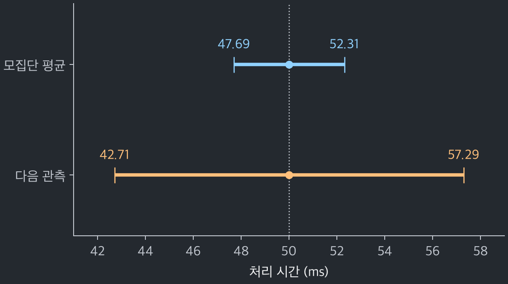

센서의 평균 처리 시간과 **다음 한 번의** 처리 시간 중 어느 쪽을 더 정확히 예측할 수 있을까? 독립된 9회 측정에서 평균이 50 ms, 표본표준편차가 3 ms다. 같은 두 숫자로 서로 다른 구간을 만들어 보자.

## 평균의 오차를 표준화한다

모집단이 정규이고 모표준편차 σ를 알고 있다면 (X̄−μ)/(σ/√n)은 표준정규분포다. σ를 몰라 S로 바꾸면 분모도 표본마다 달라진다. 독립 정규표본에서는 그 비율이 자유도 n−1인 t 분포를 따른다. 아래 t는 누적확률 0.975의 분위수다.

<math xmlns="http://www.w3.org/1998/Math/MathML" display="block"><semantics><mrow><mover><mi>x</mi><mo stretchy="true">&#x000AF;</mo></mover><mtext>&#x000A0;</mtext><mi>&#x000B1;</mi><mtext>&#x000A0;</mtext><msub><mi>t</mi><mrow><mn>0.975</mn><mo>&#x0002C;</mo><mi>n</mi><mo>&#x02212;</mo><mn>1</mn></mrow></msub><mfrac><mrow><mi>s</mi></mrow><mrow><msqrt><mi>n</mi></msqrt></mrow></mfrac></mrow><annotation encoding="application/x-tex">\bar x\ \pm\ t_&#123;0.975,n-1}\frac&#123;s}&#123;\sqrt n}</annotation></semantics></math>

자유도 8에서 t≈2.306이고 표준오차는 3/√9=1 ms다. 따라서 모집단 평균의 95% 신뢰구간은 **[47.69, 52.31] ms**다. 95%는 이 절차를 반복해 만든 구간이 고정된 참평균을 포함하는 장기 비율이다. 이 구간이 개별 측정치의 95%를 담는다는 뜻은 아니다.

## 다음 관측의 구간이 넓어지는 이유

같은 정규모집단에서 독립적으로 얻을 새 관측과 표본평균의 차이에는 두 오차가 들어간다. 새 관측 자체의 분산 σ²와 추정한 평균의 분산 σ²/n이다. 이에 따른 95% 예측구간은 다음과 같다.

<math xmlns="http://www.w3.org/1998/Math/MathML" display="block"><semantics><mrow><mover><mi>x</mi><mo stretchy="true">&#x000AF;</mo></mover><mtext>&#x000A0;</mtext><mi>&#x000B1;</mi><mtext>&#x000A0;</mtext><msub><mi>t</mi><mrow><mn>0.975</mn><mo>&#x0002C;</mo><mi>n</mi><mo>&#x02212;</mo><mn>1</mn></mrow></msub><mi>s</mi><msqrt><mrow><mn>1</mn><mo>&#x0002B;</mo><mfrac><mn>1</mn><mi>n</mi></mfrac></mrow></msqrt></mrow><annotation encoding="application/x-tex">\bar x\ \pm\ t_&#123;0.975,n-1}s\sqrt&#123;1+\frac1n}</annotation></semantics></math>

숫자를 넣으면 약 **[42.71, 57.29] ms**다. 표본을 크게 늘리면 평균의 구간은 좁아지지만, 개별 프레임 자체의 흩어짐은 남는다. ‘모집단의 적어도 일정 비율을 주어진 신뢰수준으로 포함한다’는 규격에는 별도의 **공차구간**이 필요하다.

<figure class="lecture-figure" markdown="0"><figcaption>같은 축과 같은 중심에서 시작해도 추정 대상에 따라 구간의 폭이 달라진다.</figcaption></figure>

## 묻는 모수가 바뀌면 기준 분포도 바뀐다

측정의 흔들림 σ²가 목적이면 독립 정규표본에서 (n−1)S²/σ²가 자유도 n−1의 카이제곱 분포를 따른다. 이번 자료의 분자는 72 ms²다. 이를 각각 97.5%, 2.5% 분위수로 나누면 분산의 95% 구간은 약 [4.11, 33.03] ms²다. 큰 분위수로 나눈 쪽이 아래 끝점이다.

성공 횟수라면 비율 p가 모수다. 큰 표본에서 p̂의 표준오차는 √[p̂(1−p̂)/n]으로 추정할 수 있다. 성공 또는 실패 수가 매우 작을 때 이 정규근사 구간은 부정확하다. 특히 한 번도 실패하지 않았다고 추정 오차가 0인 것은 아니다.

## 확인 문제

다음 프레임이 55 ms였다. 위 95% 평균 신뢰구간을 벗어났으니 모형을 기각해야 할까?

풀이 보기

55 ms는 모집단 평균이 아니라 개별 관측이다. 이번 예제의 개별 관측 예측구간 안에 있다. 여러 새 관측의 평균이나 잔차 분포를 모으면 모형이 계속 맞는지 별도로 점검할 수 있다.

