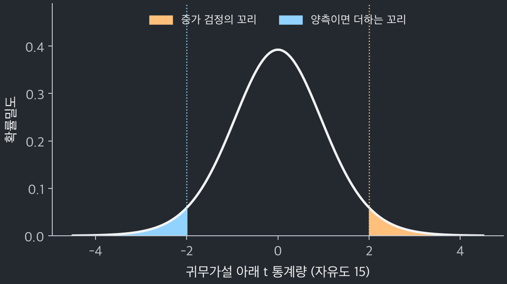

기존 제어기는 평균 50 ms에 처리를 마친다. 새 버전에서 지연이 늘었는지 확인하려고 독립 주행 16회를 측정했더니 평균 52 ms, 표본표준편차 4 ms다. 2 ms 차이가 표본 변동으로도 흔히 나오는지 묻는 것이 가설검정이다. 먼저 ‘늘어나는 경우만 찾는지’부터 자료를 보기 전에 정하자.

## 귀무가설 아래 눈금으로 바꾼다

평균 증가만을 감시하기로 했다면 H₀는 μ≤50, H₁은 μ>50이다. 경계인 μ=50에서 오른쪽 꼬리 확률을 계산한다. 독립 정규표본이고 모분산을 모른다면 다음 통계량은 경계에서 자유도 15의 t 분포를 따른다.

<math xmlns="http://www.w3.org/1998/Math/MathML" display="block"><semantics><mrow><mi>t</mi><mo>&#x0003D;</mo><mfrac><mrow><mover><mi>x</mi><mo stretchy="true">&#x000AF;</mo></mover><mo>&#x02212;</mo><msub><mi>&#x003BC;</mi><mn>0</mn></msub></mrow><mrow><mi>s</mi><mo>&#x0002F;</mo><msqrt><mi>n</mi></msqrt></mrow></mfrac><mo>&#x0003D;</mo><mfrac><mrow><mn>52</mn><mo>&#x02212;</mo><mn>50</mn></mrow><mrow><mn>4</mn><mo>&#x0002F;</mo><msqrt><mrow><mn>16</mn></mrow></msqrt></mrow></mfrac><mo>&#x0003D;</mo><mn>2</mn></mrow><annotation encoding="application/x-tex">t=\frac&#123;\bar x-\mu_0}&#123;s/\sqrt n}=\frac&#123;52-50}&#123;4/\sqrt&#123;16}}=2</annotation></semantics></math>

오른쪽 꼬리 P(T≥2)는 약 **0.0320**이다. 미리 정한 유의수준 0.05에서는 증가의 증거가 있다. 방향을 정하지 않고 양쪽 모두에서 변화를 찾는 설계였다면 양측 p값은 약 **0.0639**다. 데이터를 본 뒤 유리한 쪽을 골라 단측으로 바꾸면 원래 내세운 오류율이 유지되지 않는다.

<figure class="lecture-figure" markdown="0"><figcaption>미리 정한 증가 검정은 오른쪽 주황 꼬리를 쓴다. 양방향 변화를 찾기로 했다면 왼쪽 파란 꼬리를 더한다.</figcaption></figure>

p값은 귀무가설의 경계 모형에서 지금처럼 극단적인 통계량이 나올 확률이다. 귀무가설이 참일 확률도, 결과가 재현될 확률도 아니다. 공학적 판단에는 **차이의 크기**도 필요하다. 예를 들어 계약상 문제가 되는 증가량이 5 ms라면, 이번 +2 ms가 0과 다른지와 5 ms를 넘는지는 다른 질문이다.

## 잘못된 결정 두 가지

제1종 오류는 실제 증가가 없는데 증가를 선언하는 경우이고, 제2종 오류는 정해진 크기의 증가가 있는데 놓치는 경우다. 검정력 1−β는 특정 대립값, 표본 수, 변동, 검정 기준에 따라 달라진다. 아주 작은 표본으로 기각하지 못했다고 해서 두 버전이 동등하다고 결론 내릴 수 없다.

모표준편차를 독립 교정으로 정확히 아는 상황에서는 평균의 z 검정을 쓸 수 있다. 성공률 검정에서는 H₀의 비율 p₀가 예측하는 표준오차가 기준이다. 예컨대 p₀=0.9인 성공률 시험에서 n=100이면 귀무 표준오차는 √(0.9×0.1/100)=0.03이다. 기대 성공·실패 수가 작다면 정확한 이항검정을 고려한다.

## 확인 문제

유의수준을 0.05에서 0.01로 낮추고 자료는 그대로 두면 결론과 검정력은 어떻게 달라질까?

풀이 보기

단측 p≈0.032는 0.01보다 커서 기각하지 못한다. 같은 표본 수에서 문턱을 엄격하게 만들면 제1종 오류는 줄지만, 같은 크기의 실제 증가를 발견할 검정력도 대체로 낮아진다.

