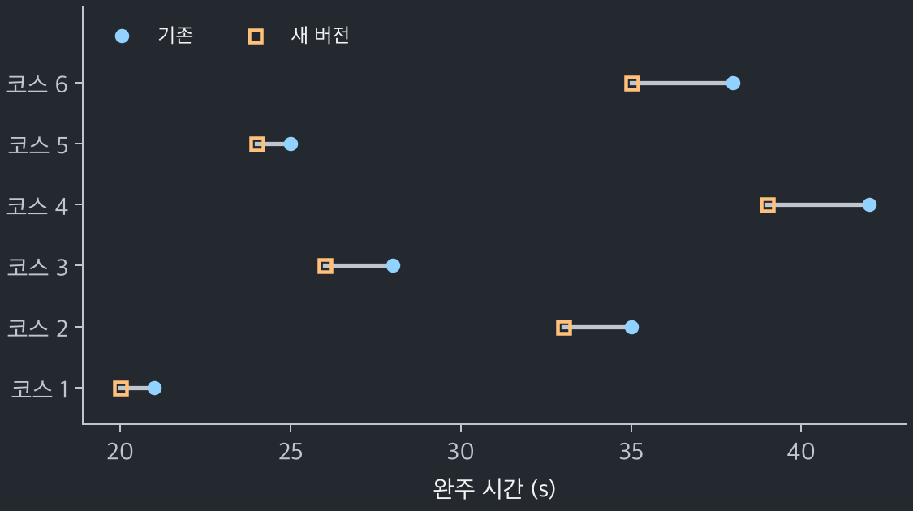

경로 계획기를 바꿨더니 더 빨라졌다고 한다. 알고리즘마다 서로 다른 코스를 돌렸을까, 같은 코스를 두 번씩 돌렸을까? 이 차이가 표준오차의 분모를 결정한다. 이번 강의에서는 **무엇이 한 쌍인지**부터 기록한다.

## 같은 코스를 다시 달렸다면 차이를 표본으로 삼는다

독립적으로 선정한 코스 6개에서 기존·새 계획기를 각각 한 번씩 실행했다. 기존 시간이 21, 35, 28, 42, 25, 38초이고 새 시간은 20, 33, 26, 39, 24, 35초다. 기존−새의 차이는 1, 2, 2, 3, 1, 3초다. 양수면 새 버전이 빠르다.

<math xmlns="http://www.w3.org/1998/Math/MathML" display="block"><semantics><mrow><msub><mi>d</mi><mi>i</mi></msub><mo>&#x0003D;</mo><msub><mi>x</mi><mrow><mi>i</mi><mo>&#x0002C;</mo><mi mathvariant="normal">o</mi><mi mathvariant="normal">l</mi><mi mathvariant="normal">d</mi></mrow></msub><mo>&#x02212;</mo><msub><mi>x</mi><mrow><mi>i</mi><mo>&#x0002C;</mo><mi mathvariant="normal">n</mi><mi mathvariant="normal">e</mi><mi mathvariant="normal">w</mi></mrow></msub><mo>&#x0002C;</mo><mspace width="2em" /><mi>t</mi><mo>&#x0003D;</mo><mfrac><mrow><mover><mi>d</mi><mo stretchy="true">&#x000AF;</mo></mover><mo>&#x02212;</mo><mn>0</mn></mrow><mrow><msub><mi>s</mi><mi>d</mi></msub><mo>&#x0002F;</mo><msqrt><mi>n</mi></msqrt></mrow></mfrac></mrow><annotation encoding="application/x-tex">d_i=x_&#123;i,\rm old}-x_&#123;i,\rm new},\qquad t=\frac&#123;\bar d-0}&#123;s_d/\sqrt n}</annotation></semantics></math>

평균 차이는 2초, 차이의 표본표준편차는 √(4/5)≈0.894초다. 따라서 표준오차는 약 0.365초, t≈5.48이다. 코스 사이가 독립이고 차이 분포를 정규로 볼 수 있다면, 자유도 5의 95% 구간은 2±2.571×0.365, 즉 **[1.06, 2.94]초**다. 표본이 작은 만큼 개별 차이와 이상값을 함께 보자.

<figure class="lecture-figure" markdown="0"><figcaption>한 줄이 한 코스다. 행끼리 섞지 않고 같은 행의 원과 네모 사이 거리 여섯 개를 분석한다.</figcaption></figure>

코스 절대 시간은 20초에서 40초 이상까지 흩어져도, 같은 코스 안의 차이는 1~3초다. 쌍을 버리면 공통 난이도 때문에 상쇄될 변동까지 비교에 들어간다. 반대로 로봇 A에서 얻은 첫 관측과 로봇 B의 첫 관측을 단지 순서가 같다는 이유로 짝지어도 안 된다. 배터리 온도나 연습 효과가 실행 순서와 얽히지 않도록 코스마다 실행 순서를 무작위화할 수 있다.

## 두 독립 집단이라면 어떤 검정을 쓸까?

서로 다른 코스 집단에서 측정했고 두 집단의 분산을 모른다면 Welch 방법을 생각하자. 차이의 표준오차는 각 집단의 평균 분산 기여분을 더한 뒤 제곱근을 취한다. 자유도는 Welch–Satterthwaite 근사를 사용한다.

<math xmlns="http://www.w3.org/1998/Math/MathML" display="block"><semantics><mrow><mrow><mi mathvariant="normal">S</mi><mi mathvariant="normal">E</mi></mrow><mo stretchy="false">&#x00028;</mo><msub><mover><mi>X</mi><mo stretchy="true">&#x000AF;</mo></mover><mn>1</mn></msub><mo>&#x02212;</mo><msub><mover><mi>X</mi><mo stretchy="true">&#x000AF;</mo></mover><mn>2</mn></msub><mo stretchy="false">&#x00029;</mo><mo>&#x0003D;</mo><msqrt><mrow><mfrac><mrow><msubsup><mi>s</mi><mn>1</mn><mn>2</mn></msubsup></mrow><mrow><msub><mi>n</mi><mn>1</mn></msub></mrow></mfrac><mo>&#x0002B;</mo><mfrac><mrow><msubsup><mi>s</mi><mn>2</mn><mn>2</mn></msubsup></mrow><mrow><msub><mi>n</mi><mn>2</mn></msub></mrow></mfrac></mrow></msqrt></mrow><annotation encoding="application/x-tex">\mathrm&#123;SE}(\bar X_1-\bar X_2)=\sqrt&#123;\frac&#123;s_1^2}&#123;n_1}+\frac&#123;s_2^2}&#123;n_2}}</annotation></semantics></math>

예를 들어 서로 다른 코스에서 독립으로 9회씩 측정하고 두 표본의 표준편차가 3초, 6초라면, 평균 차이의 표준오차는 √(9/9+36/9)=√5≈2.24초다. 위 쌍체 예제의 0.365초를 재사용할 수 없다.

독립 정규집단의 분산이 같다는 근거가 있다면 합동분산 t 방법을 사용할 수 있다. 두 분산을 알고 있다면 대응하는 모집단 분산을 넣은 z 방법이 가능하다. ‘흔들림 자체가 달라졌는가’를 묻는다면 독립 정규표본에서 분산비가 F 검정의 출발점이다. 이 방법은 비정규성과 이상값에 민감하다. 성공률 두 개를 비교할 때에는 독립 집단인지 먼저 확인하고, 두 비율이 같다는 귀무가설의 검정에서는 보통 합친 성공률로 표준오차를 구한다.

## 확인 문제

같은 코스를 돌렸지만 새 계획기는 언제나 두 번째로 실행했고 그때 노면이 말라 있었다. 평균 2초 개선을 모두 알고리즘 효과로 해석할 수 있을까?

풀이 보기

쌍체 계산은 코스 간 차이를 줄여 주지만 알고리즘과 고정된 실행 순서의 효과를 분리해 주지 않는다. 순서를 코스마다 바꾸거나 노면과 시간을 통제해 다시 비교해야 한다.

