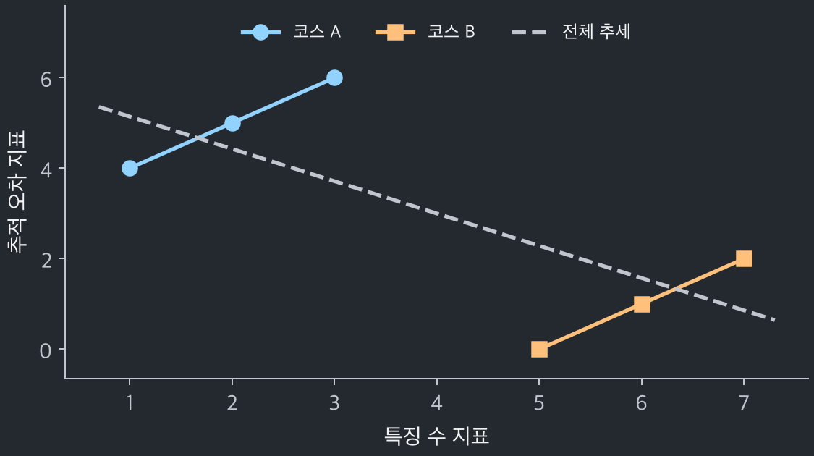

지도 특징을 더 많이 쓸수록 추적 오차가 줄어드는 듯 보인다. 그런데 코스별로 나누어 그리면 둘 다 반대 방향으로 움직인다. 마지막 강의에서는 **변수 사이의 관계를 설명하는 일**과 **새 관측의 집단을 맞히는 일**을 구별해 본다.

## 산점도에 집단을 표시한 뒤 상관을 계산한다

설명용 자료에서 코스 A의 (특징 수 지표, 오차 지표)는 (1,4), (2,5), (3,6)이고, B는 (5,0), (6,1), (7,2)다. 각 코스 안에서는 기울기 +1인 직선에 놓인다. 그런데 여섯 점을 합치면 피어슨 상관계수는 **−5/7≈−0.714**다. 코스 B는 특징 수가 많고 기본 오차 수준은 낮아서 집단 간 차이가 전체 관계를 뒤집었다.

<math xmlns="http://www.w3.org/1998/Math/MathML" display="block"><semantics><mrow><mi>r</mi><mo>&#x0003D;</mo><mfrac><mrow><msub><mo>&#x02211;</mo><mi>i</mi></msub><mo stretchy="false">&#x00028;</mo><msub><mi>x</mi><mi>i</mi></msub><mo>&#x02212;</mo><mover><mi>x</mi><mo stretchy="true">&#x000AF;</mo></mover><mo stretchy="false">&#x00029;</mo><mo stretchy="false">&#x00028;</mo><msub><mi>y</mi><mi>i</mi></msub><mo>&#x02212;</mo><mover><mi>y</mi><mo stretchy="true">&#x000AF;</mo></mover><mo stretchy="false">&#x00029;</mo></mrow><mrow><msqrt><mrow><msub><mo>&#x02211;</mo><mi>i</mi></msub><mo stretchy="false">&#x00028;</mo><msub><mi>x</mi><mi>i</mi></msub><mo>&#x02212;</mo><mover><mi>x</mi><mo stretchy="true">&#x000AF;</mo></mover><msup><mo stretchy="false">&#x00029;</mo><mn>2</mn></msup><msub><mo>&#x02211;</mo><mi>i</mi></msub><mo stretchy="false">&#x00028;</mo><msub><mi>y</mi><mi>i</mi></msub><mo>&#x02212;</mo><mover><mi>y</mi><mo stretchy="true">&#x000AF;</mo></mover><msup><mo stretchy="false">&#x00029;</mo><mn>2</mn></msup></mrow></msqrt></mrow></mfrac></mrow><annotation encoding="application/x-tex">r=\frac&#123;\sum_i(x_i-\bar x)(y_i-\bar y)}&#123;\sqrt&#123;\sum_i(x_i-\bar x)^2\sum_i(y_i-\bar y)^2}}</annotation></semantics></math>

코스별 평균을 각각 빼면 x와 y의 잔차는 두 코스 모두 (−1,0,1)이 된다. 잔차끼리의 상관은 +1이다. 이것이 이 자료에서 코스 지시변수를 통제한 **부분상관**이다. 코스가 숨겨져 있으면 전체 상관만으로 ‘특징을 늘리면 오차가 감소한다’는 인과 주장을 하기 어렵다.

<figure class="lecture-figure" markdown="0"><figcaption>점의 모양은 코스를 구분한다. 각 코스 안의 선과 모든 점에 맞춘 점선의 기울기 부호를 비교해 보자.</figcaption></figure>

피어슨 r은 선형 동행을 측정한다. 등간 간격을 해석하기 어려운 순위 자료에는 평균 순위를 낸 뒤 순위끼리 피어슨 상관을 구하는 **스피어만 상관**이 유용하다. 이변량 정규성은 r을 계산하는 데 필요한 조건이 아니라, 고전적인 소표본 상관 검정의 분포를 정당화하는 데 쓰인다. 주변 히스토그램의 왜도와 초과첨도도 살피자. 오른쪽 꼬리의 극단값 하나가 r을 바꿀 수 있다. 정규분포의 첨도는 3이고 초과첨도는 0이다.

## 설명에서 분류로 질문을 바꾼다

이제 두 센서 지표 x=(x₁,x₂)로 ‘정상’과 ‘점검 필요’를 분류하고 싶다. 선형판별분석(LDA)은 각 집단의 특징이 서로 다른 평균과 **공통 공분산 Σ**를 갖는 다변량 정규분포라고 가정한다. 집단 k의 평균은 μₖ, 사전확률은 πₖ다. 오분류 비용이 같을 때 아래 점수가 큰 쪽을 선택한다.

<math xmlns="http://www.w3.org/1998/Math/MathML" display="block"><semantics><mrow><msub><mi>&#x003B4;</mi><mi>k</mi></msub><mo stretchy="false">&#x00028;</mo><mi>x</mi><mo stretchy="false">&#x00029;</mo><mo>&#x0003D;</mo><msup><mi>x</mi><mi>T</mi></msup><msup><mi>&#x003A3;</mi><mrow><mo>&#x02212;</mo><mn>1</mn></mrow></msup><msub><mi>&#x003BC;</mi><mi>k</mi></msub><mo>&#x02212;</mo><mfrac><mn>1</mn><mn>2</mn></mfrac><msubsup><mi>&#x003BC;</mi><mi>k</mi><mi>T</mi></msubsup><msup><mi>&#x003A3;</mi><mrow><mo>&#x02212;</mo><mn>1</mn></mrow></msup><msub><mi>&#x003BC;</mi><mi>k</mi></msub><mo>&#x0002B;</mo><mi>log</mi><msub><mi>&#x003C0;</mi><mi>k</mi></msub></mrow><annotation encoding="application/x-tex">\delta_k(x)=x^T\Sigma^&#123;-1}\mu_k-\frac12\mu_k^T\Sigma^&#123;-1}\mu_k+\log\pi_k</annotation></semantics></math>

μ₀=(0,0), μ₁=(2,1), Σ=I, 사전확률이 같다면 집단 1 점수에서 집단 0 점수를 뺀 값은 2x₁+x₂−2.5다. 새 점 (1,0.8)의 차이는 +0.3이어서 이 모형은 집단 1로 분류한다. 점검 대상이 희귀해지면 log(π₁/π₀)가 낮아져 같은 점도 다르게 분류할 수 있다. 이는 2강의 경보 사전확률과 같은 원리다.

실제 검증에서는 한 주행의 인접 프레임이 학습과 시험 양쪽에 흩어지지 않게 주행 단위로 분리한다. 놓친 고장과 불필요한 점검을 따로 집계해야 어느 비용을 줄였는지 알 수 있다.

## 확인 문제

위 판별기에서 (1,0.5)는 어디에 놓일까? 집단 1의 사전확률을 0.1로 낮추면?

풀이 보기

사전확률이 같으면 점수 차이가 정확히 0이라 경계 위다. π₁=0.1, π₀=0.9이면 차이에 log(1/9)≈−2.20이 더해져 집단 0으로 간다. 평균과 공분산을 고정해도 사전확률이 결정에 영향을 준다.

